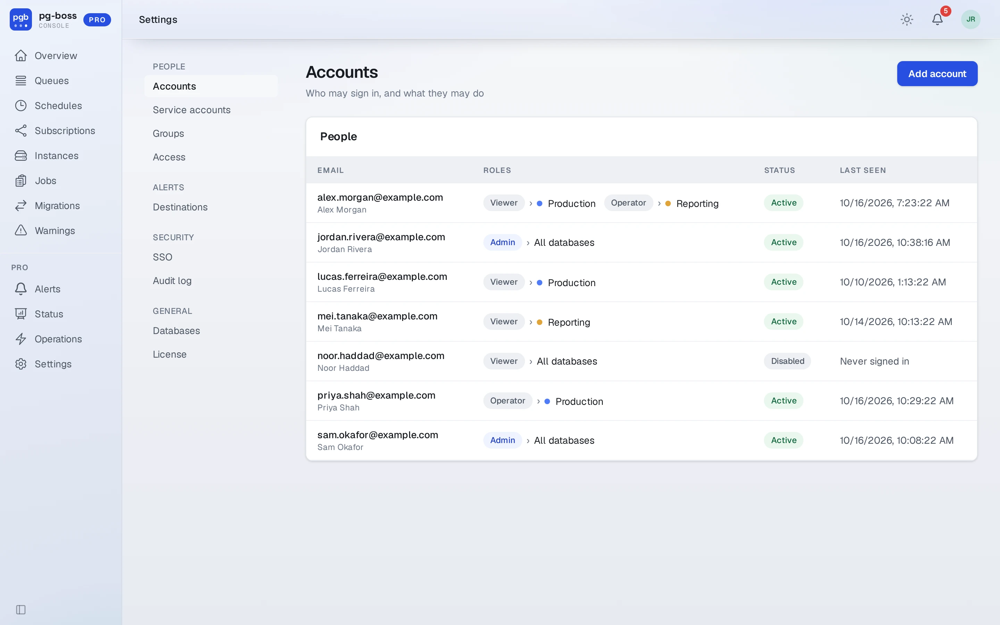
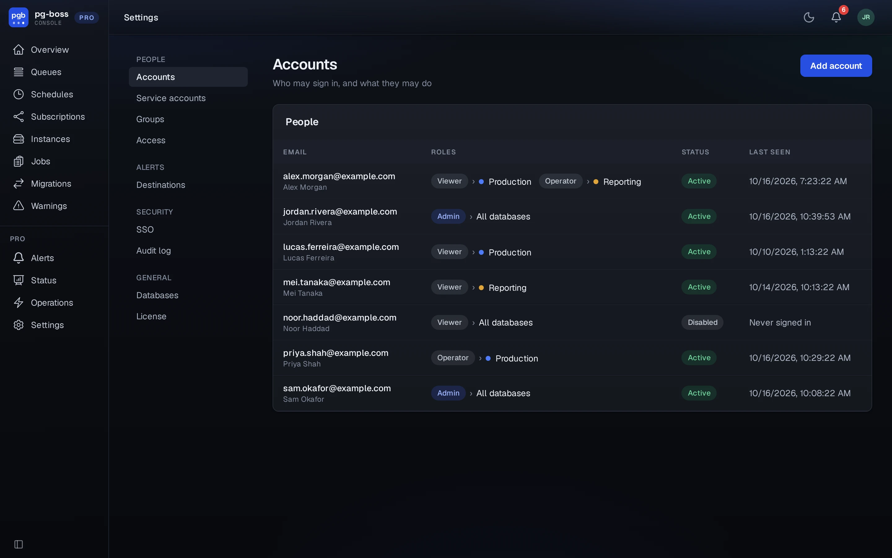
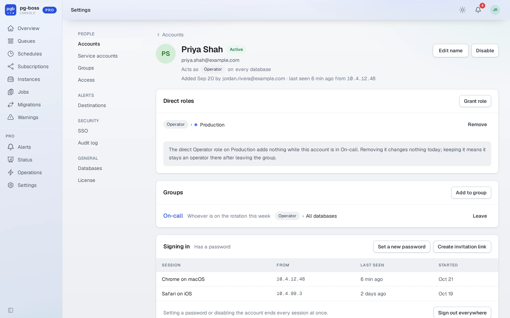
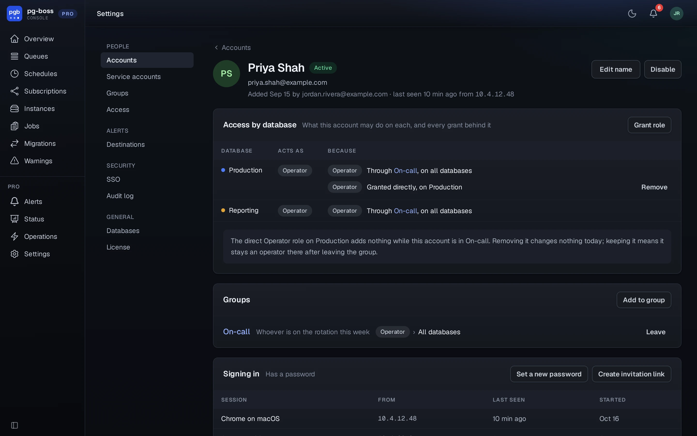
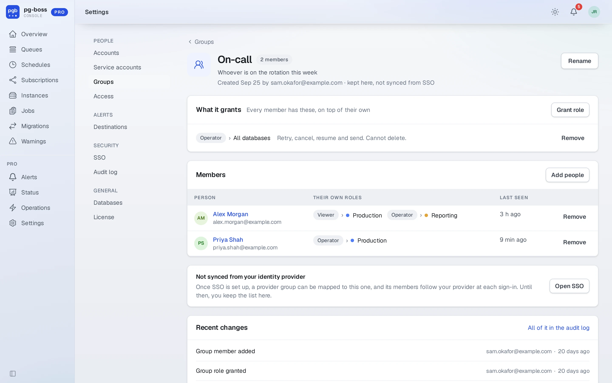
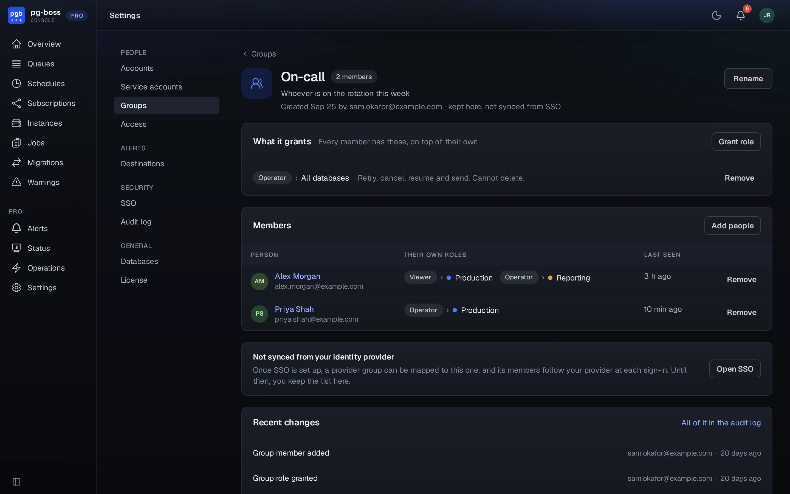

# Accounts and groups

Pro authenticates each person with their own account. On first run it has no
accounts, so open `/setup` and create the first administrator. That page closes
for good the moment the first account exists. After that, sign in at `/login`,
and sign out from the account menu (your picture or initials at the top right).

Accounts, sessions and role assignments live in Pro's own schema, `pgboss_pro`
by default. It sits in the first database you configured, unless
`PGBOSS_PRO_DATABASE_URL` says otherwise. The server creates and migrates it at
startup. It's separate from the `pgboss` schema the queue uses, so nothing here
touches your job tables.

[Roles and access](./roles.md) lists what each role may do.

## Managing accounts

An administrator whose role covers **every** database manages accounts at
`/pro/accounts`, under **Settings** in the sidebar. An admin scoped to a single
database doesn't get this screen, because it would let them widen their own
scope.

{.light-only}
{.dark-only}

From there, add an account with a role. Its own page shows:

- **Access by database**: the role in effect on each database, and every grant behind it, direct
  or through a group. You remove a direct grant here, and change a group's grant on the group. When a
  direct grant adds nothing a group already gives, the page says so.
- **Groups**: the groups it's in, with what each grants. You add it to a group or take it out here.
- **Signing in**: set a password, or create an invitation link that lets the person choose one. It
  also lists the browsers the account is signed in on, with where from and when. **Sign out
  everywhere** ends every session.
- **Recent activity**: what it did through the Pro Console, from the [audit log](./audit-log.md).

You can also edit its name, and disable or delete the account. Disabling, deleting or changing a
password ends that account's sessions immediately.

Machines get [service accounts](./api-tokens.md) instead, at `/pro/service-accounts`. A service
account acts only through API tokens.

{.light-only}
{.dark-only}

Pro always refuses two changes, and says so:

- removing the last administrator who covers every database, by demotion,
  disabling or deletion, because nobody would be left who could undo it
- disabling or deleting your own account (another administrator can do that)

Pro sends no invitation email, because it runs inside your network and may have
no mail credentials. An administrator sends the invitation link, or sets the
first password and hands it over. The person then changes it at `/pro/profile`,
from **Profile** in the account menu at the top right. That page needs no role.
It shows who you are and what you may do, and takes your current password, a new
one, and the new one again. Changing your password there signs out every other
session and keeps the one you're using.

## Groups

An account can hold a role directly, or through a group that holds one. Groups
live at `/pro/groups`. Give a group a role over a database (or over every
database) and put people in it by pasting their addresses, and everyone in it has
that role. Where two roles apply to the same database, the person may do everything
either allows, as [Roles](./roles.md) explains. A group's page lists its
members with the roles each holds on their own, says whether [SSO](./sso.md) maps a provider group
to it, and shows its recent changes. Service accounts can't join a group.

{.light-only}
{.dark-only}

`/pro/access` answers the question people ask in an incident, which is who can
act on this database and why. It shows the role each person ends up with beside
every grant that produced it.
