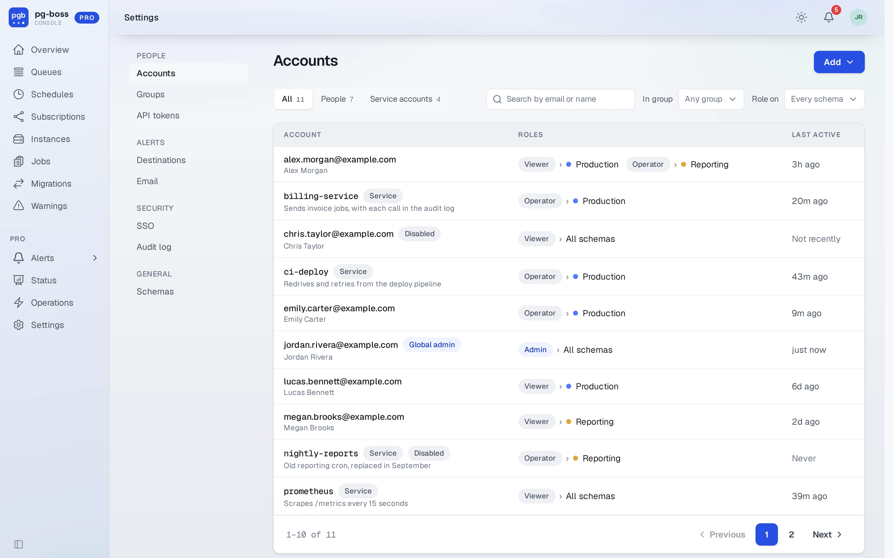
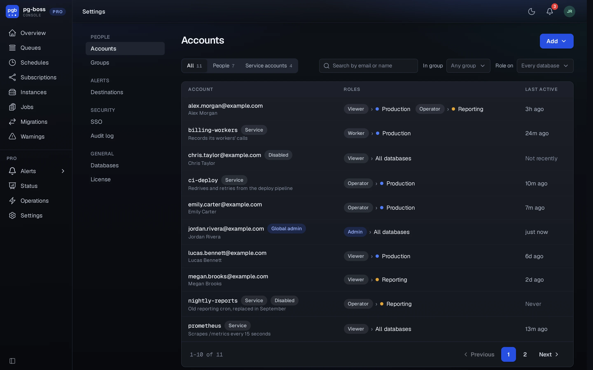
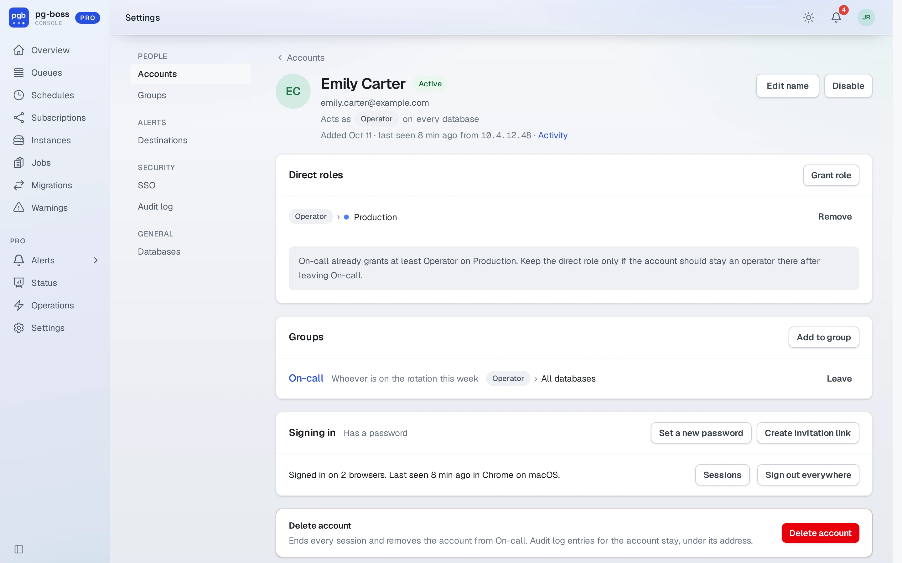
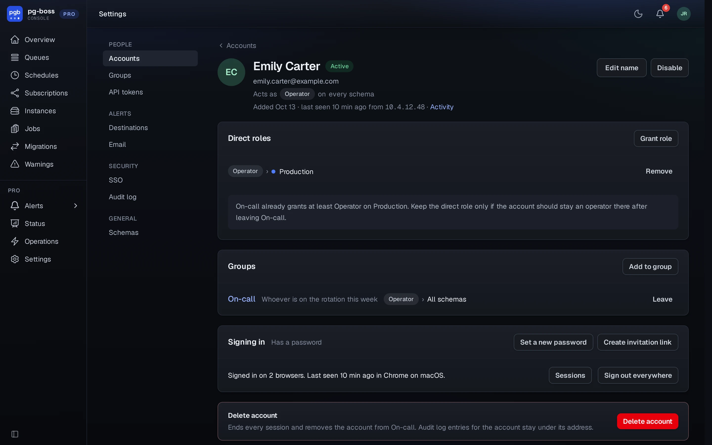
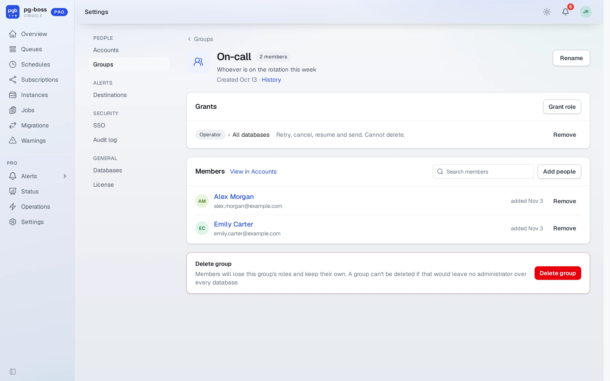
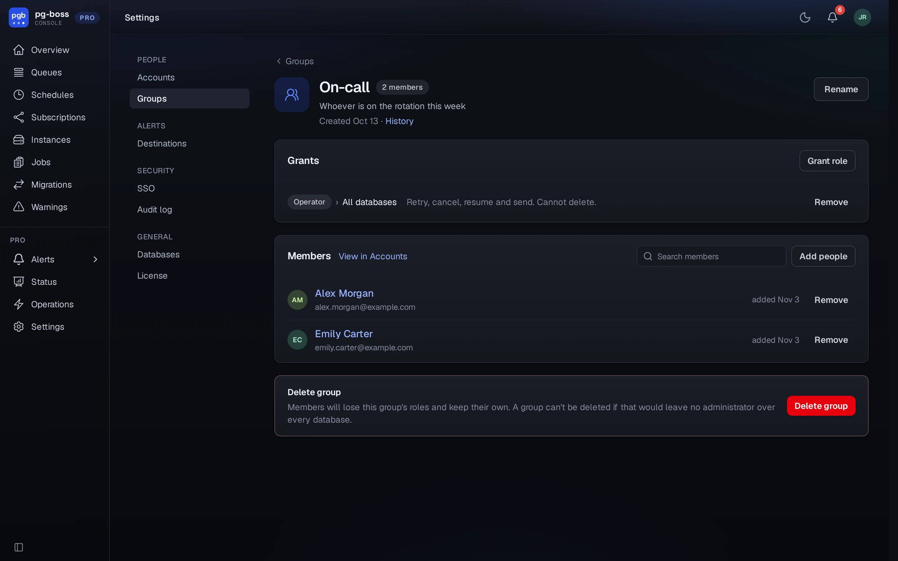

# Accounts and groups

Pro authenticates each user with their own account. Users sign out from the account menu
(the picture or initials at the top right).

[Roles and access](./roles.md) lists each role's permissions.

## Managing accounts

Accounts live under **Settings › Accounts** in the sidebar. Only
[global admins](./roles.md#global-admin) see the page. An admin on a single
app doesn't get this screen, because from it they could widen their own
grant.

The list holds people and [service accounts](./api-tokens.md) together. **All**,
**People** and **Service accounts** narrow the list to one kind. **Add** creates
a person or a service account. The search box keeps the accounts whose email, service account name or
person's name holds the text. The counts on the tabs follow the search. **In group** keeps one
group's members. **Role on** picks an app. The list then shows each account with a role on that app
and the grant the role comes from. See [access by app](./roles.md#access-by-app).

{.light-only}
{.dark-only}

From there, add a person with a role. An account's page shows under its name the roles its direct grants and groups together
give it on each app. **Role on** in the list shows which
grant each role comes from. The **Activity** link after the date the account was added opens the
[audit log](./audit-log.md) filtered to the account's actions. The page also shows:

- **Direct roles**: the roles granted to the account itself. Grant and remove them here. When a
  direct role adds nothing a group already gives, the page says so.
- **Groups**: the groups the account is in, with what each group grants. Add the account to a group or take it out here.
- **Signing in**: set a password, or create an invitation link the person opens to choose a password. The section
  also says how many browsers the account is signed in on and the address it was last seen from. **Sessions**
  lists each browser with the address it signed in from and the time, and links to the account's sign-in
  history in the audit log: every sign-in, failed attempt and sign-out. **Sign out everywhere** ends
  every session.

Edit the account's name here too, or disable or delete the account. Disabling, deleting or changing a
password ends that account's sessions immediately. An open invitation link stops working when the
account is disabled, its password is set or changed another way, or the person signs in by SSO.

Failed sign-ins lock for fifteen minutes. Five failures against an account from one client
address in fifteen minutes lock that account from that address. Five failures from one client address lock
that address out of every account. An account is locked from everywhere only after twenty failures. A
stranger can't lock someone out of their own account in a few tries. The account's page shows
the lock, where a global admin can clear it.

Machines get [service accounts](./api-tokens.md) instead, which appear in the same list. A service account
acts only through API tokens.

{.light-only}
{.dark-only}

Pro always refuses two changes, and says so:

- removing the last global admin who can sign in (with a password or by SSO), by demotion,
  disabling or deletion, because nobody would be left to undo it
- a global admin disabling or deleting their own account (another global admin can do that)

Pro sends no invitation email, because it runs inside the organization's network and may have
no mail credentials. A global admin sends the invitation link, or sets the
first password and hands it over. The person then changes it
from **Profile** in the account menu at the top right. That page needs no role.
It shows the signed-in account and its roles, and takes the current
password and the new password twice. Changing the password there signs out
every other session and keeps the current session.

## Groups

An account can hold a role directly or through a group. Groups
live under **Settings › Groups**, where the search box keeps the groups whose name or
description holds the text. Give a group a role on an app (or on all
apps), and every member has that role. **Add people** adds members by searching for a name or address
or by pasting a list of addresses. Where two roles apply to the same app, the person may do everything
either allows, as [Roles](./roles.md) explains. A group's page lists its
members ten at a time, with a search and a way to remove each member. **View in Accounts** opens the
Accounts list filtered to the group, with each member's roles and last activity.
**History** opens the audit log filtered to the group's changes. When
[SSO](./sso.md) maps a provider group to the Pro group, the page names the provider group too. Service accounts can't join a group.

{.light-only}
{.dark-only}
