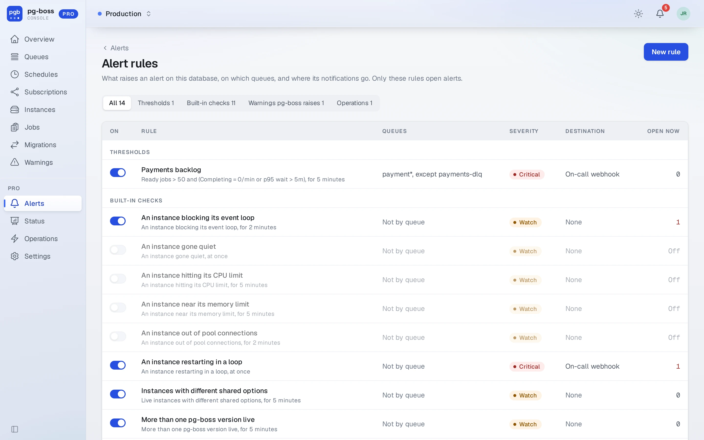
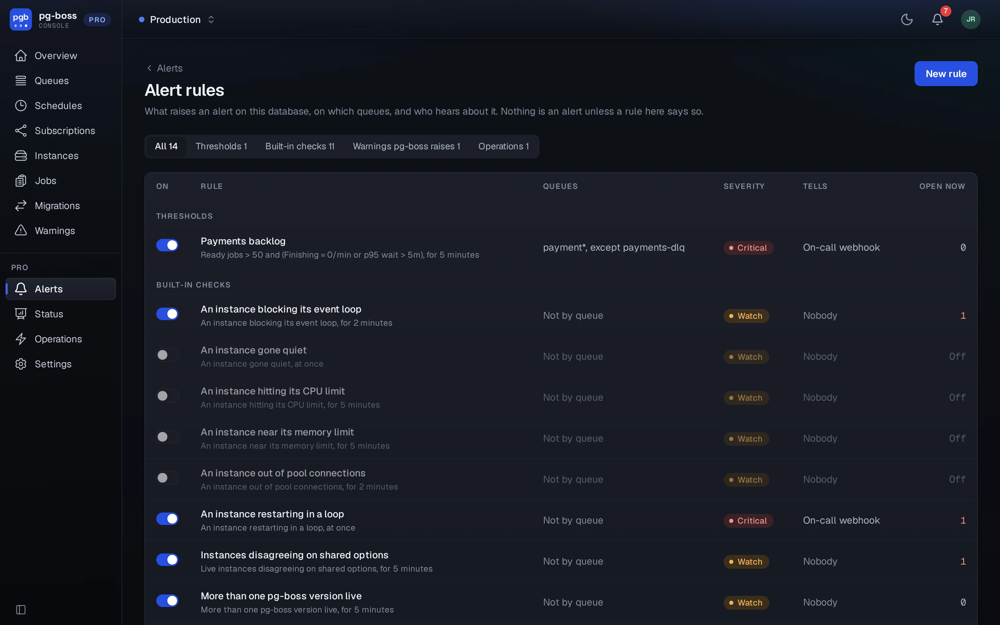
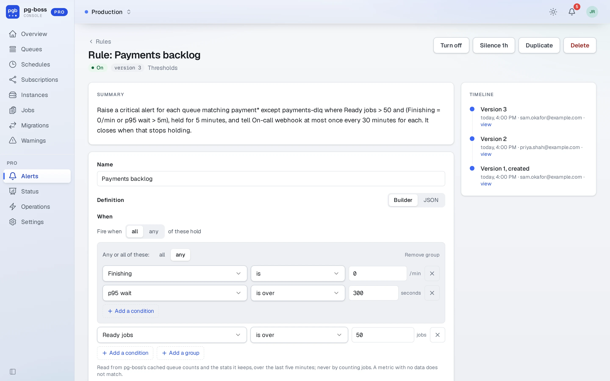
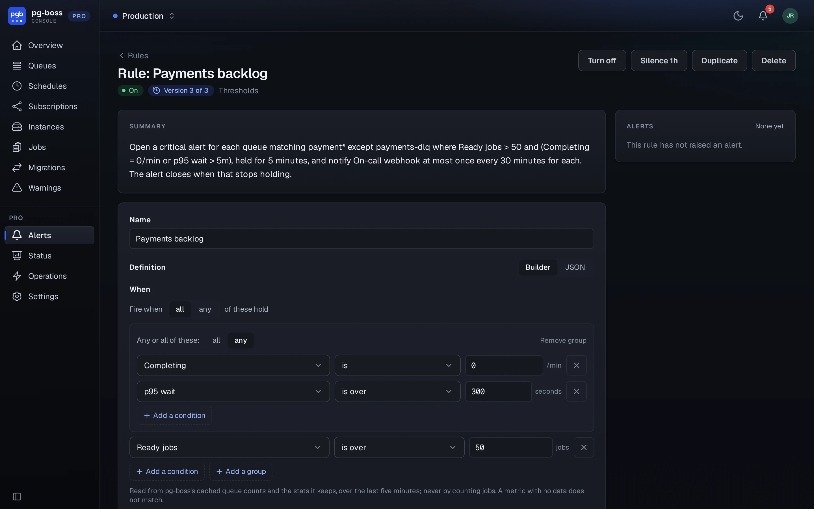
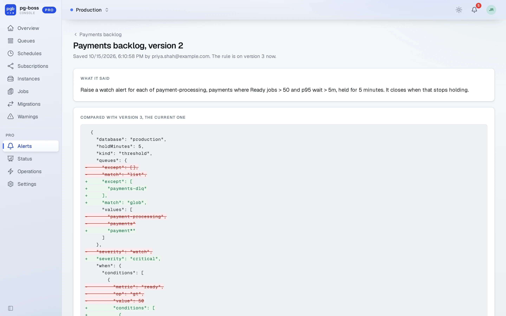
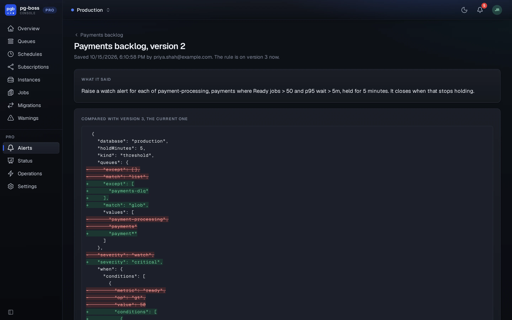

# Alert rules

## Default rules

Every database starts with one rule for each check Pro can run. Five are on:

- **Queue stalled or falling behind**: the queue's health verdict, read from its
  throughput.
- **Queue with no workers**: jobs are ready and nothing has taken one for two
  monitor passes.
- **No live instance supervising**: nothing is running pg-boss's maintenance.
- **An operation failed**: an operation that failed, or a redrive that left
  collisions.
- **pg-boss warnings**: every warning type pg-boss records.

**Queue with no workers** judges by what leaves the queue, whoever takes it, so
a queue drained with `fetch()` and `complete()` counts as worked. A job active at
the last monitor pass is activity. So is a job completed or failed in the last two
passes, from the throughput pg-boss counts with `persistQueueStats`. Without that
option, or when its counts don't cover those passes (as just after a supervisor
starts), Pro reads the queue's ready count at each pass, and a fall between two
passes is activity. That count is net, so canceling or deleting ready jobs also
lowers it, and a consumer slower than arrivals never does. When the monitor hasn't
written the counts in three passes, the check judges nothing. The alert names any
live instance with a `work()` on the queue, or the last one that had one.

The instance checks start off: an instance restarting in a loop, an instance gone
quiet, more than one pg-boss version live, instances with different shared
options, an instance out of pool connections, blocking its event loop, hitting its
CPU limit, or near its memory limit.

None of them sends a notification until it has a destination, so on a new install
the alerts show up only in the bell. A default rule can be edited and turned off,
but never deleted. **Reset to default** puts back its original definition.
A database added to `DATABASE_URL` later gets its default rules on the
evaluator's next pass.

{.light-only}
{.dark-only}

## Writing a rule

**New rule** opens the builder, which makes one of four kinds of rule:

{.light-only}
{.dark-only}

- **Threshold** compares a queue's metrics with numbers set on the rule. Conditions
  combine with *all* or *any*, with one level of grouping inside, as in "ready
  above 1,000 and (p95 wait above 10 minutes or nothing finishing)". The metrics
  are queued, ready, active, deferred, blocked and total jobs, from pg-boss's
  cached counts. The stats pg-boss keeps add jobs arriving, finishing and failing
  per minute, the oldest ready job's wait, p95 wait and p95 run time. No rule
  counts the job table itself. A queue with no data for a metric doesn't match a
  comparison on it.
- **Check** is one of the built-in checks above with its settings: which health
  verdicts count and over which interval, how many ready jobs make a queue
  uncovered, how many restarts make a loop.
- **Warning** turns pg-boss warnings into alerts: every type or only the ones the rule names,
  on every queue or some.
- **Operation** raises an alert for each failed operation and for each redrive
  that left collisions.

A threshold or check raises an alert only once it has held for the number of
minutes the rule sets. Every rule has a severity, critical or watch.

Queue rules apply to every queue, to a list, or to names matching patterns, less
any exceptions. A pattern uses `*` for any run of characters and `?` for exactly
one, and matches the whole name. `/` isn't special, so `billing-*` matches
`billing-eu/retry`. When two rules that are turned on watch the same queues the
same way, the rule's page names the other one. Each rule raises its own alert.

The rule's page also sets where the rule sends, and how often at most it notifies
about the same thing (60 minutes by default). Its **Silence 1h** button
is for a deploy or a maintenance window. A silenced rule still opens alerts but
sends no notifications, and the silence ends by itself.

## JSON definitions

The **JSON** switch on the editor shows the same rule as its definition. The
editor checks each edit against the schema that parses every save, so a
message under the editor is the one a save would give, at the path it applies to.
Unknown keys are errors. Each metric has one fixed unit (jobs, per minute or
seconds), so `"value": 600` on `waitP95Seconds` is ten minutes.

```json
{
  "kind": "threshold",
  "database": "production",
  "queues": { "match": "glob", "values": ["billing-*"], "except": ["billing-dlq"] },
  "when": {
    "match": "all",
    "conditions": [
      {
        "match": "any",
        "conditions": [
          { "metric": "completedPerMinute", "op": "eq", "value": 0 },
          { "metric": "waitP95Seconds", "op": "gt", "value": 600 }
        ]
      },
      { "metric": "ready", "op": "gt", "value": 1000 }
    ]
  },
  "holdMinutes": 5,
  "severity": "critical"
}
```

A save stores the definition in a normal order, so conditions ordered by hand
can come back sorted.

## Versions

Pro keeps every change to what a rule decides as a version, and a version can't
be changed afterward. Only the definition is versioned. Changing the name,
destination, notification interval, on or off state, or silence adds no version.
Saving the same definition again adds nothing. Going back to an earlier
one adds a new version, which the rule's history marks as the same as the earlier
one. Each version has a page that shows its definition and what changed between
it and the current one.

{.light-only}
{.dark-only}

Each alert keeps the version that opened it, and its page links there. When a
rule changes while it has open alerts, they keep their version, and from the next
pass the evaluator judges them by the new definition. An alert that no longer matches closes as "the
rule changed", so it isn't read as the problem fixing itself. Turning a rule off
closes its alerts as "the rule was turned off", and deleting one closes them as
"the rule was deleted". A deleted rule's versions stay readable from the alerts
that point at them.

## Requirements

- Warning rules read what `persistWarnings` stores. With it off there are no
  warnings to match.
- Health, and the per-minute rates in thresholds, read the stats
  `persistQueueStats` keeps (pg-boss 12.35 or later). Waits and run times need
  pg-boss 12.36, and so do the instance checks, which read its instance registry.
- The evaluator runs once a minute as a pg-boss job in a `<schema>_queue` schema
  of its own. The job has a singleton key, so two Pro replicas run one
  evaluation between them and send everything once.
