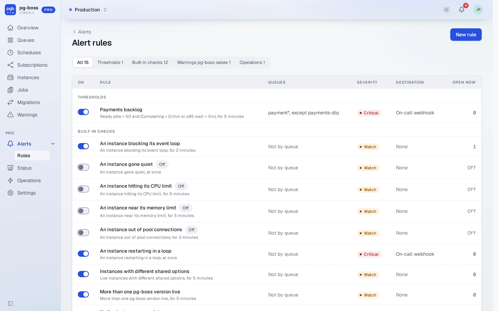
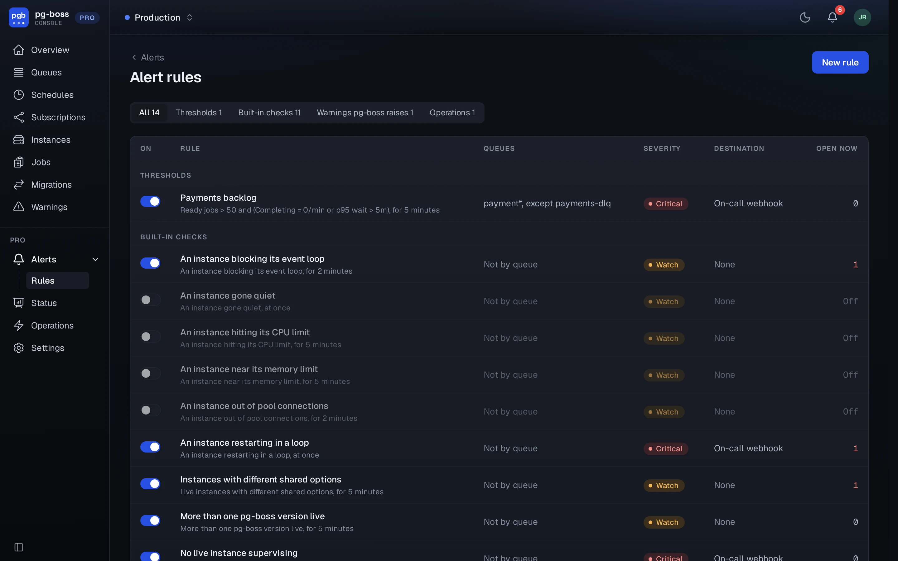
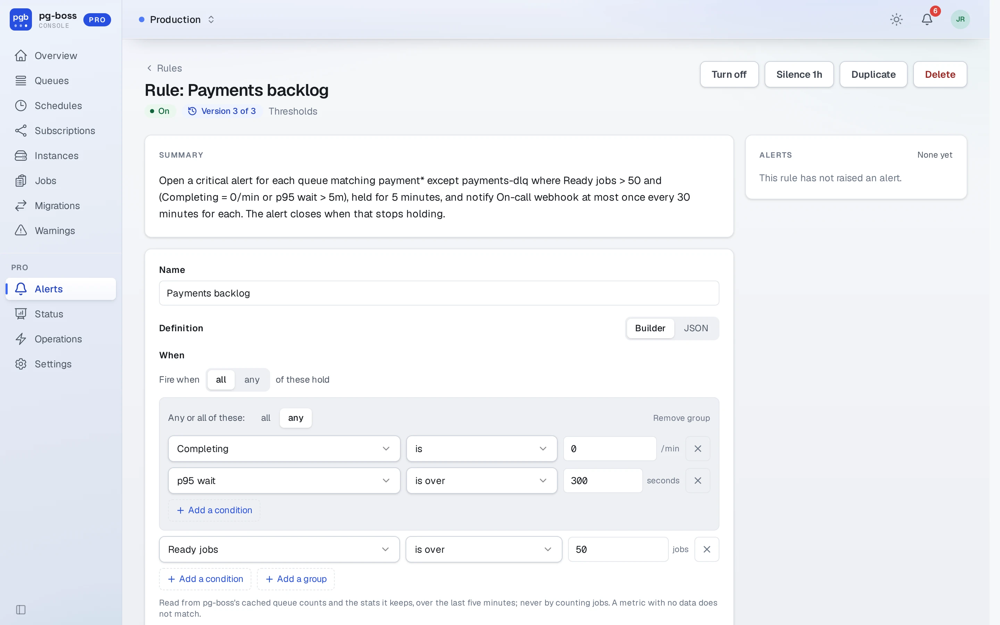
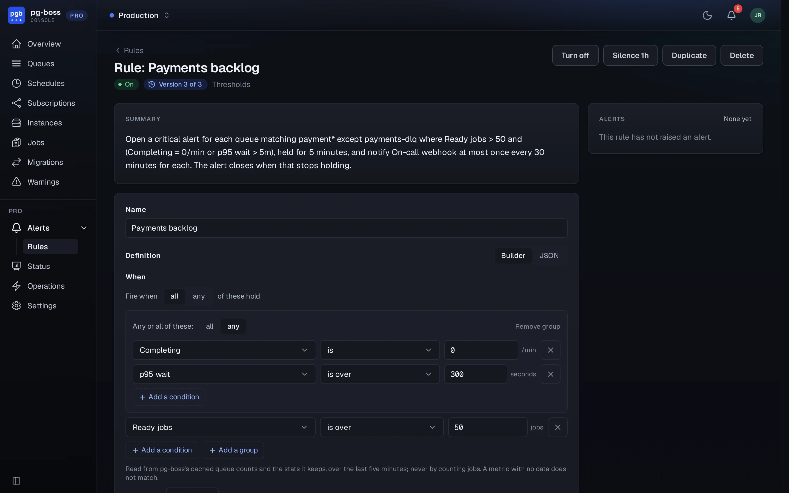
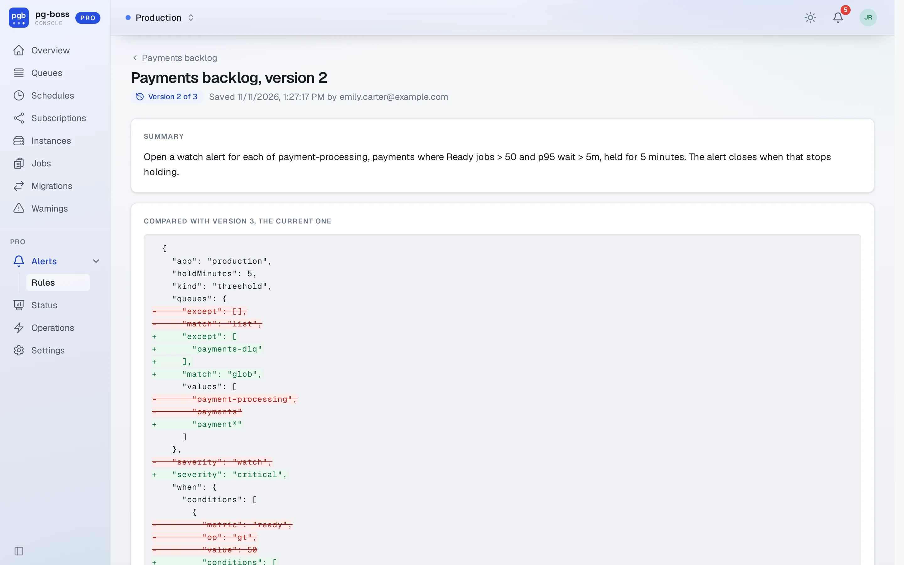
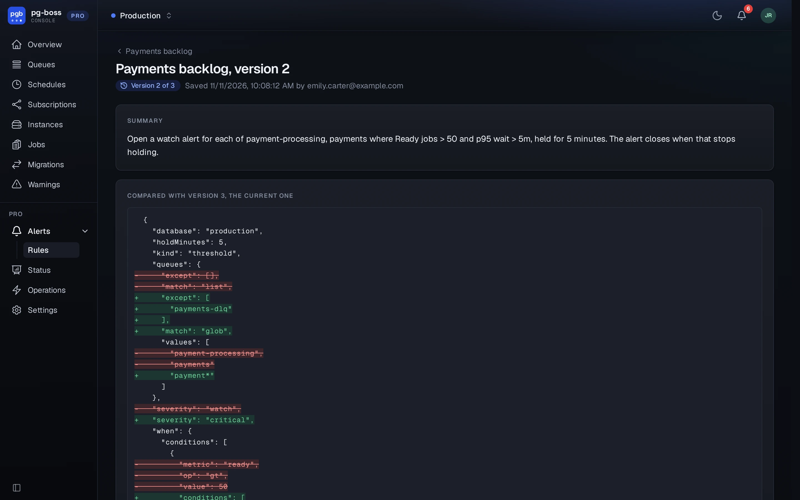

# Alert rules

## Default rules

Every schema starts with one rule for each check Pro can run. Six are on:

- **Queue stalled or falling behind**: the queue's health verdict, read from its
  throughput.
- **Queue with no workers**: jobs are ready and nothing has taken a job for two
  monitor passes.
- **No live instance supervising**: nothing is running pg-boss's maintenance.
- **An operation failed**: an operation that failed, or a redrive that left
  collisions.
- **pg-boss warnings**: every warning type pg-boss records.
- **Schema unreachable**: Pro can't connect to the schema's database.

**Schema unreachable** connects to the schema's database at the start of each evaluator
pass and runs `SELECT 1`, waiting up to 10 seconds for the connection. After 2
minutes of failed passes, the rule opens a critical alert with the connection error.
While Pro can't connect, the evaluator skips the schema's other reads. The rules that
read the schema open no new alerts, and their open check and threshold
alerts stay open until Pro connects again. A database without pg-boss's schema
still connects and doesn't count as unreachable. A schema whose stored connection
can't be decrypted isn't evaluated at all. Settings › Schemas marks that schema instead
(see [Editing a schema](./schemas.md#editing-a-schema)).

**Queue with no workers** judges by what leaves the queue, whoever takes it.
A queue drained with `fetch()` and `complete()` counts as worked. A job active at
the last monitor pass is activity. So is a job completed or failed in the last two
passes, from the throughput pg-boss counts with `persistQueueStats`. Without that
option, or when its counts don't cover those passes (as just after a supervisor
starts), Pro reads the queue's ready count at each pass. A fall between two
passes is activity. Cancelling or deleting ready jobs also lowers that count,
because the count is net. A consumer slower than arrivals doesn't lower it. If pg-boss's monitor
hasn't refreshed the queue's counts in its last three passes, the check skips the
queue until the monitor refreshes them.

The alert names the pg-boss instances that have a `work()` on the queue. When no
live instance has a `work()` on the queue, the alert names the last instance that did and how long that
instance has been quiet. Jobs in a dead letter queue usually wait for a person.
The check skips a queue that another queue names as its `deadLetter` until an
instance has had a `work()` on that queue.

A queue drained on a schedule looks unworked between runs. A cron job that calls
`fetch()` every 15 minutes is one example. **Queue with no workers** and **Queue
stalled or falling behind** each open an alert a few minutes into a gap while jobs wait. On
those two rules, set a hold longer than the gap, or list the queue as an
exception (see [Writing a rule](#writing-a-rule)).

The [instance](./instances.md) checks start off:

- **An instance restarting in a loop**
- **An instance gone quiet**
- **More than one pg-boss version live**
- **Instances with different shared options**
- **An instance out of pool connections**
- **An instance blocking its event loop**
- **An instance hitting its CPU limit**
- **An instance near its memory limit**

**An instance restarting in a loop** counts the restarts of instances with one
name on one host, 3 within an hour by default. A restart is an instance that ended
without a call to `stop()`, such as a process that crashed, followed by a new
start with that name on that host. Instances that ran at the same time count as
one restart. A deploy that ends several workers sharing a name counts once. A
paused VM or a laptop asleep isn't a restart. Its instances miss their
heartbeats, but nothing starts in their place. A script that starts pg-boss and
exits without calling `stop()` restarts the same way as a crash. A script run 3
times within an hour on one host, under one `instanceName` or with none, reads
as a restart loop. Call `stop()` before the script exits.

No rule sends a notification until it has a [destination](./destinations.md).
Alerts from a rule with no destination still open and appear on the [Alerts](./alerts.md) page. A destination
set later gets only the alerts that fire after it is set. Turning on a rule
that has no destination asks for a destination for its alerts, and offers a destination
that is on. A default
rule can be edited and turned off,
but not deleted. **Reset to default** puts back its original definition.
A schema added later gets its default rules on the evaluator's next pass.

{.light-only}
{.dark-only}

## Writing a rule

**New rule** opens the builder, which makes one of four kinds of rule:

{.light-only}
{.dark-only}

- **Threshold** compares a queue's metrics with numbers set on the rule. Conditions
  combine with *all* or *any*, with one level of grouping inside, as in "ready
  above 1,000 and (p95 wait above 10 minutes or nothing completing)". The metrics
  from pg-boss's cached counts are queued, ready, active, deferred, blocked and
  total jobs. The stats pg-boss keeps add jobs arriving, completing and failing
  per minute, the oldest ready job's wait, p95 wait and p95 run time. Each p95 comes from
  at least 20 jobs. No rule counts the job table itself. A metric with no data,
  such as p95 wait when fewer jobs finished, neither matches nor resolves. An
  open alert stays open until the data comes back, unless the rule's other
  conditions decide the result without that metric.
- **Check** is one of the built-in checks above with its settings: which health
  verdicts count and over which interval, how many ready jobs a queue with no
  workers needs before it counts, how many restarts make a loop.
- **Warning** turns pg-boss warnings into alerts. The rule matches every warning type or only
  the types it names, on every queue or only some queues.
- **Operation** raises an alert for each failed operation and for each redrive
  that left [collisions](./operations.md#redrive), which are jobs the destination queue refused.

A health alert stays open when a queue's stats stop because its supervisors
are down or its stats are off. It resolves as deleted only when the queue is
gone from pg-boss.

A threshold or check raises an alert only once it has held for the number of
minutes the rule sets. Every rule has a severity, critical or watch.

Queue rules apply to every queue, to a list, or to names matching patterns, and
leave out any queues listed as exceptions. A pattern uses `*` for any run of characters and `?` for exactly
one character, and matches the whole name. Because `/` isn't special, `billing-*` matches
`billing-eu/retry`. When two rules that are turned on watch the same queues the
same way, each rule's page names the other rule. Each rule raises its own alert.

The rule's page also has settings for where the rule sends and how often at most
it notifies about the same thing (60 minutes by default). A threshold or check that resolved
and then matches again notifies at once, because the resolve closed the incident
on call. The rule's hold keeps a queue that flips back and forth from notifying
on every change. The page's **Silence 1h** button
is for a deploy or a maintenance window. A silenced rule still opens alerts but
sends no notifications. The silence ends by itself.

## JSON definitions

The **JSON** switch on the editor shows the same rule as its definition. The
editor checks each edit against the schema that parses every save. A
message under the editor matches the message a save would give and names the path it applies to.
Unknown keys are errors. Each metric has one fixed unit (jobs, per minute or
seconds). On `waitP95Seconds`, `"value": 600` is ten minutes.

```json
{
  "kind": "threshold",
  "schema": "production",
  "queues": { "match": "glob", "values": ["billing-*"], "except": ["billing-dlq"] },
  "when": {
    "match": "all",
    "conditions": [
      {
        "match": "any",
        "conditions": [
          { "metric": "completedPerMinute", "op": "eq", "value": 0 },
          { "metric": "waitP95Seconds", "op": "gt", "value": 600 }
        ]
      },
      { "metric": "ready", "op": "gt", "value": 1000 }
    ]
  },
  "holdMinutes": 5,
  "severity": "critical"
}
```

A save stores the definition in a normal order. Conditions ordered by hand
can come back sorted.

A check rule names its check by id:

| Id | Check |
| - | - |
| `health` | Queue health |
| `uncovered` | Queue with no workers |
| `unsupervised` | No live instance supervising |
| `restart-loop` | Restarting in a loop |
| `quiet` | Gone quiet |
| `versions` | More than one version |
| `config` | Different shared options |
| `pool` | Out of pool connections |
| `event-loop` | Blocking its event loop |
| `cpu` | Hitting its CPU limit |
| `memory` | Near its memory limit |
| `unreachable` | Schema unreachable |

## Versions

Pro keeps every change to what a rule decides as a version. A version can't
be changed afterward. Only the definition is versioned. Changing the name,
destination, notification interval, on or off state, or silence adds no version.
Saving the same definition again adds nothing. Reordering conditions or leaving out a default value adds nothing
either, because Pro compares definitions after filling in defaults and sorting. Going back to an earlier
definition adds a new version, which the rule's history marks as the same as the earlier
version. Each version has a page that shows its definition and what changed between
it and the current version.

**Reset to default** saves a default rule's original definition as a new version, and is disabled
while the definition already matches it. When a Pro release changes how a check decides, Pro saves a
new version of each rule that uses the check. The history names pg-boss Pro as the author. The
[audit log](./audit-log.md) records the reason. Like any new version, the release's version restarts the
hold and closes the open alerts the new logic no longer matches.

A link under the rule's name, such as **Version 2 of 4**, opens the version
history. The link is on the rule's page and on each version's page, and names the
version on screen. The history lists every version newest first, with who saved
it, when, and how many lines it changed from the version before.

{.light-only}
{.dark-only}

Each alert keeps the version that opened it, which the alert's page links to. When a
rule changes while it has open alerts, those alerts keep their version. From the next
pass, the evaluator judges them by the new definition. An alert that no longer matches closes as "the
rule changed". That close reason tells the alert apart from a problem that fixed itself. Turning a rule off
closes its alerts as "the rule was turned off". Deleting a rule closes them as
"the rule was deleted". A deleted rule's versions stay readable from the alerts
that point at them.

## Requirements

- Warning rules read what `persistWarnings` stores. With it off there are no
  warnings to match.
- The health check and the per-minute rates in thresholds read the stats
  `persistQueueStats` keeps (pg-boss 12.35 or later). Waits and run times need
  pg-boss 12.36, and so do the instance checks, which read pg-boss's instance registry.
- The evaluator runs once a minute as a pg-boss job in the `pgboss` schema of
  [Pro's database](./install.md#database-setup). A pass holds a Postgres advisory lock
  on Pro's database while it runs. Pro replicas run one pass at a time between them, and the pass queues each
  notification once to its destination's [send queue](./destinations.md#send-queues).
  A minute whose job finds the lock taken skips its pass. A pooler in front of
  the store must not be in transaction mode, because the lock needs a session
  of its own. In transaction mode, the send queues also lose LISTEN/NOTIFY and find
  new sends by polling every 10 seconds.
- Pro starts the evaluator when its server starts, whether or not anyone opens
  the Pro Console, and tries again each minute until it runs.
- On SIGTERM or SIGINT, a pass in progress gets up to 20 seconds to finish before the
  database connections close. A replica that dies during a pass releases the lock
  with its connection. The next minute's pass then runs. pg-boss fails the
  dead pass's job about two minutes later, once the job's heartbeat stops.
