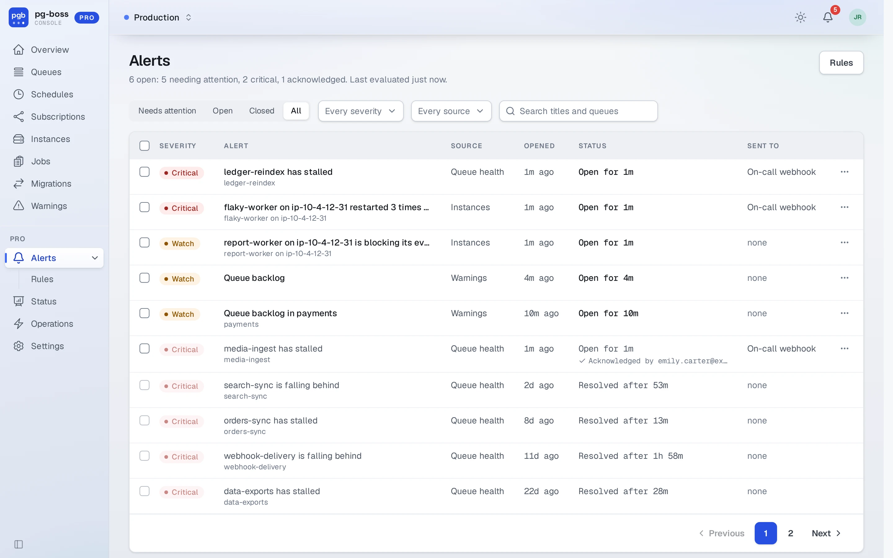
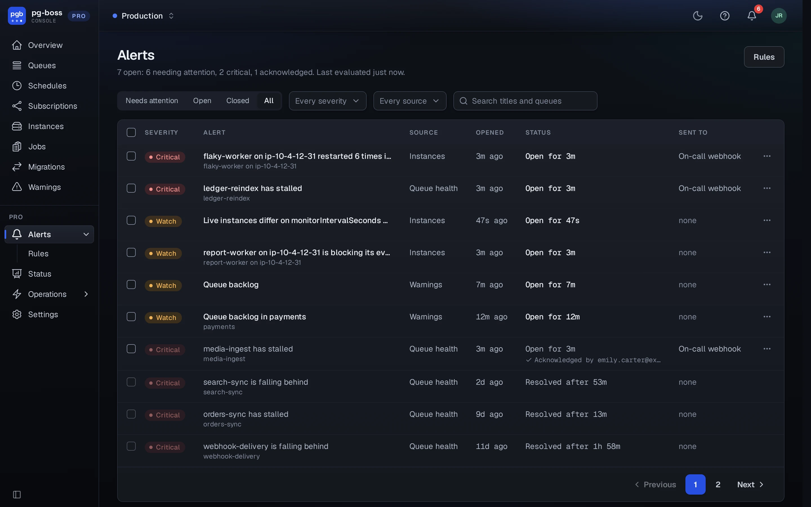
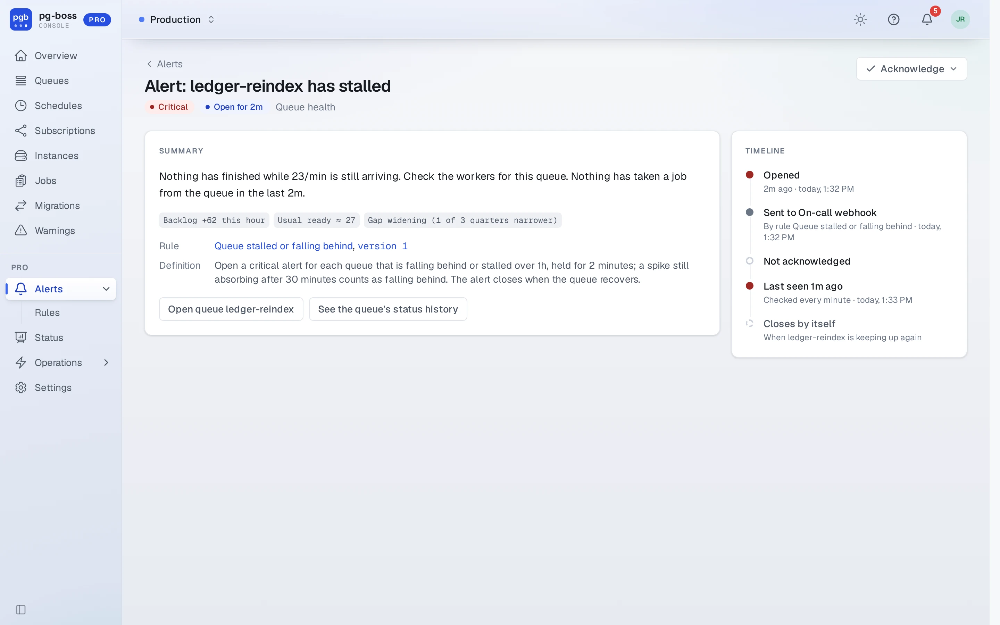
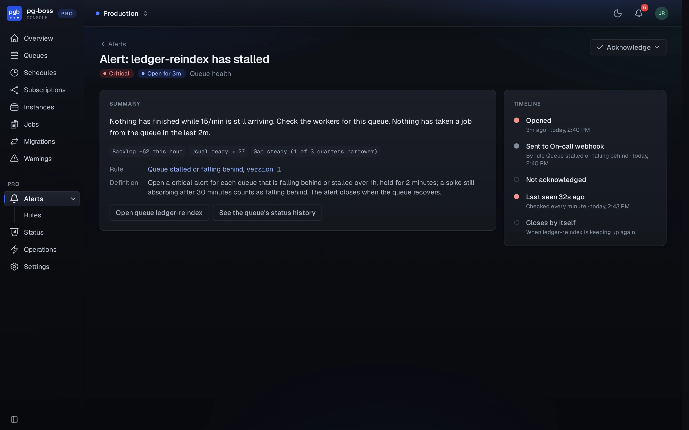

# Alerts

The **Alerts** page lists the alerts on the current schema, open alerts
first. Its filters show the alerts that need attention, open alerts, closed alerts or every alert. The bell
in the top bar counts the alerts that need attention, which are the open alerts nobody has
acknowledged. The count shows in red when any of those alerts is critical. Its menu lists the latest
alerts and links to this page. An alert's page
shows the condition that matched, the rule and version that opened it, and the destinations its
notifications went to.

The page header shows the time the evaluator last finished a pass on the schema, which it does
once a minute. When no pass has finished on a schema for 3 minutes, the schema's pages show a
banner, because no alert opens or closes on that schema until its next pass. Pages that name no
schema, such as Settings, show a banner naming every schema behind.
[Requirements](./alert-rules.md#requirements) covers how the evaluator runs, and
[stopped passes](#stopped-passes) the causes of the banner.

{.light-only}
{.dark-only}

Alerts come only from rules that are turned on. A rule
belongs to the schema that was selected when the rule was created.
Rules live under **Alerts › Rules** in the sidebar. Only
[global admins](./roles.md#global-admin) see them.
A rule's page lists the 8 alerts it opened most recently. When the rule has opened
more, a link there opens this list filtered to that rule.

{.light-only}
{.dark-only}

Operators and admins can **acknowledge** an open alert, until it closes
or for an hour, four hours or a day. The alert then leaves the bell's count for every user.
Pro also holds the alert's notifications. For an event, acknowledging sends its resolve to the
destinations, as closing does. Conditions, such as a stalled queue, close by
themselves when they stop matching. Events, such as a pg-boss warning or a failed
operation, have no condition that could stop matching. An event closes when a user
resolves it or 24 hours after the event last happened. A warning that keeps
repeating stays open.

Rules have [their own page](./alert-rules.md), and [Destinations](./destinations.md) covers where alerts go.

API tokens can list open alerts and acknowledge an alert. See [the Pro API](./api.md#alerts).

## Stopped passes

The banner means no evaluator pass has finished on the schema for 3 minutes. A schema that Pro can't
connect to doesn't cause the banner. Its passes still finish, and the **Schema unreachable** rule
opens an alert instead. Passes stop for these reasons:

- No Pro server is running. Every schema falls behind at once, and nothing answers on `/healthz`.
- The evaluator can't start. Pro tries again each minute and logs the error.
- A schema's reads are slow. Each read can take up to
  [`PGBOSS_PRO_QUERY_TIMEOUT`](./environment.md#pgboss-pro-query-timeout), 60 seconds by default, and a
  pass makes several. A slow schema holds up only its own passes. A pass that runs for 15 minutes is
  failed.
- A pass fails before it finishes, as when a write to Pro's database fails.

The causes show up in three places:

- The server's log, which names the schema and the error.
- **Pro internal queues**, in the schema menu. Each schema's passes run as jobs on the queue named
  `pgboss-pro-pass-` and the schema's id. A failed job shows its error, and an active job shows when
  its pass started.
- The [`pgboss_evaluator_pass_age_seconds`](./metrics.md) metric, and
  [`/alertz`](./install.md#health-checks), which fails while any schema is behind.

Behind a pooler in transaction mode, a pass can start up to 30 seconds into its minute, well short of
the banner's 3 minutes.
