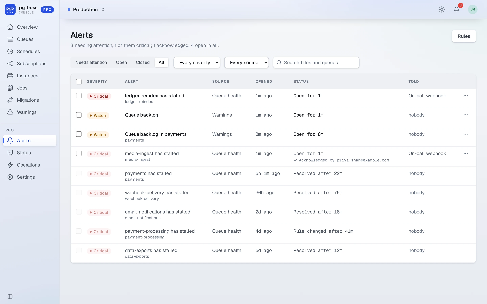
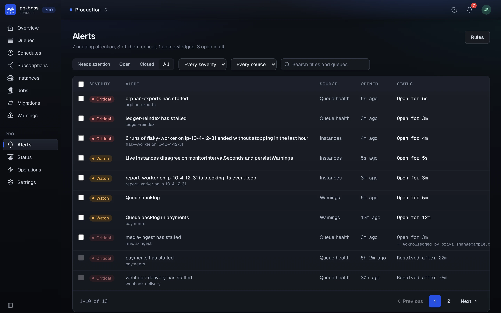
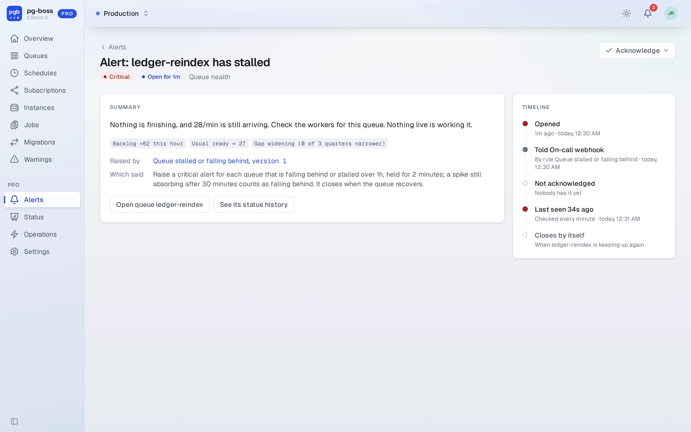
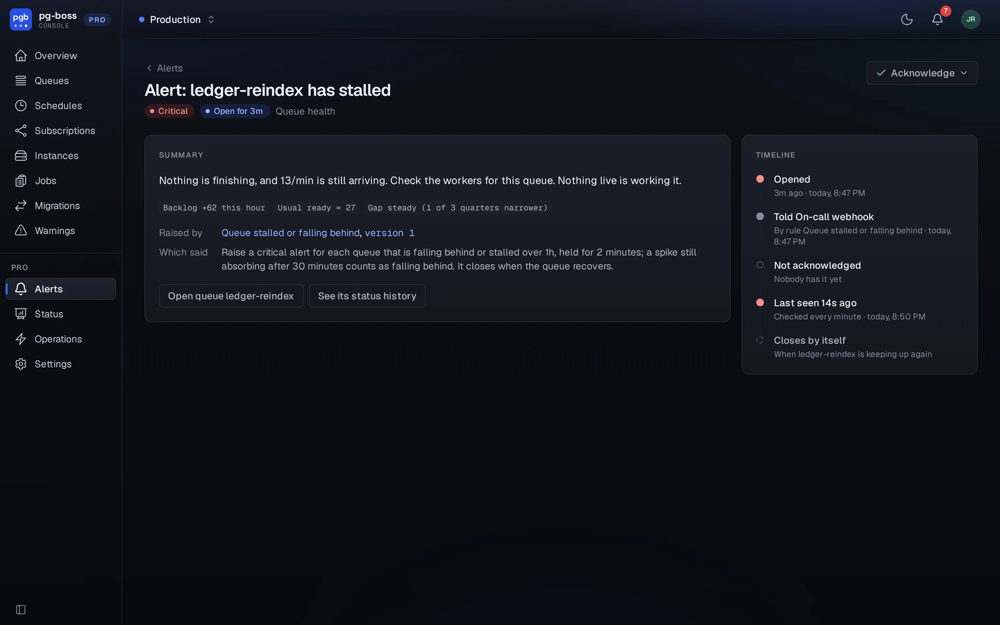

# Alerts

`/pro/alerts` lists the alerts on the current database, open ones
first, with filters for those that need attention, open, closed and all. The bell
in the top bar counts the open ones, colored by the most severe. An alert's page
says what matched, which rule opened it and at which version, and where its
notifications were sent.

{.light-only}
{.dark-only}

Alerts come only from rules, and only a rule that's turned on opens one. A rule
belongs to one database, the one selected when the rule was created.
Administrators manage rules from the **Rules** button on the alerts page
(`/pro/alerts/rules`).

{.light-only}
{.dark-only}

Operators and administrators can **acknowledge** an open alert, until it closes
or for an hour, four hours or a day. The alert then leaves the bell's count for every user, and
Pro holds its notifications. Conditions, such as a stalled queue, close by
themselves when they stop matching. Events, such as a pg-boss warning or a failed
operation, have no condition that could stop matching, so they close when a user
resolves them, or after 24 hours.

Rules have [their own page](./alert-rules.md), and [Destinations](./destinations.md) covers where alerts go.

API tokens can list open alerts and acknowledge one. See [the API](./api.md#alerts).
