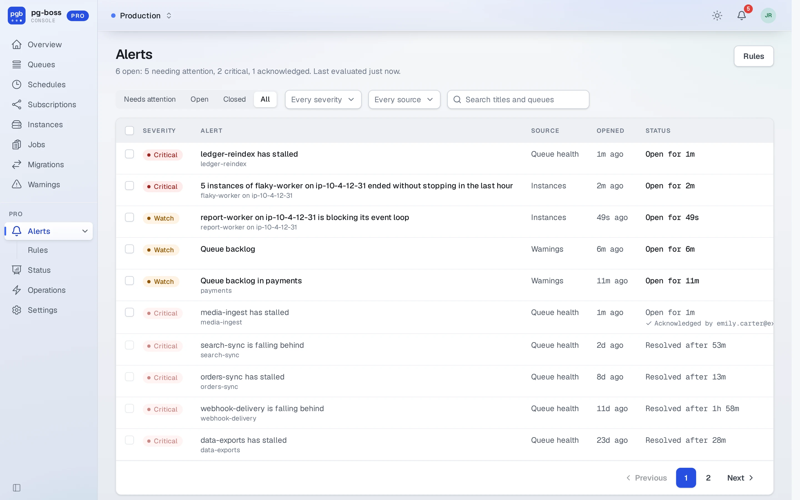
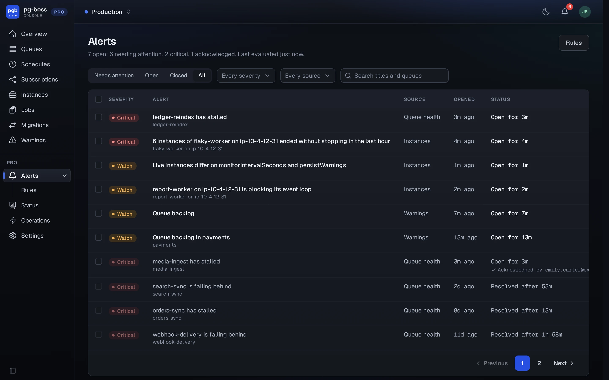
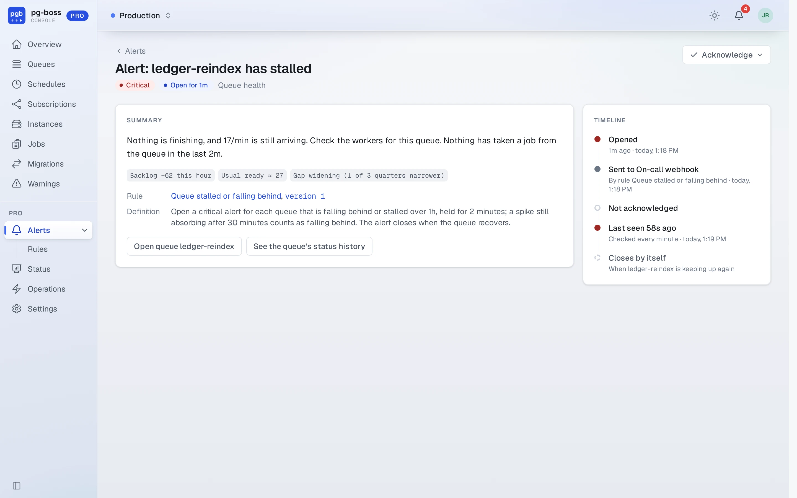
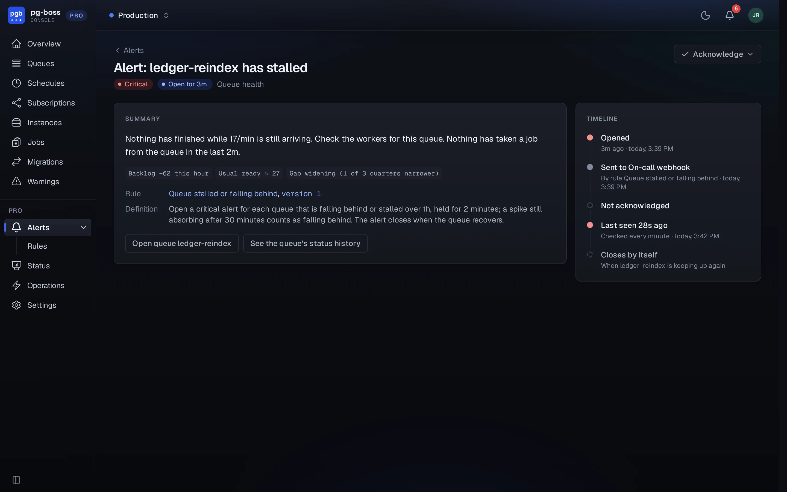

# Alerts

The **Alerts** page lists the alerts on the current database, open alerts
first. Its filters show the alerts that need attention, open alerts, closed alerts or every alert. The bell
in the top bar counts the alerts that need attention, which are the open alerts nobody has
acknowledged. The count shows in red when any of those alerts is critical. Its menu lists the latest
alerts and links to this page. An alert's page
says what matched, which rule opened it and at which version, and where its
notifications were sent.

The page header says when the evaluator last finished a pass, which it does once
a minute. When no pass has finished for 3 minutes, every Console page shows a
banner, because no alert opens or closes until the evaluator runs again.
[Requirements](./alert-rules.md#requirements) covers how the evaluator runs.

{.light-only}
{.dark-only}

Alerts come only from rules that are turned on. A rule
belongs to the database that was selected when the rule was created.
Rules live under **Alerts › Rules** in the sidebar. Only
[global admins](./roles.md#global-admin) see them.
A rule's page lists the 8 alerts it opened most recently. When the rule has opened
more, a link there opens this list filtered to that rule.

{.light-only}
{.dark-only}

Operators and admins can **acknowledge** an open alert, until it closes
or for an hour, four hours or a day. The alert then leaves the bell's count for every user.
Pro also holds the alert's notifications. For an event, acknowledging sends its resolve to the
destinations, as closing does. Conditions, such as a stalled queue, close by
themselves when they stop matching. Events, such as a pg-boss warning or a failed
operation, have no condition that could stop matching. An event closes when a user
resolves it or 24 hours after the event last happened, so a warning that keeps
repeating stays open.

Rules have [their own page](./alert-rules.md), and [Destinations](./destinations.md) covers where alerts go.

API tokens can list open alerts and acknowledge an alert. See [the API](./api.md#alerts).
