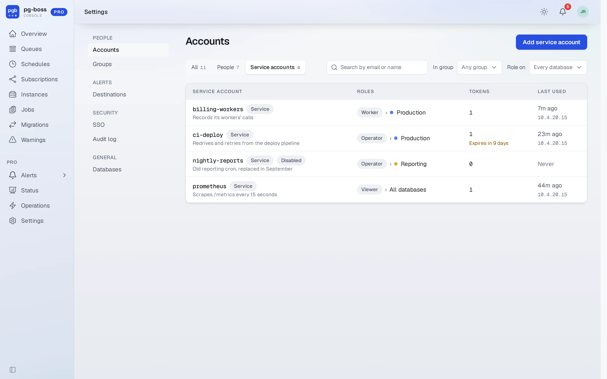
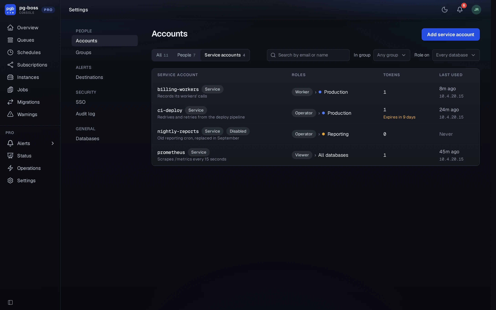
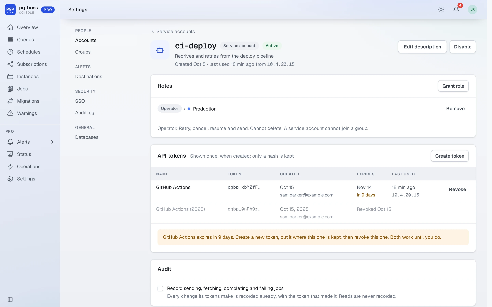
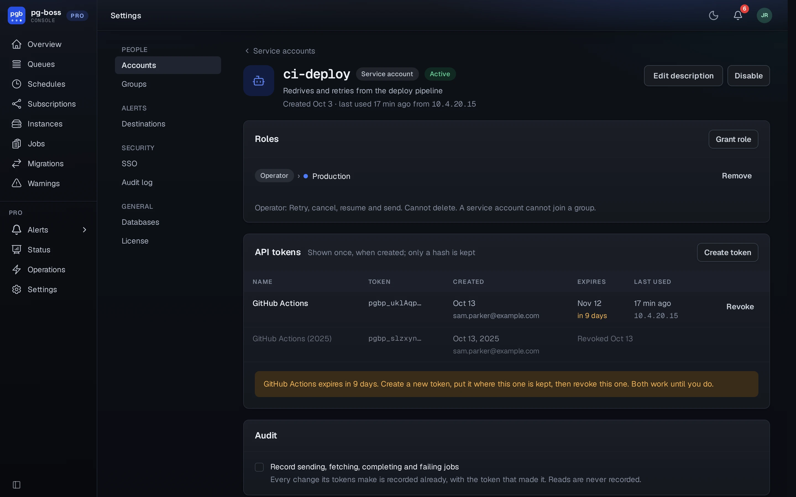

# API tokens and service accounts

A script, a CI job, a Prometheus scrape or a worker in another language reaches Pro with an API token. A token belongs to a **service account**, which is an account for a machine. The token keeps working when the person who set it up leaves.

- A service account has [roles](./roles.md) on databases like a person: a viewer for a scrape, an operator on one database for a CI redrive, a worker for a worker.
- It can't sign in to the Pro Console by password, SSO or invitation. It acts only through its tokens, and only on the [Pro API](./api.md) and `/metrics`.
- Disabling it stops every one of its tokens at once.
- It can have several tokens. To replace a token with no gap, create the new token, deploy it, then revoke the old token.

## Service accounts list

Service accounts live in **Settings › Accounts**, beside the people. Only [global admins](./roles.md#global-admin) see them.
**Service accounts** at the top of that list shows each service account's
purpose, roles, working tokens, when it was last used and from where, and marks a token that
expires within 14 days.

{.light-only}
{.dark-only}

**Add service account** (or **Add** then **Service account** on the list of every account) takes a name, a description, and a first role. The service account's page then shows:

- **Roles**: what its tokens may do, and on which databases. Grant and remove them here. A service
  account can't join a group.
- **API tokens**: each with its name, its first characters, who created it, when it expires and
  when it was last used. **Create token** asks for a name and an expiry and shows the token once, to
  copy. **Revoke** stops a token at once.
- **Audit**: whether its sending, fetching, completing and failing are recorded.
- **Using a token**: a `curl` for the API and for open alerts, with this Console's address.
- **Recent activity**: what its tokens did, and the changes made to it.

{.light-only}
{.dark-only}

## Tokens

A token is `pgbp_` followed by 43 characters. Pro shows it once, at creation. Pro keeps only its hash and its first characters, to tell tokens apart. Each token expires after 30, 90 or 365 days or never. Any token can be revoked. Pro records when and where a token was last used, at most once a minute.

A client sends the token in an `Authorization: Bearer` header:

```bash
curl -H "Authorization: Bearer $PGBOSS_PRO_API_TOKEN" https://console.example.com/pro/api/v1/pgboss/getQueues
```

Tokens work only on the API and [`/metrics`](./metrics.md). The Console's pages ignore them, and the API ignores a session cookie. Pro answers a missing or invalid token with `401` and `WWW-Authenticate: Bearer`. After five invalid tokens from one address in fifteen minutes, Pro answers that address's invalid tokens with `429` for fifteen minutes. A client sharing an address with someone guessing isn't cut off, because a valid token from the address still works.

## Audit

The [audit log](./audit-log.md) records what a token changes under its service account's name, with the token that did it. After a leaked token is revoked, the log shows what it did. The calls a producer or worker makes at volume (sending, fetching, completing and failing jobs) are recorded only when the service account is set to record them.
