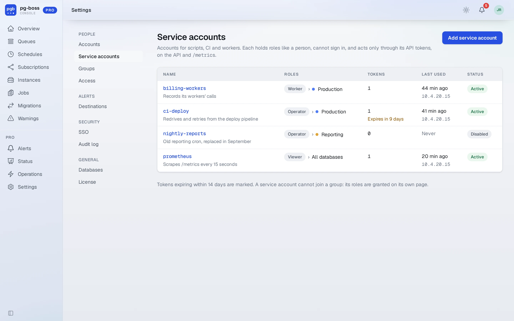
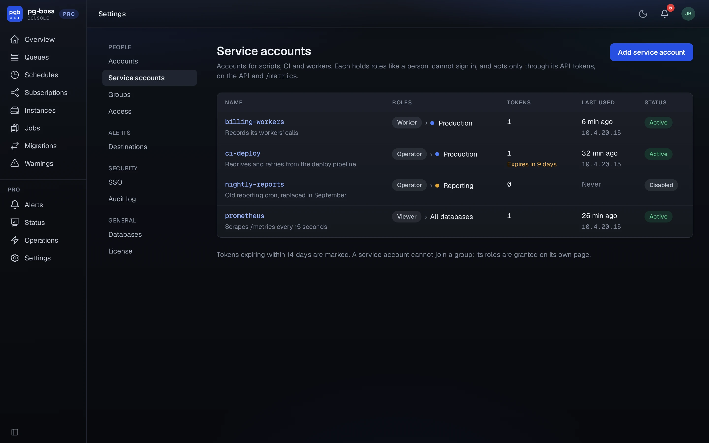
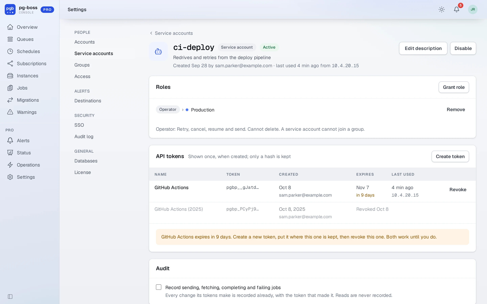
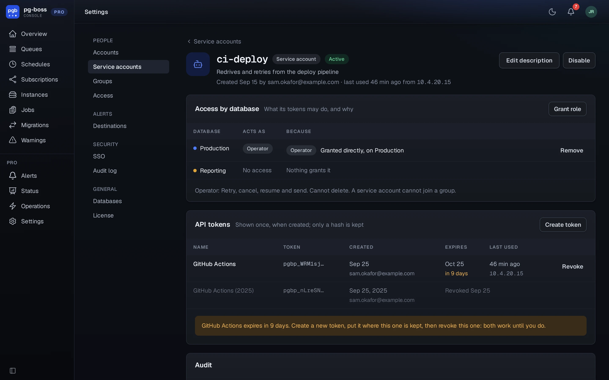

# API tokens and service accounts

A script, a CI job, a Prometheus scrape or a worker in another language reaches Pro with an API token. A token belongs to a **service account**, an account for a machine rather than a person, so it does not stop working when the person who set it up leaves.

- A service account has [roles](./roles.md) on databases like a person: a viewer for a scrape, an operator on one database for a CI redrive, a worker for a worker.
- It cannot sign in to the console by password, SSO or invitation. It acts only through its tokens, and only on the API and `/metrics`.
- Disabling it stops every one of its tokens at once.
- It can have several tokens, so one can be replaced with no gap: create the new one, deploy it, revoke the old one.

## The service accounts page

An administrator over every database manages them under **Settings › Service accounts**, at
`/pro/service-accounts`. The list shows each one's purpose, roles, working tokens, when it was last
used and from where, and marks a token that expires within 14 days.

{.light-only}
{.dark-only}

**Add service account** takes a name, what it is for, and a first role. Its page then shows:

- **Access by database**: what its tokens may do on each database, with roles granted and removed
  here. A service account cannot join a group.
- **API tokens**: each with its name, its first characters, who created it, when it expires and
  when it was last used. **Create token** asks for a name and an expiry and shows the token once, to
  copy. **Revoke** stops one at once.
- **Audit**: whether its sending, fetching, completing and failing are recorded.
- **Using a token**: a `curl` for the API and for open alerts, with this console's address.
- **Recent activity**: what its tokens did, and the changes made to it.

{.light-only}
{.dark-only}

## Tokens

A token is `pgbp_` and 43 characters, shown once when it is created. Pro keeps only its hash and its first characters, to tell tokens apart. Each has an expiry, 30, 90 or 365 days or none, and can be revoked. Its last use, when and from where, is recorded at most once a minute.

Send it as a bearer token:

```bash
curl -H "Authorization: Bearer $PGBOSS_PRO_API_TOKEN" https://console.example.com/pro/api/v1/pgboss/getQueues
```

Tokens work only on the [API](./api.md) and [`/metrics`](./metrics.md). The console's pages ignore them, and the API ignores a session cookie. A missing or invalid token answers `401` with `WWW-Authenticate: Bearer`. After five failures from one address in fifteen minutes, that address is refused for fifteen minutes.

## Audit

What a token changes is recorded in the [audit log](./audit-log.md) under its service account's name, with the token that did it, so revoking a leaked token can be followed by what it did. The calls a producer or worker makes at volume, sending, fetching, completing and failing jobs, are recorded only when the service account is set to record them.
