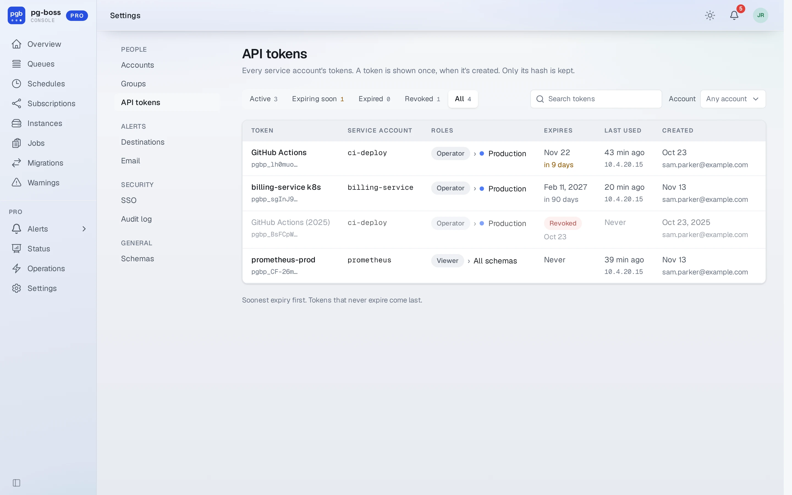
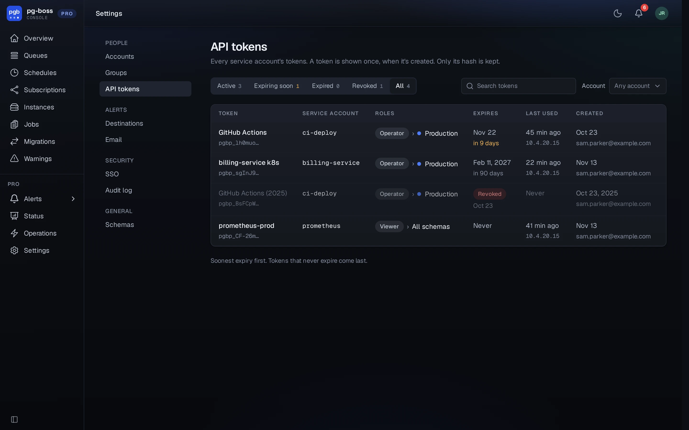

# API tokens and service accounts

A script, a CI job, a Prometheus scrape or a service in another language reaches Pro with an API token. A token belongs to a **service account**, which is an account for a machine. The token keeps working when the person who set it up leaves.

- A service account has [roles](./roles.md) on schemas like a person: a viewer for a scrape, and an operator on one schema for a CI redrive or a service that sends jobs.
- It can't sign in to the Pro Console by password, SSO or invitation. It acts only through its tokens, and only on the [Pro API](./api.md) and `/metrics`.
- Disabling it stops every one of its tokens at once.
- It can have several tokens. To replace a token with no gap, create the new token, deploy it, then revoke the old token.

## Service accounts list

Service accounts live in **Settings › Accounts**, beside the people. Only [global admins](./roles.md#global-admin) see them.
**Service accounts** at the top of that list shows each service account's
purpose, roles, working tokens, when it was last used and from where, and marks a token that
expires within 14 days.

{.light-only}
{.dark-only}

**Add service account** (or **Add** then **Service account** on the list of every account) takes a name, a description, and a first role. The service account's page then shows:

- **Roles**: what its tokens may do, and on which schemas. Grant and remove them here. A service
  account can't join a group.
- **API tokens**: each with its name, its first characters, who created it, when it expires and
  when it was last used. **Create token** asks for a name and an expiry and shows the token once, to
  copy. **Revoke** stops a token at once.
- **Audit**: whether the jobs it sends are recorded.
- **Using a token**: a `curl` for the Pro API and for open alerts, with this Pro Console's address.
- **Recent activity**: what its tokens did, and the changes made to it.

{.light-only}
{.dark-only}

## All tokens

**Settings › API tokens** lists every service account's tokens in one table, for [global admins](./roles.md#global-admin). Each row shows the token's name and first characters, its service account and that account's roles, when it expires, when and from where it was last used, and who created it. The tabs hold the tokens that work (**Active**), the ones of those that expire within 14 days (**Expiring soon**), the **Expired** and **Revoked** ones, and **All**, each with its count. The search finds a token by its name, its first characters or its service account's name, which helps when a log or a leaked value shows only the start of a token. **Account** keeps one service account's tokens. **Revoke** stops a token at once, as on its account's page.

{.light-only}
{.dark-only}

## Tokens

A token is `pgbp_` followed by 43 characters. Pro shows it once, at creation. Pro keeps only its hash and its first characters, to tell tokens apart. Each token expires after 30, 90 or 365 days or never. Any token can be revoked. Pro records the time and address of a token's last use, at most once a minute.

A client sends the token in an `Authorization: Bearer` header:

```bash
curl -H "Authorization: Bearer $PGBOSS_PRO_API_TOKEN" https://console.example.com/pro/api/v1/production/getQueues
```

Tokens work only on the Pro API and [`/metrics`](./metrics.md). The Pro Console's pages ignore them, and the Pro API ignores a session cookie. Pro answers a missing or invalid token with `401` and `WWW-Authenticate: Bearer`. After five invalid tokens from one address in fifteen minutes, Pro answers that address's invalid tokens with `429` for fifteen minutes. A client sharing an address with someone guessing isn't cut off, because a valid token from the address still works.

## Audit

The [audit log](./audit-log.md) records each change a token makes under its service account's name, with the token that made it. After a leaked token is revoked, the log shows every change it made. The sends a producer makes at volume are recorded only when the service account is set to record them.
