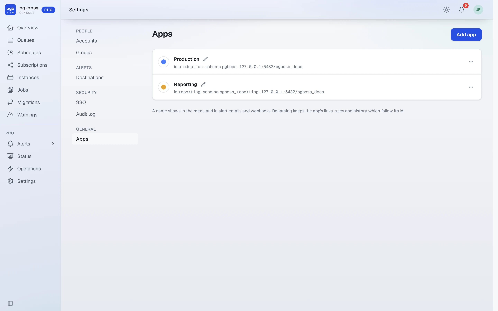
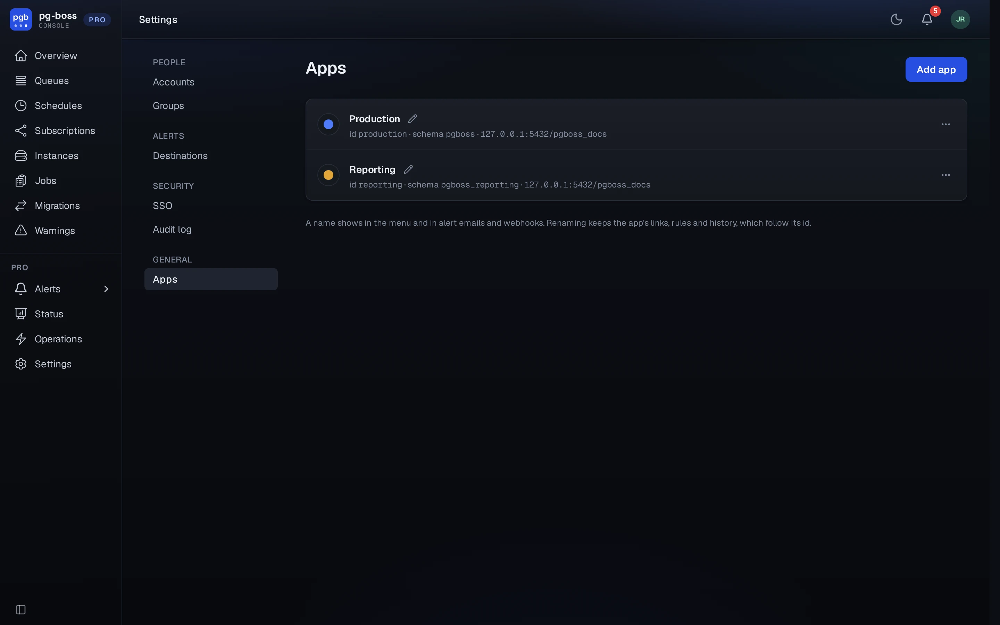

# Apps

An app is one pg-boss schema in one database, such as the pg-boss an application uses in
production. Pro monitors each app added under **Settings › Apps** and reads no list of databases from
its environment.

The Pro Console shows one app at a time. Every page about an app shows its name and a colored dot
at the start of the top bar. With more than one app, a menu there switches between them.

{.light-only}
{.dark-only}

## Adding

**Settings › Apps** is visible only to [global admins](./roles.md#global-admin). A new install has
no apps, and its first global admin is sent to this page. **Add app** asks for:

- **Name**, such as Production or Billing. Pro makes the app's id from the name it is first given,
  such as `production` for Production. The id never changes.
- **Connection**, as one connection string or as separate fields for host, port, database, user,
  password and SSL mode. Connect as the role that owns the pg-boss schema. See
  [app permissions](./install.md#app-permissions).
- **pg-boss schema**, `pgboss` unless the application's pg-boss uses another.

**Test connection** connects and reads the schema's pg-boss version. A schema that doesn't exist yet
is fine, because the application's pg-boss creates it when it first starts. Pro refuses its own
database, and a second app for a pg-boss schema that another app already monitors.

Pro stores each connection encrypted with [`PGBOSS_PRO_SECRET_KEY`](./administration.md#secrets) and
never sends it back to the browser. The list shows each app's host and database without the
password.

## Names and colors

A global admin renames an app with the pencil beside its name. A name saves when you press Enter or
leave the field. A color saves when you pick it. Names show in the app menu, in alert emails and
webhook payloads (`app_name`, beside `app`), and in the audit log. Renaming keeps every link, alert
rule and history row, because they all refer to the app's id.

## Connection changes

**Change connection** in an app's menu replaces the stored connection and its password, such as after
a password rotation or a move to another host. The app's id, rules and history stay.

An app whose connection was saved under an earlier `PGBOSS_PRO_SECRET_KEY` shows **Connection can't be
decrypted** in the list, and a banner on every page names it to global admins. Pro leaves the app out of
every page, alert rule and metric until a global admin enters its connection again with **Change
connection**, or Pro restarts with the earlier key.

## Removal

**Remove** in an app's menu stops monitoring the app and deletes everything Pro keeps about it: its
alert rules with their history, its alerts, role grants on it, its operations and its status
history. The confirmation counts the rules, open alerts and grants first. Open alerts are deleted
without a resolve. Close any incident they opened at its destination. The audit log keeps its
entries. Removing an app changes nothing in the app's database.

## Per app and whole install

Some of the Pro Console is about one app and some about the whole install. A page about one app
shows that app at the start of the top bar. Settings and Profile name the area there instead.

| Per app | Whole install |
| - | - |
| Overview, queues, jobs, schedules, subscriptions | Accounts, groups and access |
| Instances, migrations and warnings | The audit log, which names each entry's app and filters by it |
| Alerts and alert rules, and the bell | Alert destinations, which every app's rules share |
| Status and Operations | Apps and SSO |
| Sending, retrying, cancelling and deleting jobs, and queue and schedule changes | Profile |
| The Pro API at `/pro/api/v1/<app>` | Service accounts and their tokens |

A role is granted for one app or for all apps. The same user can be an operator on one app and a
viewer on another. The Pro Console remembers the last app viewed for 30 days. A page that names no
app, such as Settings, leads back to it.

## Pro queues

Pro runs its own background work on pg-boss queues in the `pgboss` schema of
[Pro's database](./install.md#database-setup). A global admin finds them as **Pro queues** under
**Internal** at the end of the app menu. They aren't an app. A banner on each of their pages says
which database holds them.

- `pgboss-pro-alerts` runs the alert evaluator once a minute.
- Each alert destination has a [send queue](./destinations.md#send-queues), named
  `pgboss-pro-send-` and the destination's id. Its page is titled with the destination's name.

Their pages show rates, wait times and health like any other queue's, because Pro's pg-boss keeps
`persistQueueStats` on. The Pro Console makes no changes to Pro's queues.
