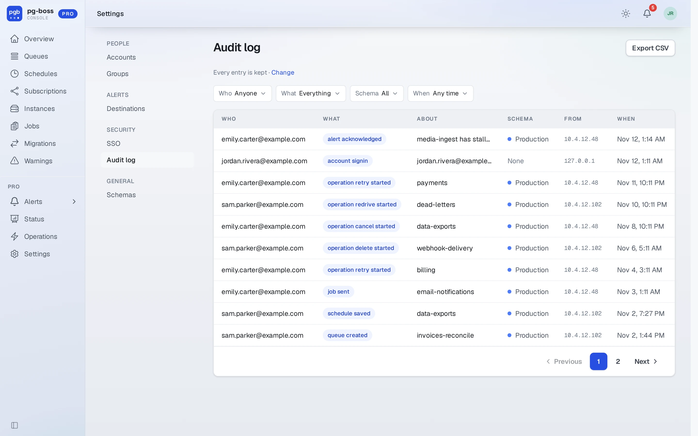
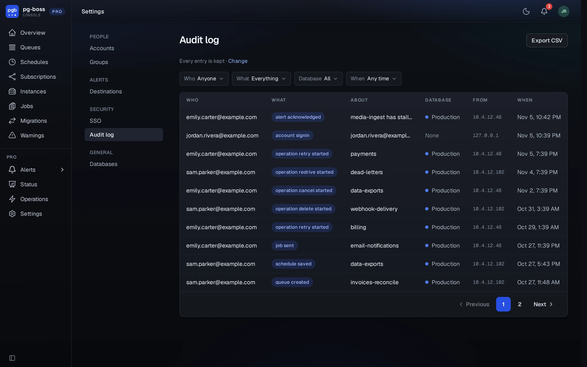
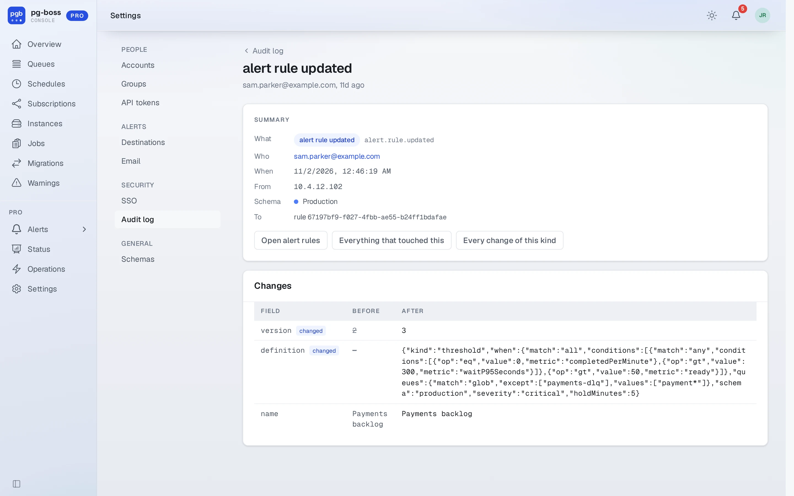
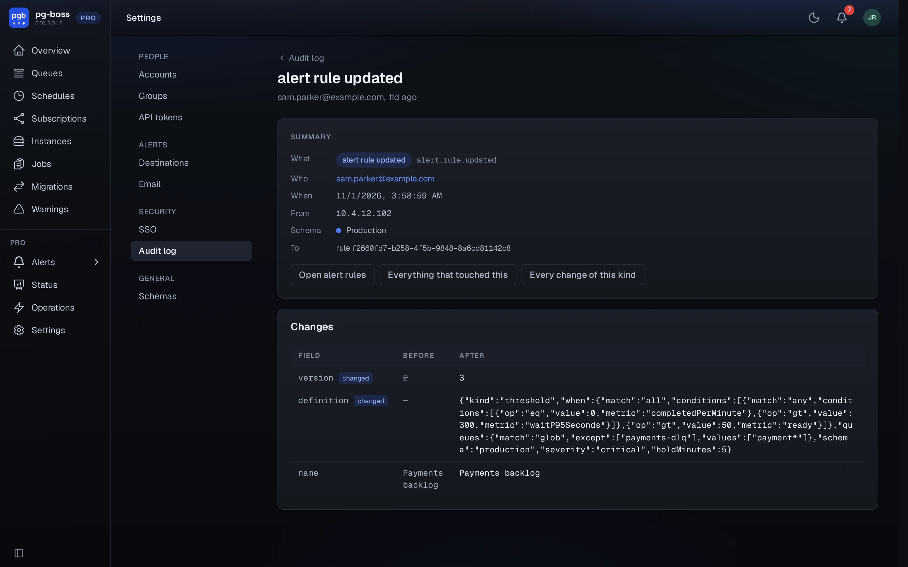

# Audit log

The **Audit log** lists every change made through the Pro Console and the [Pro API](./api.md), newest first, except the job calls a service account isn't [set to record](./api-tokens.md). Each row shows the person or service account that made the change, the change itself, the schema it was made in, and the time. Only [global admins](./roles.md#global-admin) see the page. An entry's page shows the state on either side of the change and the address it came from.

{.light-only}
{.dark-only}

Pro writes each change to the log in the same transaction as the change itself. For a change pg-boss makes, Pro writes the entry first. Pro doesn't make a change it can't record. A refusal leaves no entry claiming otherwise.

{.light-only}
{.dark-only}

- Filter by **Who** made the change (a person or a service account), **What** kind of change it was (jobs and queues, alerts, accounts and tokens, groups, sign-ins, settings, Pro API calls, one or several), the **Schema** it was made in, and **When** (the last 24 hours, 7, 30 or 90 days). **No schema** shows the changes that belong to no single schema, such as accounts, groups and settings.
- Each filter in force shows as a chip under the filter row and can be removed on its own. A link from another page can also filter by what the entries are about (**About**) or by one exact action. Those filters show as chips too.
- Each row names the change's subject, such as the account, group, rule or queues, and the address it came from.
- **Export CSV** downloads the entries on screen, under the same filters.
- An account's page links to the entries it made (**Activity**) and to its sign-in history. A group's page links to the entries about the group (**History**).
- A change made with an API token names the service account and the token.
- Pro keeps the log forever unless a global admin sets a number of days (30 or more) with **Change** under the page title. See [retention](./administration.md#retention).

## Address

An entry records the address the connection came from. When that connection comes from a trusted proxy, Pro reads the `X-Forwarded-For` header from its right end, where each proxy adds the address it saw. Pro takes the first address there that isn't a trusted proxy. The trusted proxies are loopback unless [`PGBOSS_PRO_TRUSTED_PROXIES`](./environment.md) lists others, such as the address of a proxy in another container. From any other connection the header is ignored. A client can't choose the address recorded.

Behind a proxy that isn't listed, every entry carries the proxy's address. When a private address that isn't listed sends `X-Forwarded-For`, Pro warns once on stderr and names the address to add. Behind a CDN in front of a trusted proxy, the address is the CDN's.

A handler [mounted in another server](./mount.md) is passed a request without its connection. The handler records the `clientIp` each call passes instead. A call without `clientIp` records no address. The sign-in and API token limits count failures against the same address.
