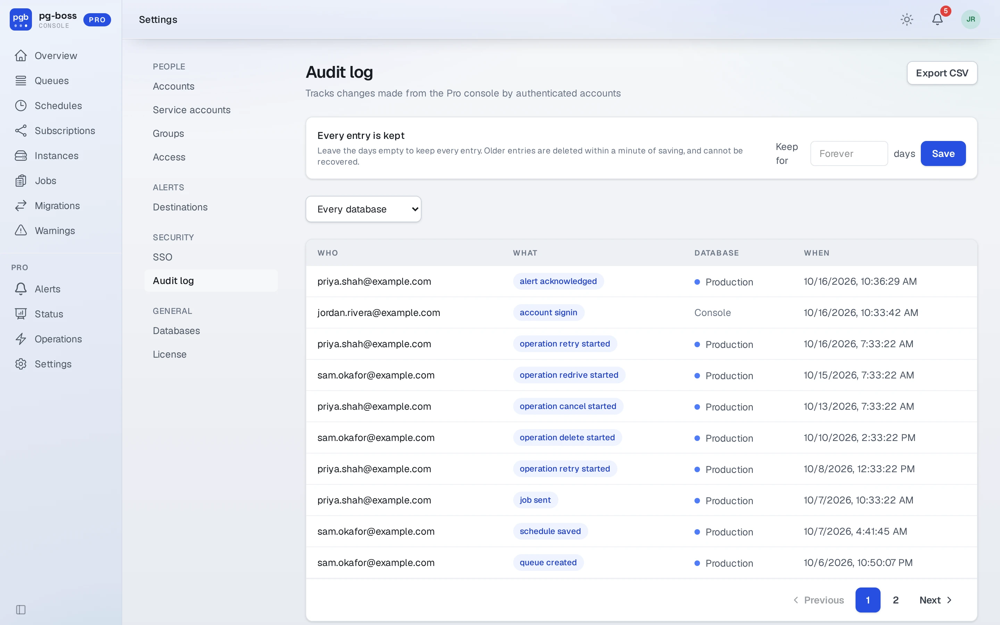
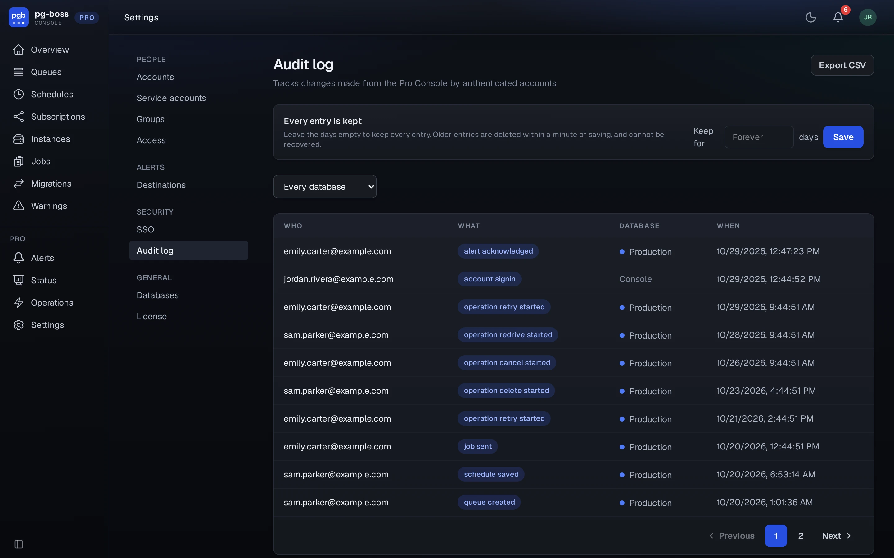
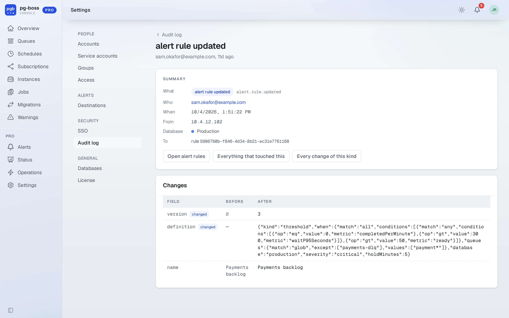
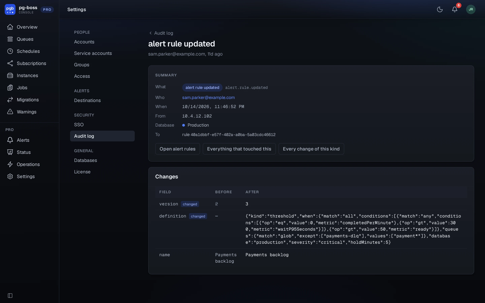

# Audit log

`/pro/audit` lists every change made through the console and the API, newest first: who made it, what it was, the database it was made in, and when. An entry's page shows the state on either side of the change and the address it came from.

{.light-only}
{.dark-only}

Pro writes each change to the log in the same transaction as the change itself. For a change pg-boss makes, it writes the entry first. Pro doesn't make a change it can't record, and a refusal leaves no entry claiming otherwise.

{.light-only}
{.dark-only}

- Filter by database. **Console-wide only** shows the changes that belong to no single database, such as accounts, groups and settings.
- **Export CSV** downloads the entries on screen, under the same filters.
- A change made with an API token names the service account and the token.
- Pro keeps the log forever unless an administrator sets a number of days, 30 or more, on the same page. See [retention](./administration.md#retention).

Only an administrator over every database can open the log.
