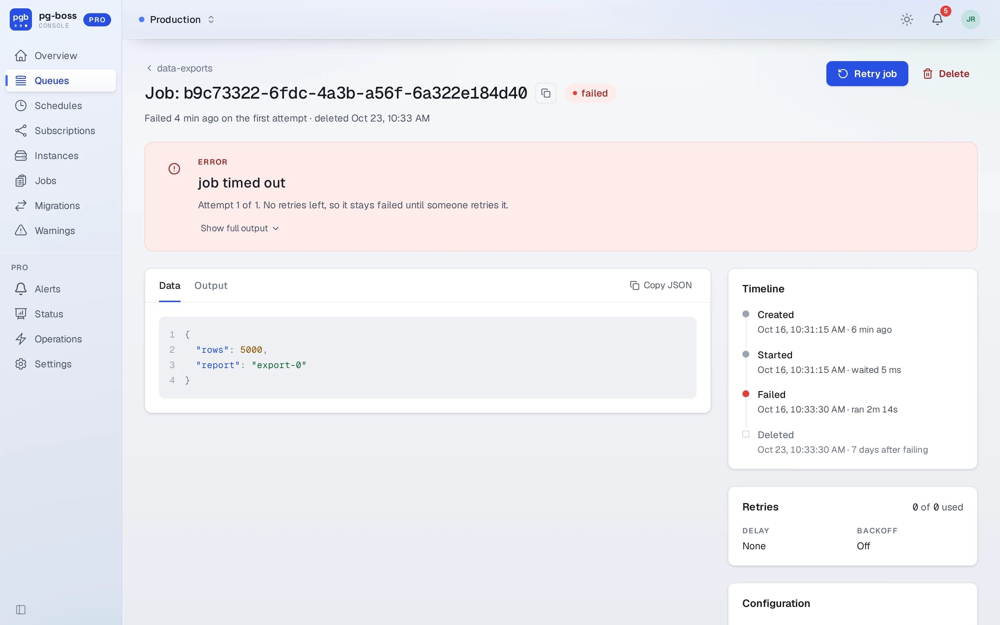
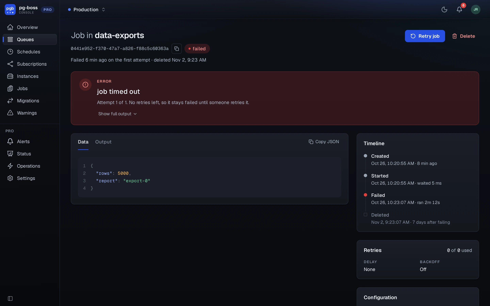

# Jobs and queues

The free dashboard only reads. Pro adds the changes below. It checks each one against the person's [role](./roles.md) on the database, records it in the [audit log](./audit-log.md) before it runs, and makes it through pg-boss itself. If Pro can't record a change, it doesn't make it.

{.light-only}
{.dark-only}

| Change | Where | Needs |
| - | - | - |
| Send a job | **Send Job** on the overview | operator |
| Retry, cancel, resume a job | a job's page, and the job lists | operator |
| Delete a job | a job's page, and the job lists | admin |
| Create a queue | **Create Queue** on the queues page | admin |
| Delete a queue | a queue's page | admin |
| Add or remove a schedule | **New Schedule**, a schedule's page | admin |

For many jobs at once, use [Operations](./operations.md).

On a database whose pg-boss schema is not the one this Pro is built for, these controls are gone and a banner says why. See [pg-boss versions](./versions.md).
