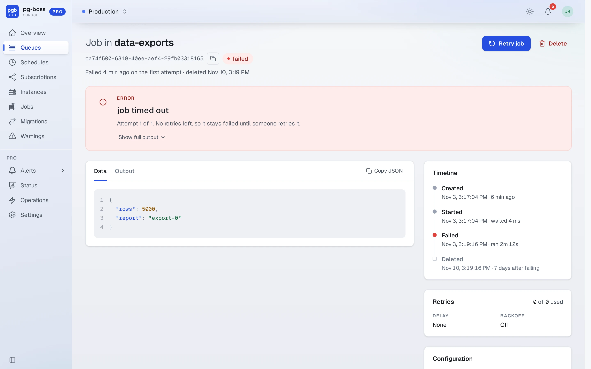
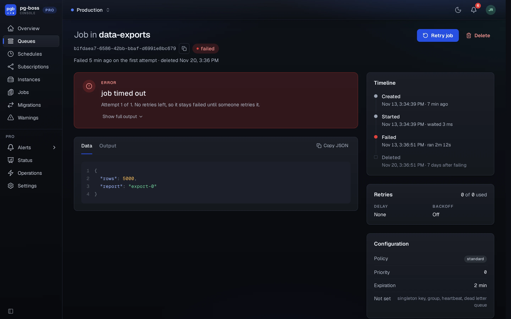

# Jobs and queues

The dashboard sends, retries, cancels, resumes and deletes jobs, and adds and removes schedules. It records nothing about who made a change. Pro makes the same changes and adds the queue changes below. It checks each change against the user's [role](./roles.md) on the schema and records the change in the [audit log](./audit-log.md) before making it through pg-boss itself. If Pro can't record a change, it doesn't make it.

{.light-only}
{.dark-only}

| Change | Where | Needs |
| - | - | - |
| Send a job | **Send Job** on the overview, the jobs page and a queue's page | operator |
| Retry, cancel, resume a job | a job's page, and the job lists | operator |
| Delete a job | a job's page, and the job lists | admin |
| Create a queue | **Create Queue** on the queues page | admin |
| Delete a queue | a queue's page | admin |
| Add or remove a schedule | **Schedule Job** on the schedules page, a schedule's page | admin |

For many jobs at once, use [Operations](./operations.md).

On a schema that isn't on the version this Pro is built for, these controls are gone and a banner names the schema's version and the version this Pro is built for. See [pg-boss versions](./versions.md).
