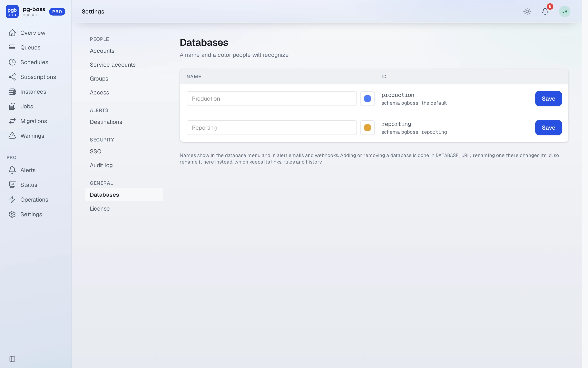
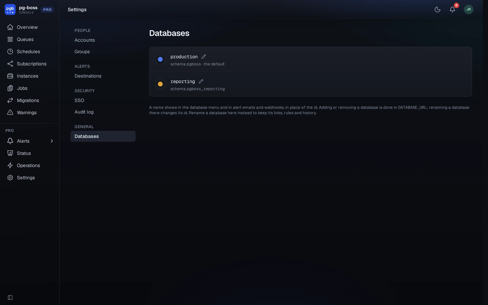

# Databases

Pro shows one connected database at a time. Every page about a database names it, with a colored
dot, at the start of the top bar. When `DATABASE_URL` lists more than one database, a menu
there switches between them.

`/pro/databases` lists each one by its id, and the pencil beside it gives it a
friendly name, such as Production or Test. A name saves when you press Enter or
leave the field, a color when you pick it, and an empty name shows the id again.
Names show in the database menu, in alert emails and webhook
payloads (`databaseName`, beside `databaseId`), and in the audit log. Renaming
here keeps every link, alert rule and history row, because they all refer to the
database's id, which comes from its name in `DATABASE_URL`. Renaming it there
changes the id, so rename it here instead. Adding or removing a database still happens in
`DATABASE_URL`. Only a [global admin](./roles.md#global-admin) can change these.

{.light-only}
{.dark-only}

Some of the Pro Console is about one database and some about the whole install. A page
about one database shows that database at the start of the top bar; Settings and
Profile name the area there instead.

| Per database | Console-wide |
| - | - |
| Overview, queues, jobs, schedules, subscriptions | Accounts, groups and access |
| Instances, migrations and warnings | The audit log, which names each entry's database and filters by it |
| Alerts and alert rules, and the bell | Alert destinations, which every database's rules share |
| Status and Operations | Databases, SSO and the license |
| Sending, retrying, canceling and deleting jobs, and queue and schedule changes | Profile |
| The API at `/pro/api/v1/<database>` | Service accounts and their tokens |

A role is granted for one database or for all databases, so the same person can be an
operator on one and a viewer on another. The Console remembers the last database
viewed for 30 days, so a page that names none, such as Settings, leads back to it.
