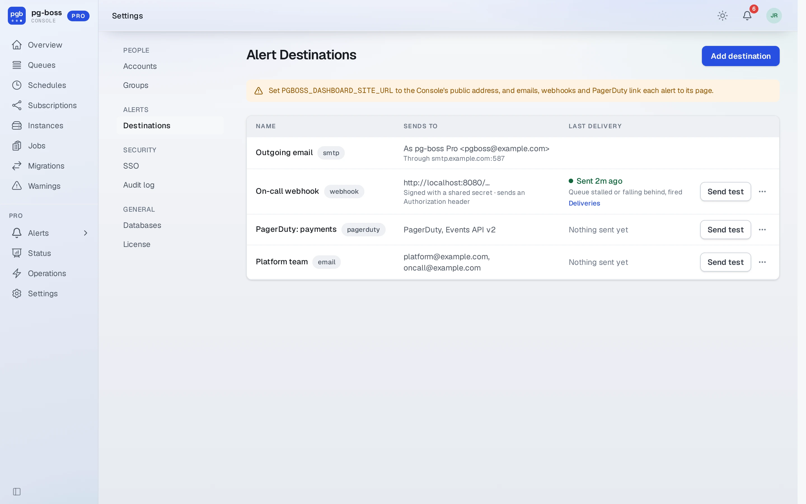
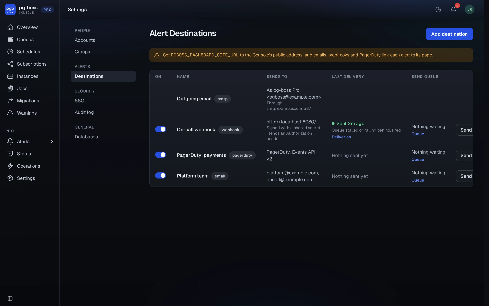

# Destinations

Destinations live in Settings (`/pro/destinations`) and are shared by the rules of every
database. A destination is an email, a webhook, or PagerDuty. **Send
test** sends a sample alert that fires and then resolves, to show the
receiver handling both.

Each destination's row shows its last delivery: when it went and whether it was
sent. For a failed delivery, the row also shows the receiver's response and how many deliveries failed in a row.
**Deliveries** opens every attempt to that destination (tests included) newest
first, or only its failures. An alert's own page shows the deliveries made for
it.

{.light-only}
{.dark-only}

Pro sends every alert to its destinations when it fires and again when it
closes, whichever way it closes: the condition ended, a user resolved it, an event
expired, or its rule changed, was turned off or was deleted. Acknowledging an event also sends
the resolve, while the event stays open in Pro. A resolve goes once, and only
to the destinations the fire went to. A fire or resolve that fails to send is tried again on
each evaluation pass until it goes or has had five attempts in all.

**Links in alerts.** Emails, webhooks and PagerDuty link each alert to its page
when Pro knows the Console's public address. Pro builds that address from [`PGBOSS_DASHBOARD_SITE_URL`](../dashboard.md#reverse-proxy),
or `siteUrl` for a [mounted handler](./mount.md), plus the base path. Without
that address, the notifications carry no link. The page shows which address the links use.

## Email

Email goes out through SMTP or Resend. Both are configured on the same page. Changing the
SMTP host, port, user or TLS setting needs the password entered again. Pro
requires STARTTLS unless the connection is TLS from the start or the server is
on this machine, so the password and messages never cross the network in the
clear. For an internal relay without TLS, **Send without TLS when the server offers none**
turns off the STARTTLS requirement.

## Webhook

Pro stores a webhook's URL encrypted, since receivers often keep their token in
the path or the query. The page and the audit log show only the URL's origin. The
edit form leaves its URL field blank. Leave the field blank to keep the URL, or enter a
new URL. A new URL on another host needs the signing secret and Authorization
header entered again or removed, so a stored secret never goes to a host it
wasn't entered for.

Pro sends one alert per request, as a POST with version 4 of
[Prometheus Alertmanager's webhook body](https://prometheus.io/docs/alerting/latest/configuration/#webhook_config). An on-call tool that takes Alertmanager can
receive Pro's alerts with no relay:

```json
{
  "version": "4",
  "groupKey": "<alert id>",
  "status": "firing",
  "receiver": "<destination name>",
  "groupLabels": { "alertname": "Queue stalled or falling behind" },
  "commonLabels": { "...": "the alert's labels" },
  "commonAnnotations": { "...": "the alert's annotations" },
  "externalURL": "https://console.example.com/pgboss",
  "truncatedAlerts": 0,
  "alerts": [{
    "status": "firing",
    "labels": {
      "alertname": "Queue stalled or falling behind",
      "severity": "critical",
      "database": "pgboss",
      "database_name": "Production",
      "queue": "payments",
      "kind": "stalled",
      "rule_id": "…",
      "rule_version": "3",
      "rule_version_id": "…",
      "source": "pgboss-pro"
    },
    "annotations": { "summary": "payments is stalled", "description": "Nothing has finished for 10 minutes." },
    "startsAt": "2026-10-14T21:00:00Z",
    "endsAt": "0001-01-01T00:00:00Z",
    "generatorURL": "https://console.example.com/pgboss/pro/alerts/<alert id>",
    "fingerprint": "<alert id>"
  }],
  "pgboss": { "alertId": "…", "ruleId": "…", "ruleVersion": 3, "...": "the alert's typed data" }
}
```

- `fingerprint` and `groupKey` are the alert's id, so they're the same on every
  send for one alert. A receiver dedupes on them. A resolve has
  `status: "resolved"`, the closing time in `endsAt` and the reason in
  `pgboss.closedReason`.
- `summary` is the title the alert opened with. It stays the same when the
  alert's title changes with what the check finds, say from falling behind to stalled.
  The description then starts with `Now:` and the current title. Receivers that match a
  resolve to its alert by the summary (GoAlert, for example) close what they opened.
- `severity` is `critical`, or `warning` for a rule whose severity is watch.
- Labels hold strings only. `pgboss` holds the typed data each kind of alert adds,
  for a receiver written for Pro. A receiver written for Alertmanager ignores it.
- **Signing secret**, optional: every request then carries
  `pgboss-signature: t=<unix seconds>,v1=<hex>`, an HMAC-SHA256 of
  `timestamp.body`. Verify the signature the same way as a Stripe webhook, and reject
  anything whose timestamp isn't recent:

  ```js
  import { createHmac, timingSafeEqual } from 'node:crypto'

  function verified (secret, body, header) {
    const { t, v1 } = Object.fromEntries(header.split(',').map((part) => part.split('=')))
    if (Math.abs(Date.now() / 1000 - Number(t)) > 300) return false
    const expected = createHmac('sha256', secret).update(`${t}.${body}`).digest()
    const given = Buffer.from(v1, 'hex')
    return expected.length === given.length && timingSafeEqual(expected, given)
  }
  ```

- **Authorization header**, optional: Pro sends it as it is, for a receiver that
  takes a token (`Bearer …`). Pro stores it encrypted, like the signing secret,
  and never shows it again once saved.

## PagerDuty

Pro posts to PagerDuty's Events API v2 with the integration key of an Events API
v2 integration on the service to page. Each alert triggers one incident,
which PagerDuty deduplicates by the alert's id. Pro resolves the incident when the alert closes. The
incident's summary is the alert's title, its source is the database's name, and
its severity is `critical` or `warning`. Its details hold the alert's why, rule
and data, with a link to the alert once the Console's address is set. Pro stores
the key encrypted, and records a key PagerDuty refuses as a failed delivery.

Secrets need `PGBOSS_PRO_SECRET_KEY`. See [Secrets](./administration.md#secrets).
