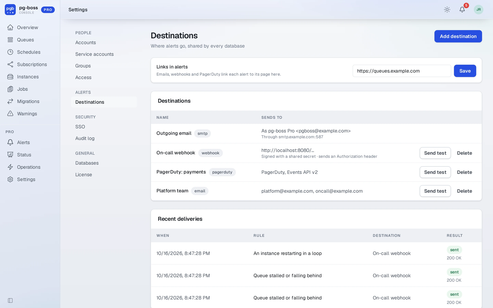
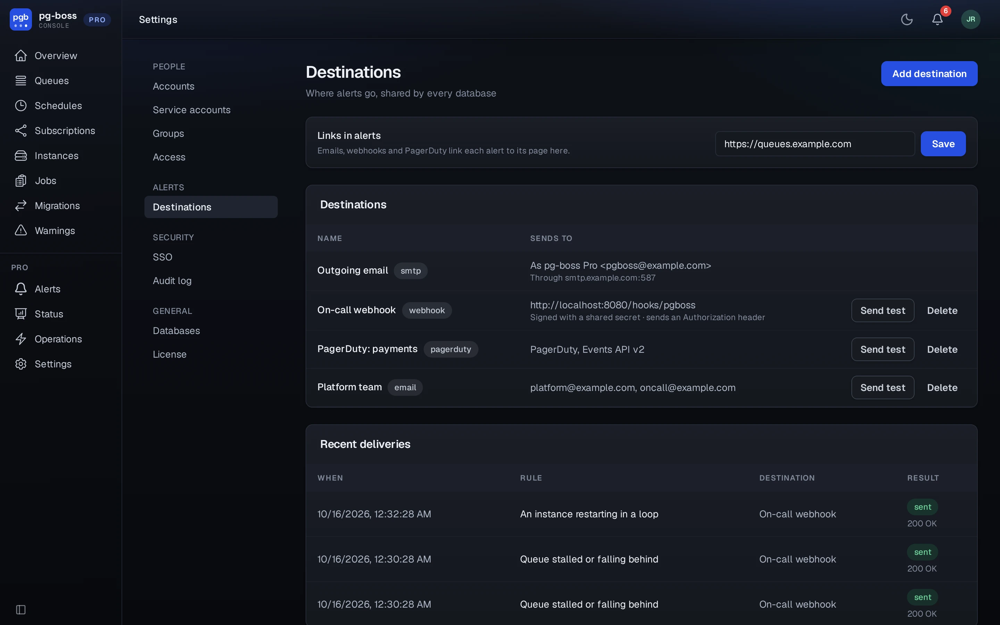

# Destinations

Destinations live in Settings (`/pro/destinations`), and the rules of every
database share them. A destination is an email, a webhook, or PagerDuty. **Send
test** sends a sample alert that fires and then resolves, to show the
receiver handling both. The page lists every attempt, tests included, with what the
far end said.

{.light-only}
{.dark-only}

Pro sends every alert to its destinations when it fires and again when it
closes, whichever way it closes: the condition ended, a user resolved or acknowledged an event, an event
expired, or its rule changed, was turned off or was deleted. A resolve goes only
where the fire went, once.

**Links in alerts.** Emails, webhooks and PagerDuty link each alert to its page
when Pro knows its public address: [`PGBOSS_DASHBOARD_SITE_URL`](../dashboard.md#reverse-proxy),
or `siteUrl` for a [mounted handler](./mount.md), with the base path added. Without
it, they carry no link. The page shows which address the links use.

## Email

Email goes out through SMTP or Resend, configured on the same page.

## Webhook

Pro stores a webhook's URL encrypted, since receivers often keep their token in
the path or the query. The page and the audit log show only its origin, and the
edit form leaves its URL field blank. Leave it blank to keep the URL, or enter a
new one.

Pro sends a POST with [Prometheus Alertmanager's webhook body](https://prometheus.io/docs/alerting/latest/configuration/#webhook_config),
version 4, one alert per request. An on-call tool that takes Alertmanager can
receive Pro's alerts with no relay:

```json
{
  "version": "4",
  "groupKey": "<alert id>",
  "status": "firing",
  "receiver": "<destination name>",
  "groupLabels": { "alertname": "Queue stalled or falling behind" },
  "commonLabels": { "...": "the alert's labels" },
  "commonAnnotations": { "...": "the alert's annotations" },
  "externalURL": "https://console.example.com/pgboss",
  "truncatedAlerts": 0,
  "alerts": [{
    "status": "firing",
    "labels": {
      "alertname": "Queue stalled or falling behind",
      "severity": "critical",
      "database": "pgboss",
      "database_name": "Production",
      "queue": "payments",
      "kind": "stalled",
      "rule_id": "…",
      "rule_version": "3",
      "rule_version_id": "…",
      "source": "pgboss-pro"
    },
    "annotations": { "summary": "payments is stalled", "description": "Nothing has finished for 10 minutes." },
    "startsAt": "2026-10-14T21:00:00Z",
    "endsAt": "0001-01-01T00:00:00Z",
    "generatorURL": "https://console.example.com/pgboss/pro/alerts/<alert id>",
    "fingerprint": "<alert id>"
  }],
  "pgboss": { "alertId": "…", "ruleId": "…", "ruleVersion": 3, "...": "the alert's typed data" }
}
```

- `fingerprint` and `groupKey` are the alert's id, so they're the same on every
  send for one alert, and a receiver dedupes on them. A resolve has
  `status: "resolved"` and the time it closed in `endsAt`, and
  `pgboss.closedReason` says why.
- `summary` is the title the alert opened with. It stays the same when the
  alert's title changes with what it finds, say from falling behind to stalled,
  and the description then starts with the current title. Receivers that match a
  resolve to its alert by the summary, such as GoAlert, close what they opened.
- `severity` is `critical`, or `warning` for a rule whose severity is watch.
- Labels hold strings only. `pgboss` holds what each kind of alert adds, typed,
  for a receiver written for Pro. A receiver written for Alertmanager ignores it.
- **Signing secret**, optional: every request then carries
  `pgboss-signature: t=<unix seconds>,v1=<hex>`, an HMAC-SHA256 of
  `timestamp.body`. Verify it the same way as a Stripe webhook, and reject
  anything whose timestamp isn't recent:

  ```js
  import { createHmac, timingSafeEqual } from 'node:crypto'

  function verified (secret, body, header) {
    const { t, v1 } = Object.fromEntries(header.split(',').map((part) => part.split('=')))
    if (Math.abs(Date.now() / 1000 - Number(t)) > 300) return false
    const expected = createHmac('sha256', secret).update(`${t}.${body}`).digest()
    const given = Buffer.from(v1, 'hex')
    return expected.length === given.length && timingSafeEqual(expected, given)
  }
  ```

- **Authorization header**, optional: Pro sends it as it is, for a receiver that
  takes a token (`Bearer …`). Pro stores it encrypted, like the signing secret,
  and never shows it again once saved.

## PagerDuty

Pro posts to PagerDuty's Events API v2 with the integration key of an Events API
v2 integration on the service to page. Each alert triggers one incident,
deduplicated by the alert's id, and resolves it when the alert closes. The
incident's summary is the alert's title, its source is the database's name, and
its severity is `critical` or `warning`. Its details hold the alert's why, rule
and data, with a link to the alert once the Console's address is set. Pro stores
the key encrypted, and records a key PagerDuty refuses as a failed delivery.

Secrets need `PGBOSS_PRO_SECRET_KEY`. See [Secrets](./administration.md#secrets).
