

# pg-boss Pro

pg-boss Pro is built for teams running pg-boss in production. It has two components, the Pro Console in the browser and the Pro API over HTTP. In the Pro Console, users make changes such as creating queues and jobs or modifying schedules, as their [role](./roles.md) allows, and every change is recorded in the audit log. Through the Pro API, scripts, CI jobs and other systems call pg-boss's methods using an API token. Pro also adds enhanced health monitoring and a configurable rules engine, which can alert whoever is on call by email, webhook or a paging service, so a stalled queue is caught before it turns into an outage.

Pro is built and supported by the author of pg-boss, and upgrading from the [free dashboard](../dashboard.md) is a change of package name, from `@pg-boss/dashboard` to `@pg-boss/pro`.

{.light-only}
{.dark-only}

  <figure>
    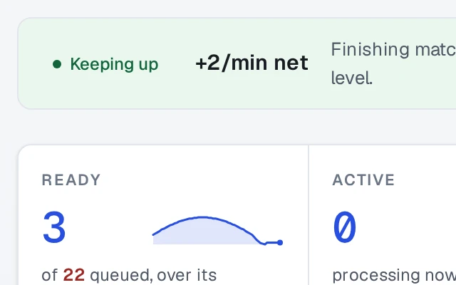
    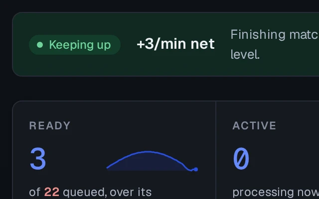
    <figcaption><a href="/pro/queues#health">Queue health</a>From throughput history, with wait and run times and time to drain.</figcaption>
  </figure>
  <figure>
    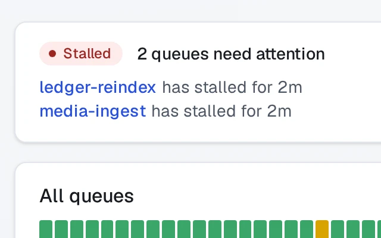
    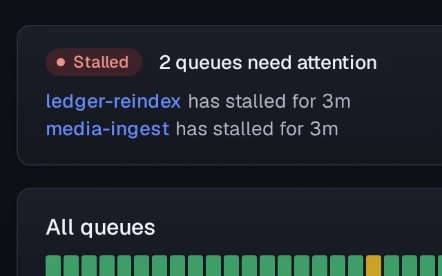
    <figcaption><a href="/pro/status">Status page</a>Each queue's health day by day, with the incidents on each day.</figcaption>
  </figure>
  <figure>
    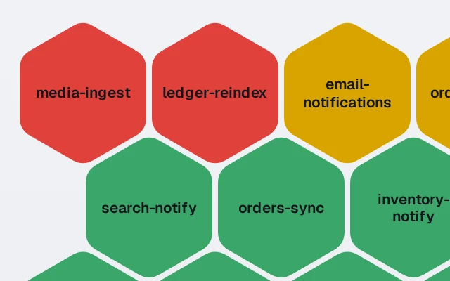
    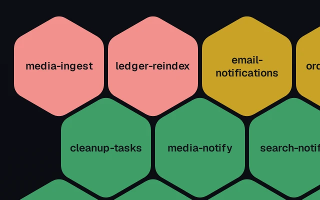
    <figcaption><a href="/pro/queues#hex-view">Hex view</a>Condensed queue health view, up to 500 at once.</figcaption>
  </figure>
  <figure>
    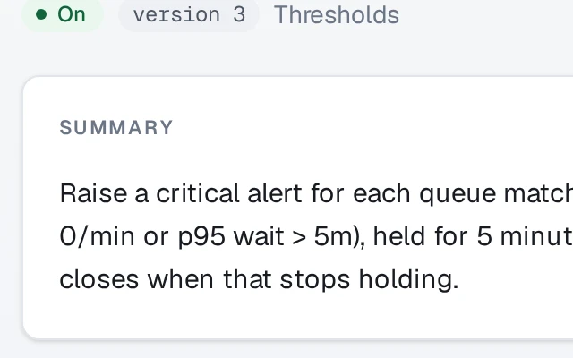
    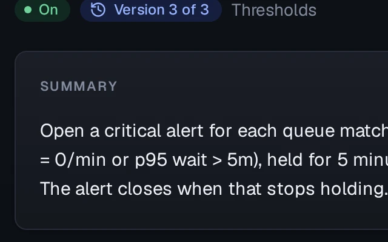
    <figcaption><a href="/pro/alert-rules">Alert rules</a>Stalls, backlogs and failures, sent by email, a webhook or a paging service.</figcaption>
  </figure>
  <figure>
    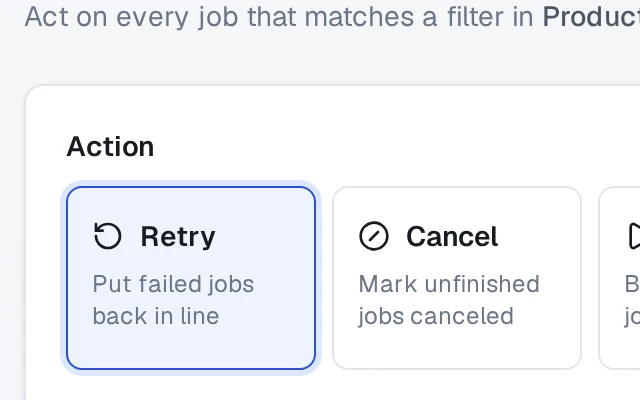
    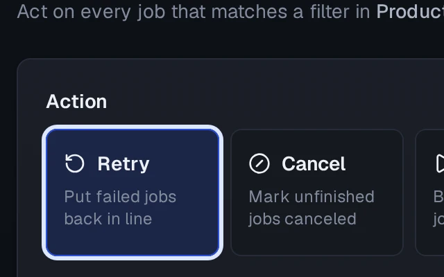
    <figcaption><a href="/pro/operations">Batch operations</a>Across multiple queues, including dead letter redrive.</figcaption>
  </figure>
  <figure>
    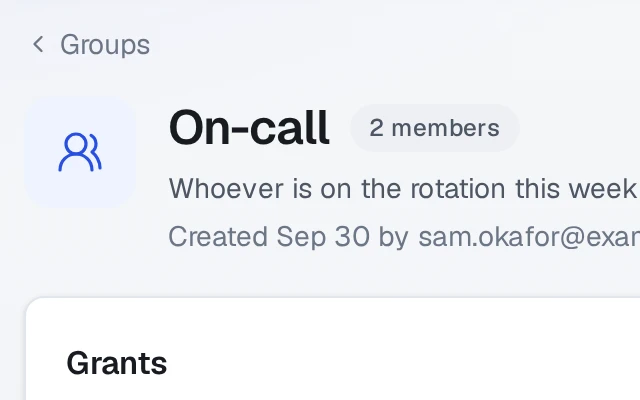
    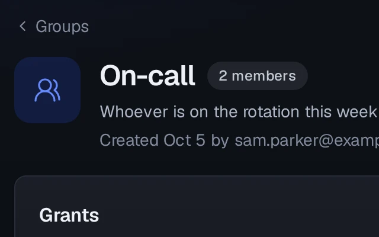
    <figcaption><a href="/pro/accounts#groups">Groups and roles</a>Accounts and groups, with roles per database.</figcaption>
  </figure>

## Features

Pro includes every page of the free dashboard. In Pro, roles, alert rules, the Pro API and metrics are set per connected database.

| Feature | Free dashboard | Pro |
| - | :-: | :-: |
| Overview and queues, with each queue's status and its counts over time | ✓ | ✓ |
| Jobs, filtered by state, queue and payload, with each job's details | ✓ | ✓ |
| Schedules, subscriptions and warnings | ✓ | ✓ |
| Registered pg-boss instances | ✓ | ✓ |
| Background migration status | ✓ | ✓ |
| [Multiple connected databases or schemas](./databases.md), such as Production and Staging, each with a name and a color | ✓ | ✓ |
| Sign-in | One username and password shared by every user, through [basic authentication](../dashboard.md#basic-authentication) | An [account](./accounts.md) for each user, with its own password |
| Mounting in an existing Node server, or under a sub-path | ✓ | ✓ |
| [Send, retry, cancel, resume and delete jobs](./changes.md) | | ✓ |
| [Create and delete queues and schedules](./changes.md) | | ✓ |
| [Batch operations](./operations.md) across multiple queues, including [dead letter redrive](./operations.md#redrive) | | ✓ |
| [Queue health](./queues.md#health) from throughput history, with wait and run times and time to drain | | ✓ |
| Each queue's [live workers](./queues.md#queue-detail) and how much of their capacity is in use | | ✓ |
| A [status page](./status.md) of each queue's health day by day, with the incidents on each day | | ✓ |
| [Instance CPU, memory, connection pool and event loop](./instances.md) | | ✓ |
| [Alert rules](./alert-rules.md) for a queue stalled or falling behind, a queue with no workers, thresholds on a queue's counts, rates and waits, pg-boss warnings, and failed operations | | ✓ |
| Each rule's own thresholds, queues and the time a condition must hold, with [versions](./alert-rules.md#versions) to compare or restore | | ✓ |
| Alerts by email, a webhook in Prometheus Alertmanager's format, or a [paging service](./destinations.md), each told when the alert closes | | ✓ |
| [Groups](./accounts.md), with [roles](./roles.md) per database | | ✓ |
| [Single sign-on](./sso.md) through an existing OpenID Connect provider | | ✓ |
| An [audit log](./audit-log.md) of every change | | ✓ |
| The [Pro API](./api.md), so a deploy script, a CI job or a worker in another language can send, fetch, complete and retry jobs without a Node.js client | | ✓ |
| [API tokens](./api-tokens.md), each with a role that decides which methods it may call | | ✓ |
| [Prometheus metrics](./metrics.md) at `/metrics`, for existing dashboards and alerting to scrape | | ✓ |
| Support from the author of pg-boss | | ✓ |

## Pricing

Pro costs $1,000 a year or $100 a month for one organization, with no limit on users, installations or databases. After twelve months paid in total, an organization that stops paying keeps the right to install and run every version released before the subscription ended. While it lasts, a subscription includes every newer version, and support. See [the license](./license.md).

[Buy Pro](https://buy.polar.sh/polar_cl_YGSAhTFmC6APdILc2m8MtIABaLUbAJjSIjooL0pP4lc). Polar takes the payment and shows the license key on its purchases page.

Pro connects only to the places its configuration names. See [network activity](./network.md).

## Getting started

1. [Install and run](./install.md) it.
2. Open `/setup` and create the first administrator.
3. Give the default alert rules a [destination](./destinations.md), so their alerts send notifications.
