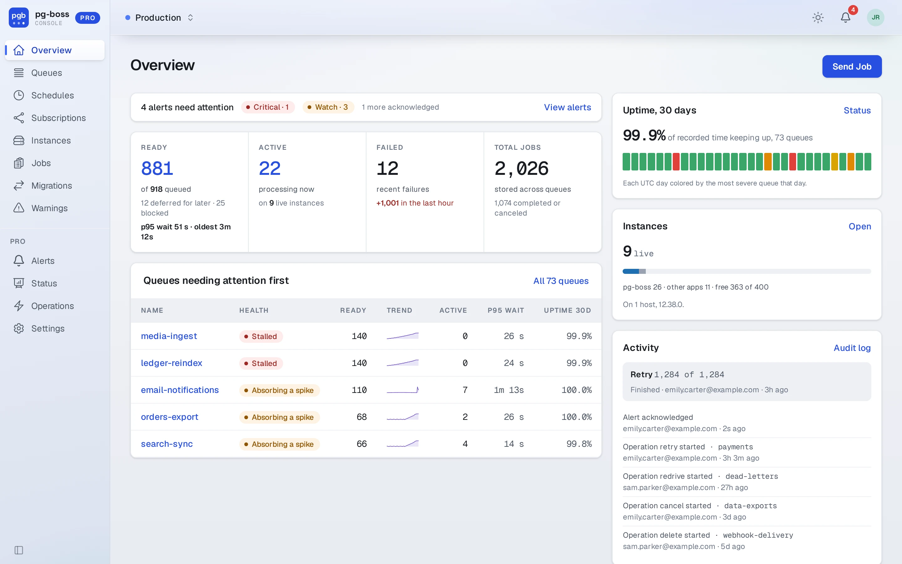
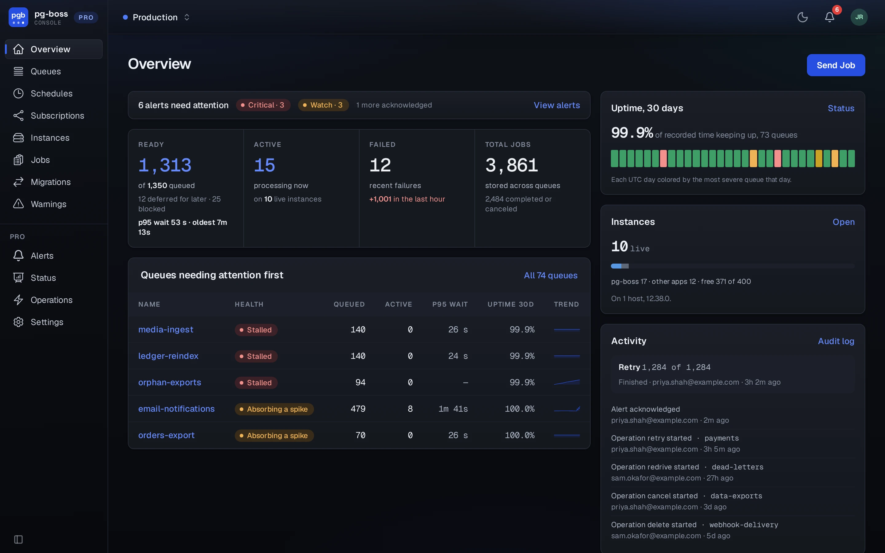

# pg-boss Pro

pg-boss Pro is built for teams running pg-boss in production. It comes in two parts, the Pro Console for your team and the Pro API for automation. In the Pro Console, people send, retry, cancel and delete jobs from the browser as their [role](./roles.md) allows, and an audit log records every change. The Pro API gives scripts, CI jobs and workers in any language token-based access to pg-boss's own methods over HTTP. Pro also watches every queue and alerts whoever is on call by email, webhook or a paging service, so a stalled queue is caught before it turns into an outage.

Pro is built and supported by the author of pg-boss, and upgrading from the [free dashboard](../dashboard.md) is a change of package name, from `@pg-boss/dashboard` to `@pg-boss/pro`.

{.light-only}
{.dark-only}

## Features

- One install of Pro watches every pg-boss database you run, such as Production and Staging. Each [connected database](./databases.md) gets a name and a color, and roles, alert rules, the Pro API and metrics are all set per database.
- From the Console, you can send, retry, cancel, resume and delete jobs, create and delete queues and schedules, and run [Operations](./operations.md) over every job a filter matches. Access is role-based per database, and people can sign in with [single sign-on](./sso.md) through your existing OpenID Connect provider.
- The [Pro API](./api.md) serves pg-boss's own methods per connected database, so a deploy script, a CI job or a worker written in another language can send, fetch, complete and retry jobs without a Node.js client. Each call carries an [API token](./api-tokens.md), and the token's role decides which methods it may call.
- [Alert rules](./alert-rules.md) decide what is an alert: a queue stalled or falling behind, nobody working a queue, a threshold on a queue's counts, rates and waits, pg-boss warnings, or an operation that failed. Alerts reach email, a webhook in Prometheus Alertmanager's format, or a [paging service](./destinations.md), and Pro tells the destination when each alert closes. You tune each rule's thresholds, queues and how long a condition must hold, and Pro keeps every change to a rule as a [version](./alert-rules.md#versions) you can compare with the current one or go back to.
- Pro shows each queue's throughput, wait and run times, time to drain, and whether it's keeping up. It also shows [ninety days of status](./status.md) and the [instances](./instances.md) working each queue.
- [Accounts and groups](./accounts.md) get [roles](./roles.md) per database, and an [audit log](./audit-log.md) records every change.
- Pro serves [Prometheus metrics](./metrics.md) at `/metrics`, for the dashboards and alerting you already run.

## Pricing

Pro costs $1,000 a year or $100 a month for one organization, with no limit on people, installations or databases. If you stop paying after twelve months paid in total, the versions released before the subscription ended stay yours to install and run. While it lasts, a subscription gets you every newer version, and support. See [the license](./license.md).

[Buy Pro](https://buy.polar.sh/polar_cl_YGSAhTFmC6APdILc2m8MtIABaLUbAJjSIjooL0pP4lc). Polar takes the payment and shows your license key on your purchases page.

Pro sends nothing anywhere you haven't configured. See [network activity](./network.md).

## Getting started

1. [Install and run](./install.md) it.
2. Open `/setup` and create the first administrator.
3. Give the default alert rules a [destination](./destinations.md), so their alerts reach somebody.
