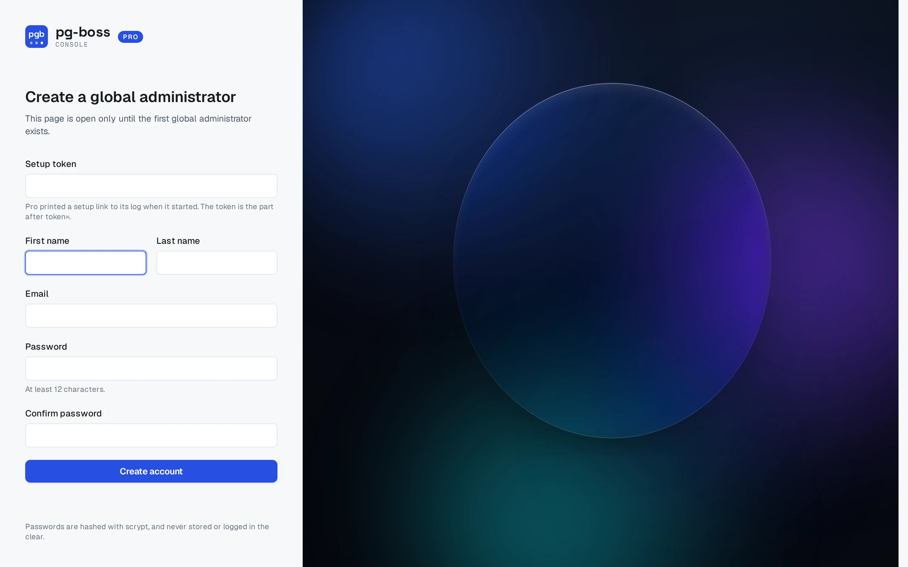
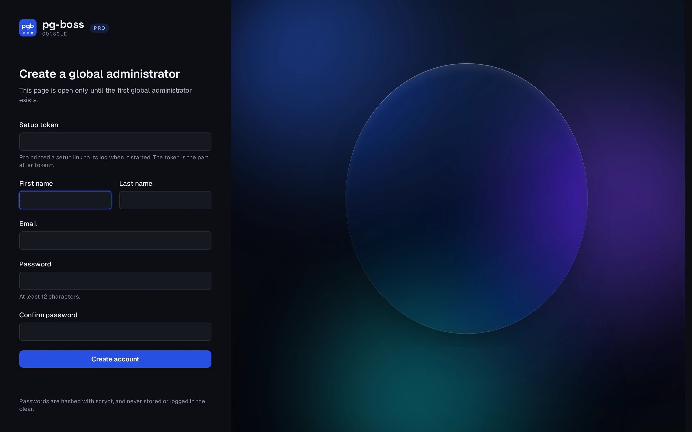

# Install and run

## Requirements

- Node.js 22.12 or later.
- A Postgres database for Pro.
- pg-boss 12.36 or later in each schema Pro monitors. The schemas are added in the Pro Console once Pro is running. See [Schemas](./schemas.md) and [pg-boss versions](./versions.md).
- A [Pro subscription](https://buy.polar.sh/polar_cl_YGSAhTFmC6APdILc2m8MtIABaLUbAJjSIjooL0pP4lc), which comes with a license key.

## Install

Pro is installed from a private registry, not from npmjs. To create a project for Pro, install Pro and start it, run:

```bash
npm init @pg-boss/pro
```

The command asks for the license key and for Pro's database, which is either an existing database or a new one it creates from an admin connection. It doesn't keep the admin connection. It then:

1. Checks the license key with the registry.
2. Points the project's `.npmrc` at Pro's registry, and saves the license key in the user's npm config, as `npm login` does.
3. Writes `.env` with Pro's database, a new secret key and a setup token. `.gitignore` keeps the file out of version control.
4. Installs Pro, starts it and opens the setup page, where you create the first global administrator.

Keep a copy of `PGBOSS_PRO_SECRET_KEY` from `.env` in another secret store, because Pro's database backups don't hold it. See [Backup](#backup).

To run it without prompts, as in a script, pass the answers after `--`:

```bash
npm init @pg-boss/pro -- pgboss-pro --yes --license "<your license key>" \
  --database-url "postgres://pgboss_pro:<password>@localhost:5432/pgboss_pro" --no-start
```

`--admin-url` in place of `--database-url` creates the database. `--token-in-env` leaves the user's npm config alone and has the project's `.npmrc` read the license key from `PGBOSS_PRO_LICENSE`, as a CI runner needs. `npm init @pg-boss/pro -- --help` lists every option.

Pro runs as its own server, apart from your application's. To serve it under a path of an existing site, such as `https://example.com/admin/queues`, put it behind that site's reverse proxy and set [`PGBOSS_PRO_BASE_PATH`](./environment.md#pgboss-pro-base-path) to the path.

## Install by hand

To set up the project yourself, point npm at Pro's registry:

```bash
npm init -y
npm config set --location=project //npm.pgboss.io/:_authToken '${PGBOSS_PRO_LICENSE}'
npm config set --location=project @pg-boss:registry https://npm.pgboss.io
```

The `npm config set` commands above create a `.npmrc` file and refer to the environment variable `PGBOSS_PRO_LICENSE`, which is your license key. The license key is shown on the purchases page of the Polar account that bought the subscription.

Then, assign the environment variable and install:

```bash
PGBOSS_PRO_LICENSE="<your license key>" \
npm install @pg-boss/pro
```

Then create Pro's database, set its configuration and start it, as the next sections describe.

## Database setup

Pro keeps its accounts, rules, alerts and audit log in a database of its own. Create it, owned by the role Pro connects to it as:

```sql
CREATE ROLE pgboss_pro LOGIN PASSWORD '<password>';
CREATE DATABASE pgboss_pro OWNER pgboss_pro;
```

Pro uses pg-boss internally to run its alert evaluator and send notifications. Pro's own tables go in `public` and pg-boss uses its default schema `pgboss`. As the database's owner, the role has the permissions to create Pro's tables and run the migrations in later upgrades.

## Configuration

Pro reads these settings at startup:

| Variable | Needed | What |
| - | - | - |
| `PGBOSS_PRO_DB_HOST` | Always | The host of Pro's database. |
| `PGBOSS_PRO_DB_PASSWORD` | Always | The password of the role Pro connects to its database as. |
| `PGBOSS_PRO_SECRET_KEY` | Always | The encryption key. This is used to encrypt secrets such as each schema's connection settings, webhook URLs, and email password. This should be at least 32 characters. You can generate one with `openssl rand -base64 32`. |
| `PGBOSS_PRO_SITE_URL` | In production | The public address of the Pro Console and Pro API. Without it, emails, webhooks and PagerDuty carry no link to the alert. Behind a reverse proxy that ends HTTPS, actions need it too. See [reverse proxy](../dashboard.md#reverse-proxy). |
| `PGBOSS_PRO_TRUSTED_PROXIES` | Behind a reverse proxy on another host | The reverse proxy's address. Pro then reads each client's address from `X-Forwarded-For`, for sign-in limits and the [audit log](./audit-log.md#address). |
| `PGBOSS_PRO_SETUP_TOKEN` | With several instances behind a load balancer | One setup token the instances share, set before the first start. The setup link then works on every instance. |

Store the encryption key in another secret store. Rotating the secret key requires entering all secrets again. Without `PGBOSS_PRO_SECRET_KEY`, Pro logs an error at startup and serves no pages. See [secrets](./administration.md#secrets).

Pro doesn't read `DATABASE_URL`, which the dashboard reads. The schemas Pro monitors are added in the Pro Console. See [Schemas](./schemas.md).

The other settings for Pro's database default to the role and database above:

| Setting | Default |
| - | - |
| `PGBOSS_PRO_DB_PORT` | `5432` |
| `PGBOSS_PRO_DB_DATABASE` | `pgboss_pro` |
| `PGBOSS_PRO_DB_USER` | `pgboss_pro` |
| `PGBOSS_PRO_DB_SSLMODE` | |

`PGBOSS_PRO_DB_CONNECTION_STRING` replaces them all, for a host that gives out a connection string. [Environment variables](./environment.md) lists every variable.

## Schema permissions

In each pg-boss schema it monitors, Pro reads what its pages show and makes changes through pg-boss's own methods, such as `createQueue()`, `retry()` and `deleteJob()`. Pro doesn't install pg-boss in a schema's database, supervise it, run its schedules or migrate it.

The application's pg-boss creates its schema when it first starts. pg-boss's [CLI](../cli.md) can also create the schema ahead of time. Until then, the Pro Console says pg-boss isn't installed in the schema.

Connect as the role that owns pg-boss's schema, because some of Pro's changes need the owner. Creating or deleting a queue with [`partition`](../api/queues.md#createqueue-name-queue) attaches or drops a table, which Postgres allows only to the table's owner.

Instance health reads `pg_stat_activity`. A role without `pg_read_all_stats` sees other roles' sessions without their state. For that role, the connection counts by state can read low. The following script grants `pg_read_all_stats` to the role Pro connects as:

```sql
GRANT pg_read_all_stats TO <role>;
```

## Run

Keep Pro's settings in a `.env` file in the project, where the secret key stays out of shell history and survives a restart. The following commands write the settings above to the file with a new secret key, and keep the file out of version control:

```bash
echo "PGBOSS_PRO_DB_HOST=localhost" >> .env
echo "PGBOSS_PRO_DB_PASSWORD=<password>" >> .env
echo "PGBOSS_PRO_SECRET_KEY=$(openssl rand -base64 32)" >> .env
echo ".env" >> .gitignore
```

Keep a copy of the secret key in another secret store as well, because Pro's database backups don't hold it. See [Backup](#backup).

Start Pro in the project. Pro reads the `.env` file in the directory it starts in:

```bash
npx pg-boss-pro
```

A variable set in the environment takes precedence over the same variable in `.env`. When Pro doesn't start, [check the install](#check-the-install).

On first run there are no accounts. Pro prints a setup link to its log:

```
pg-boss Pro: no account yet. Open /setup?token=… to create the first global administrator. The link works until this process restarts.
```

Open the setup link (for example `http://localhost:3000/setup?token=…`) and create the first global administrator. Whoever reaches a new install first can't take it, because the page refuses anyone without the token. The token is new each time the process starts. With several instances behind a load balancer, set [`PGBOSS_PRO_SETUP_TOKEN`](./environment.md#pgboss-pro-setup-token) so they share one token, and open `/setup?token=` followed by its value. The token needs 32 characters or more, such as the output of `openssl rand -base64 32`. After five wrong tokens from one address in fifteen minutes, or fifty from every address together, the page refuses tokens for fifteen minutes. The page closes for good once the first account exists.

{.light-only}
{.dark-only}

## First schema

After setup, Pro opens **Settings › Schemas**. Press **Add schema** and enter a name, the connection to the database the application's pg-boss uses, and the name of its pg-boss schema. **Test connection** checks the connection before you add the schema. Add one schema for each pg-boss Pro monitors, such as Production and Staging. See [Schemas](./schemas.md).

## First alert

Pro includes a rules engine that opens an alert when one of its rules finds a problem in a schema.
Each schema starts with a set of [default rules](./alert-rules.md#default-rules), some of them
turned on. Their alerts show in the Pro Console from the start. To have them sent by email, webhook
or PagerDuty:

1. Add a destination under **Settings › Destinations**: an email list, a webhook or PagerDuty. Pro
   offers to send the rules that are on to it.
2. For an email destination, set up **Settings › Email** with an SMTP server or a Resend API key.
3. Press **Send test** on the destination's row. A webhook or PagerDuty destination gets a sample
   alert that fires and then resolves. An email destination gets one message.

See [destinations](./destinations.md) for each kind.

## Docker

The image reads the license key from `PGBOSS_PRO_LICENSE`, which the `.npmrc` from [Install by hand](#install-by-hand) names. A project from `npm init @pg-boss/pro -- --token-in-env` has the same `.npmrc`. Pass the license key as a build secret so that no image layer keeps it.
The image copies `package-lock.json`. Run `npm install` in the project once before the first build:

```dockerfile
FROM node:22-alpine
WORKDIR /app
COPY .npmrc package.json package-lock.json ./
RUN --mount=type=secret,id=pgboss_pro_license \
    PGBOSS_PRO_LICENSE="$(cat /run/secrets/pgboss_pro_license)" npm ci
ENV PORT=3000
EXPOSE 3000
HEALTHCHECK CMD wget -qO- http://127.0.0.1:3000/healthz || exit 1
ENTRYPOINT ["./node_modules/.bin/pg-boss-pro"]
```

```bash
PGBOSS_PRO_LICENSE=<your license key> docker build --secret id=pgboss_pro_license,env=PGBOSS_PRO_LICENSE -t pgboss-pro .
```

Pass the settings when the container starts, not when the image is built:

```bash
docker run -p 3000:3000 \
  -e PGBOSS_PRO_DB_HOST="db" \
  -e PGBOSS_PRO_DB_PASSWORD="<password>" \
  -e PGBOSS_PRO_SECRET_KEY="<your secret key>" \
  pgboss-pro
```

To [check the install](#check-the-install) in a container, add `doctor` after the image name, with the same settings.

### Docker Compose

Compose runs the `pgboss-pro` image built above beside a Postgres of its own. Compose reads the settings from the project's `.env`. The following commands add a database password and a secret key to it:

```bash
echo "PGBOSS_PRO_DB_PASSWORD=$(openssl rand -hex 24)" >> .env
echo "PGBOSS_PRO_SECRET_KEY=$(openssl rand -base64 32)" >> .env
```

Save the following as `compose.yaml` in the project:

```yaml
services:
  pro:
    image: pgboss-pro
    restart: unless-stopped
    ports:
      - "127.0.0.1:3000:3000"
    environment:
      PGBOSS_PRO_DB_HOST: db
      PGBOSS_PRO_DB_PASSWORD: ${PGBOSS_PRO_DB_PASSWORD:?set it in .env}
      PGBOSS_PRO_SECRET_KEY: ${PGBOSS_PRO_SECRET_KEY:?set it in .env}
    extra_hosts:
      - "host.docker.internal:host-gateway"
    depends_on:
      db:
        condition: service_healthy

  db:
    image: postgres:17-alpine
    restart: unless-stopped
    environment:
      POSTGRES_USER: pgboss_pro
      POSTGRES_DB: pgboss_pro
      POSTGRES_PASSWORD: ${PGBOSS_PRO_DB_PASSWORD:?set it in .env}
    volumes:
      - pgboss_pro_data:/var/lib/postgresql/data
    healthcheck:
      test: ["CMD-SHELL", "pg_isready -U pgboss_pro -d pgboss_pro"]
      interval: 5s
      timeout: 5s
      retries: 10

volumes:
  pgboss_pro_data:
```

Then start both containers, and check the install in the `pro` container:

```bash
docker compose up -d
docker compose run --rm pro doctor
```

The Postgres image creates the `pgboss_pro` role and database the first time it starts with an empty volume. It reads `POSTGRES_PASSWORD` only then. To change the password later, change it in `.env` and run `ALTER ROLE pgboss_pro PASSWORD` with the same value.

Pro waits for Postgres to report healthy before it starts. The database publishes no port, because only Pro connects to it. Pro's port is published on `127.0.0.1` alone, which keeps a first run off the network. To serve it from a server, publish `3000:3000` or put a reverse proxy in front, and set [`PGBOSS_PRO_SITE_URL`](./environment.md#pgboss-pro-site-url).

`extra_hosts` makes `host.docker.internal` resolve on Linux as it does on macOS and Windows. A schema whose database runs on the Docker host is added in the Pro Console with `host.docker.internal` as its host.

Pro's database in the volume and the secret key in `.env` are on the same machine. Keep a copy of the key somewhere else. See [Backup](#backup).

To upgrade, run `npm update @pg-boss/pro`, build the image again with the `docker build` command above, and run `docker compose up -d`.

## Backup

Back up Pro's database like any other, with `pg_dump` or the host's snapshots:

```bash
pg_dump --format=custom --file=pgboss_pro.dump --host=localhost --username=pgboss_pro pgboss_pro
```

The backup holds Pro's schemas, accounts, rules, alerts, audit log and the notifications waiting to send. It doesn't hold `PGBOSS_PRO_SECRET_KEY`. Keep a copy of the key too, stored apart from the backup. Restored with another key, Pro keeps everything except the stored secrets, which need entering again. See [secrets](./administration.md#secrets).

## Upgrading

Pro doesn't check for new releases itself. To see whether one is available, run this in the project that installs Pro:

```bash
npm outdated @pg-boss/pro
```

To upgrade Pro, run `npm update` in the same project:

```bash
npm update @pg-boss/pro
```

At startup, Pro logs its version. The [release notes](./releases.md) list what each release changes.

Each Pro release is built with one pg-boss release, and installs that release whatever version the application runs. When the application moves to a pg-boss release with a new schema version, upgrade Pro with it. See [pg-boss versions](./versions.md).

## Check the install

The `doctor` command checks Pro's settings and its database without starting Pro. Run it in the project, where it reads the same `.env` file:

```bash
npx pg-boss-pro doctor
```

It reports each check as passed or failed, with the fix for each failure:

- The secret key, and the setup token when one is set.
- The connection to Pro's database.
- Pro's tables, against the version this Pro uses. Tables from a later Pro mean the install is older than the release that last migrated the database.
- The stored secrets, decrypted with the current key. See [key changes](./administration.md#key-changes).

The doctor doesn't write to Pro's database, and it exits with status 1 when a check fails. It doesn't connect to the schemas Pro monitors, which Settings › Schemas checks. See [Schemas](./schemas.md).

```
pg-boss Pro 1.0.0

✓ Secret key: PGBOSS_PRO_SECRET_KEY is set.
✓ Pro's database: Connected to localhost:5432/pgboss_pro.
✓ Pro's tables: At version 1, the version this Pro uses.
✓ Stored secrets: They were saved with this PGBOSS_PRO_SECRET_KEY.
```
