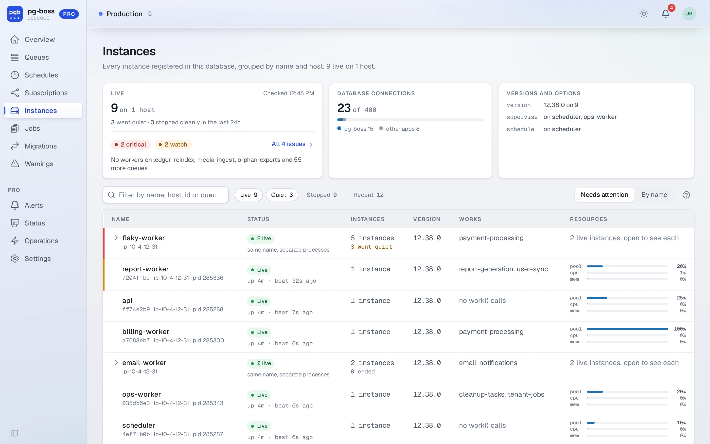
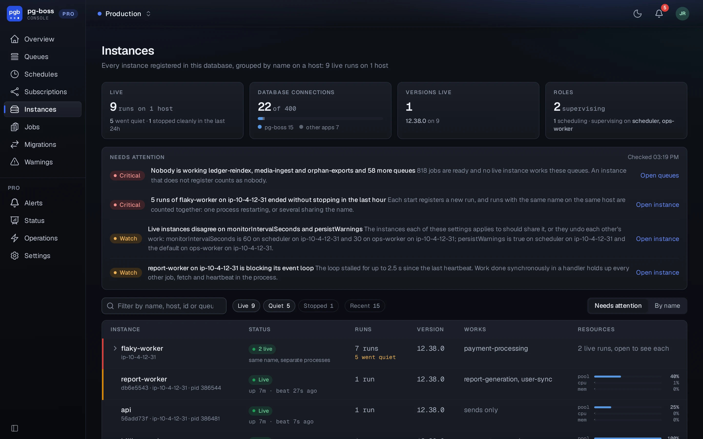

# Instances

The free dashboard lists every pg-boss instance registered in a database. Pro groups an instance's runs by name on a host and says what needs attention across them. For each run, it shows CPU and memory against the container's limits, and the connection pool and event loop against theirs.

{.light-only}
{.dark-only}

What needs attention is what the instance [alert rules](./alert-rules.md#the-default-rules) check:

- an instance restarting in a loop
- an instance gone quiet
- more than one pg-boss version live
- instances disagreeing on shared options
- a pool out of connections
- a blocked event loop
- a process at its CPU limit or near its memory limit

A queue's page names the instances working it, and its charts mark them starting, stopping and going quiet.

The registry needs pg-boss 12.36 or later. An instance started with `registerInstance: false` works without appearing here.
