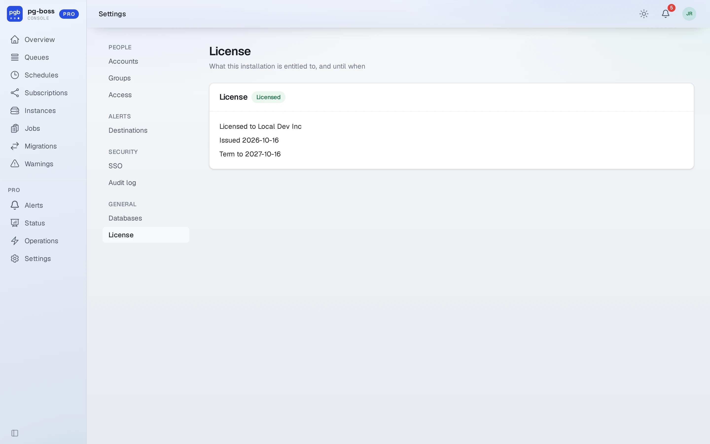
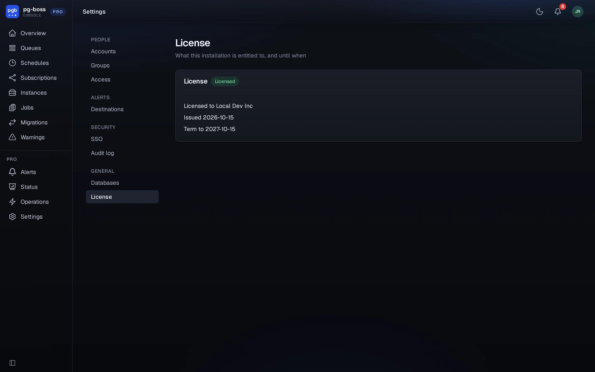

# License

The license is separate from the registry token, and its job is small. It names
your company on the Pro page, so anyone looking at the dashboard can see whose
license it runs under. **It doesn't turn any feature on or off.**

{.light-only}
{.dark-only}

Fetch it with your license key:

```bash
PGBOSS_PRO_TOKEN=<your license key> npx pg-boss-pro-license
```

The command writes `license.json` inside the installed package. Run it in your
deploy pipeline, right after the install:

```bash
npm ci
PGBOSS_PRO_TOKEN=$PGBOSS_PRO_TOKEN npx pg-boss-pro-license
```

The token is the same license key your `.npmrc` uses. You pass it explicitly
because npm deliberately keeps `.npmrc` tokens out of reach of installed
packages, as a security boundary.

## Keep the license as a secret

A fresh `npm ci` removes `license.json`, because it lives in `node_modules`. To
keep the license somewhere durable, fetch it once and store the string:

```bash
PGBOSS_PRO_TOKEN=<your license key> npx pg-boss-pro-license --print
```

Set the output as `PGBOSS_PRO_LICENSE` in your secret store. The environment
variable takes precedence over the file. Use it for air-gapped installs,
immutable images, and anywhere `node_modules` is read-only.

To keep `license.json` on a mounted volume instead, point
`PGBOSS_PRO_LICENSE_FILE` at it.

## When it lapses

Nothing stops working. The Pro page says the term has ended and that Pro is
unaffected.

Pro has no countdown, no banner, no grace period and no date when features
stop. Pro is a monitoring tool, and the operator who would lose it over billing
usually can't do anything about billing.

Your subscription controls what you can *download*:

- After twelve paid months in total, a lapsed subscription still installs every
  version released before it ended, forever.
- Before twelve paid months, a lapsed subscription can't install Pro.
- Either way, a lapsed subscription can't upgrade to a newer version or fetch a
  new license.

What's already running keeps running. Before twelve paid months, though, your
license to use it ends with the subscription. See `LICENSE`.

Running with no license at all also works. It's the normal state after a fresh
`npm ci` that hasn't run the license command. The page then says "Unlicensed",
and everything works.
