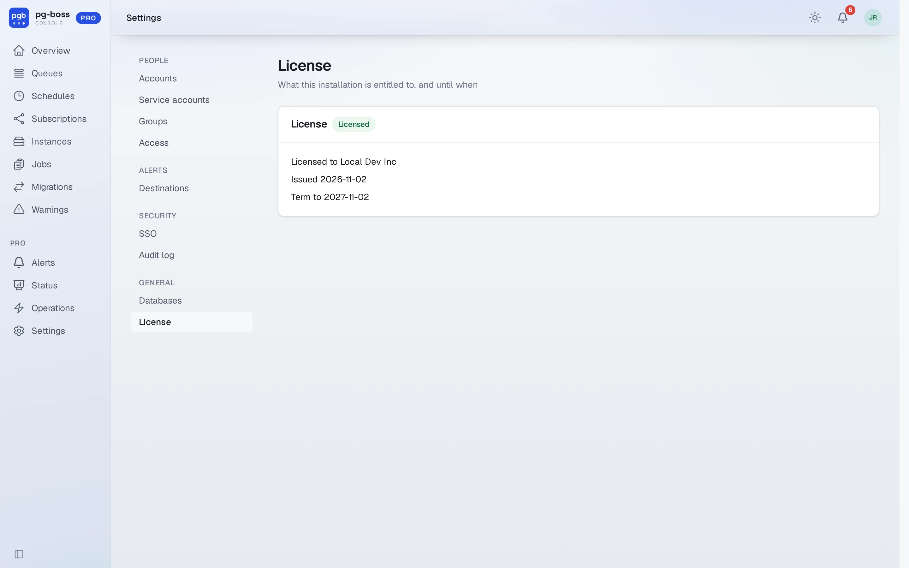
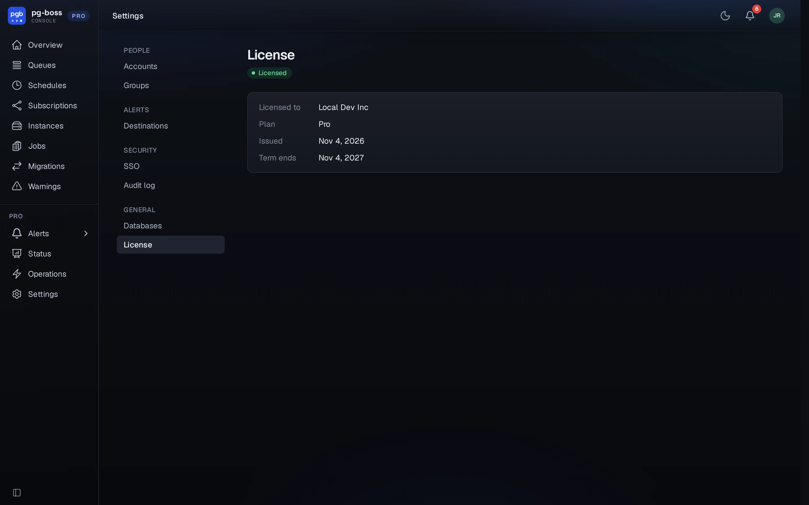

# License

The License page, only visible to [global admins](./roles.md#global-admin), shows the installed
license. **The license doesn't turn any feature on or off.**

{.light-only}
{.dark-only}

To install the license, run the license command with the license key:

```bash
PGBOSS_PRO_TOKEN=<your license key> npx pg-boss-pro-license
```

The command writes `license.json` inside the installed package. Run it in the
deploy pipeline, right after the install:

```bash
npm ci
PGBOSS_PRO_TOKEN=$PGBOSS_PRO_TOKEN npx pg-boss-pro-license
```

The token is the same license key the `.npmrc` uses. The command needs it passed
explicitly, because npm deliberately keeps `.npmrc` tokens out of reach of installed
packages, as a security boundary.

## Storing the license

A fresh `npm ci` removes `license.json`, because it lives in `node_modules`. To
keep the license somewhere durable, fetch it once and store the string:

```bash
PGBOSS_PRO_TOKEN=<your license key> npx pg-boss-pro-license --print
```

Set the output as `PGBOSS_PRO_LICENSE` in a secret store. The environment
variable takes precedence over the file. Use it for air-gapped installs,
immutable images, and anywhere `node_modules` is read-only.

To keep `license.json` on a mounted volume instead, point
`PGBOSS_PRO_LICENSE_FILE` at it.

## Expiration

A subscription renews until it's canceled. A canceled subscription lasts until the end of the period
already paid for. After that, the License page shows **Term ended** while Pro keeps running.

What an organization may still install and use depends on its plan and how long it paid:

| After the subscription ends | Annual, or monthly for 12 months or more | Monthly for less than 12 months |
| - | - | - |
| Use the versions already installed | Yes, permanently | No |
| Install a version released before it ended | Yes | No |
| Install a version released after it ended | No | No |
| Fetch a new license | No | No |
| Support | No | No |

An annual subscription that wasn't refunded has paid for 12 months by the time it ends. A monthly
subscription reaches 12 months after 12 monthly payments that weren't refunded, even when the months
aren't consecutive. On a monthly subscription under 12 months, Pro keeps running only so that a lapse
never takes a dashboard away without warning. Running past the end gives no right to keep using it.
See section 2 of `LICENSE`.

### Upgrading pg-boss after the subscription ends

Each Pro release makes changes only on the schema version of the pg-boss it's built with. When the
application upgrades to a pg-boss release with a new schema version, the installed Pro can't make
changes on that schema. The Pro release built for that schema came out after the subscription ended,
so the organization can't install it. Every page still works, but changes are off, as [pg-boss
versions](./versions.md) describes. The [free dashboard](../dashboard.md#job-actions) follows every
pg-boss release and still retries, cancels and resumes a job.

### Subscribing again

An organization that subscribes again can install new versions, starting from the current release.
Nothing is owed for the time between. Fetch the license again to get the new term.

## Unlicensed installs

Pro also runs with no license at all, which is the normal state after a fresh `npm ci` that hasn't
run the license command. The License page then shows **Unlicensed**. Every Pro feature still works.
