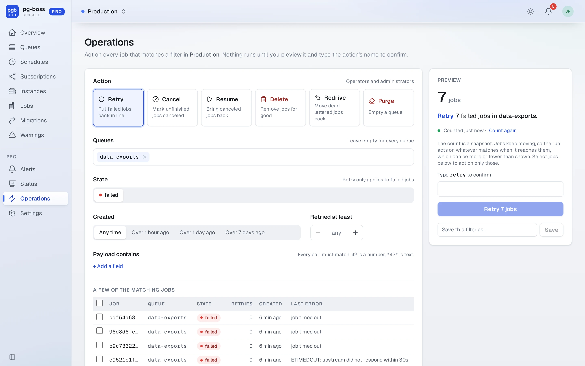
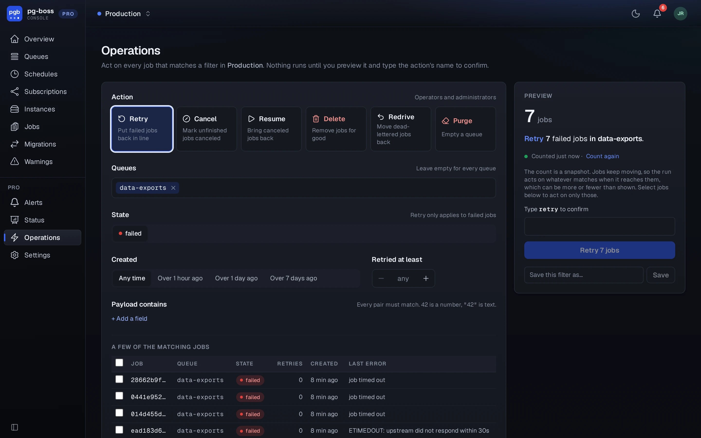
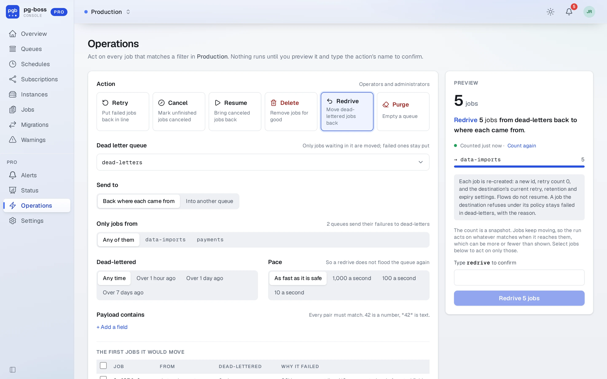
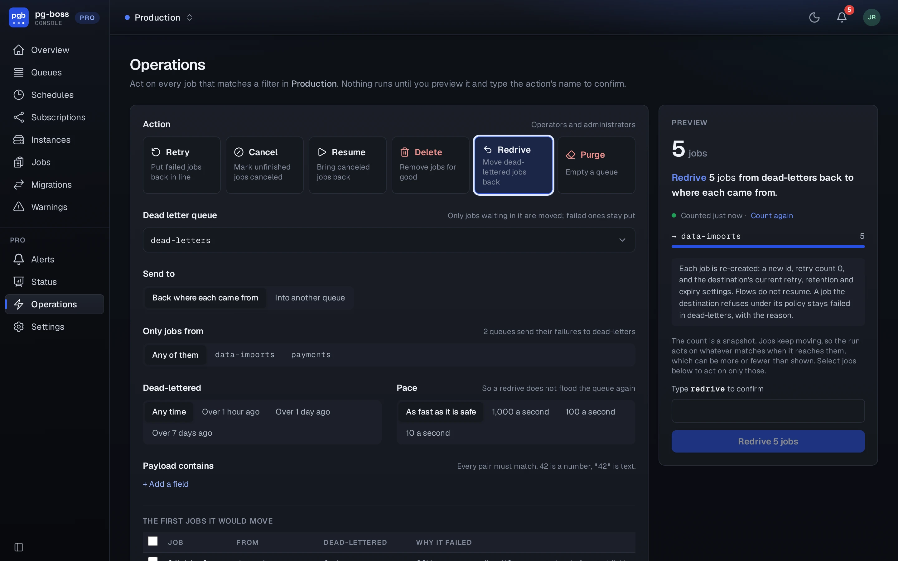

# Operations

**Operations** (`/pro/ops`) runs one verb (retry, cancel, resume or delete)
over every job matching a filter at once. It's the page for the morning after
a bad deploy.

Describe the set: queues, state, how long ago the jobs were created, how many
times they have been retried, and fields their `data` must contain. The page
recounts as the filter changes and shows the exact number, a sentence saying what will
happen, how the matches split across queues, and a few of the actual jobs. The
queue picker accepts typing, and each suggestion shows how many matches it adds.

{.light-only}
{.dark-only}

Nothing runs until a user presses **Review**, which freezes the number, and
then presses the button that names it. The confirmation covers exactly that
number of jobs. If more jobs land in the set while the confirmation is open, the
page refuses, shows the new count and asks again. Deleting 1,000 jobs or more
also requires typing the number.

- Each verb only touches what it could touch on its own: retry acts on
  failures, resume on cancellations, cancel on anything unfinished, delete on
  everything. The count follows the same rule, so it never promises more than
  the verb does.
- A payload value is read as JSON when it parses and as text otherwise, so
  `42` matches the number and `"42"` the string.
- Permissions are the single-job ones. Deleting needs `job:delete`, which
  only an administrator has. The page doesn't offer it to an operator, and an
  operator can't post it.
- Each recount is read-only and gives up after 10 seconds. On a large job
  table, narrow the filter to a queue or an age.
- The operation runs in chunks beside the live queues and commits each one, so
  a large operation never holds locks for minutes. **Stop after this chunk**
  ends it there and keeps what's already done.
- The page runs the operation, posting one chunk at a time, so the run needs
  the page open. Leaving the page or closing the tab stops it after the chunk
  in progress, and the page asks first. The history shows a run whose page went
  away as stopped a minute after its last chunk.
- One operation runs at a time in a database. The page refuses a second one at
  confirm and names the one running.
- The audit log records each operation when it starts, with who started it,
  the filter and the expected count, and again when it ends, with how it
  ended, how many jobs it changed and any error. A stop request is recorded
  too.
- Deleted jobs are gone. There is no undo, and the page says so.

The page saves a filter by name, to apply again from the top of the page.
**Operation history** (`/pro/ops/history`, linked from the page header) lists
every operation on the database from the last 90 days, newest first, with how
each one ended. Filter it by action or by how the operations ended. For an
administrator, each row links to its entries in the audit log.

## Redrive

**Redrive** moves the jobs waiting in a dead letter queue back into work as new
jobs, through pg-boss's own `redrive()`. The page offers it when at least one
queue names another as its `deadLetter`, and it needs the same permission as
retrying a job.

Choose the dead letter queue, then where the jobs go: **back where each came
from** (the default), or **into another queue**. Filters narrow it to the jobs
from one source queue, by payload, and by how long ago they were dead-lettered.
A pace cap of 1,000, 100 or 10 jobs a second keeps a large redrive from flooding
the queue again. The summary shows how the jobs split across
destinations and the first few it would move, each with the error it failed
with.

{.light-only}
{.dark-only}

- Only waiting jobs are moved. A job that failed inside the dead letter queue
  stays there.
- A job with no source queue recorded (sent straight to the dead letter queue)
  stays put unless the redrive names a destination, and the page says how many.
- Each job is re-created with a new id, retry count 0, and the destination's
  current retry, retention and expiry settings. Flows do not resume.
- A job the destination refuses under its policy (`short`, `singleton`,
  `stately`) stays failed in the dead letter queue with the reason, and the
  history counts them and links to the queue.
- The confirmed number is a ceiling. The run leaves out jobs dead-lettered
  after the confirmation.

To open the page ready to redrive a queue, link to
`/pro/ops?verb=redrive&queue=<dead letter queue>`.
