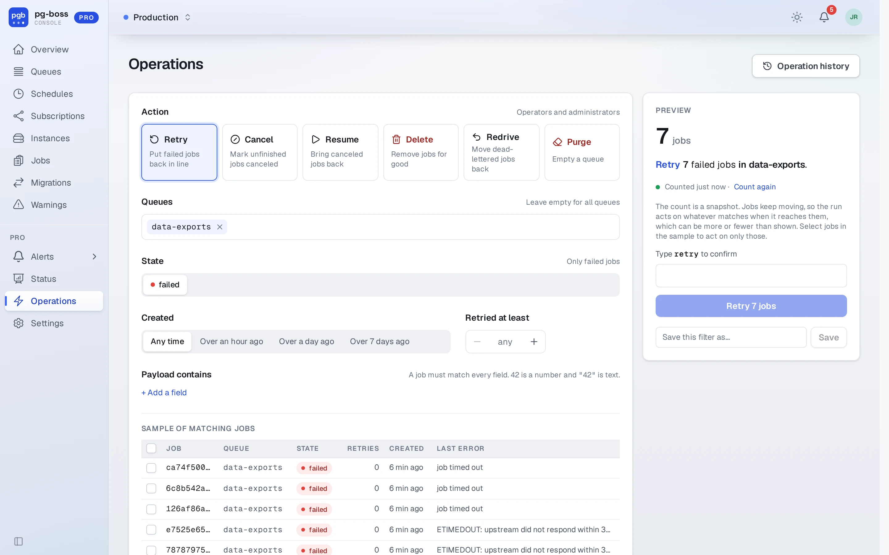
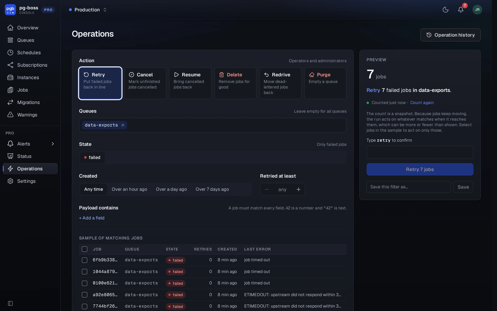
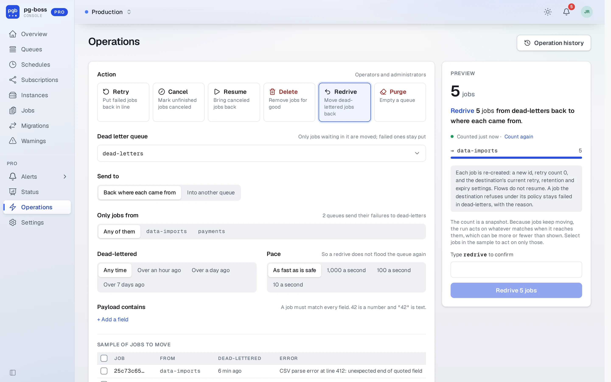
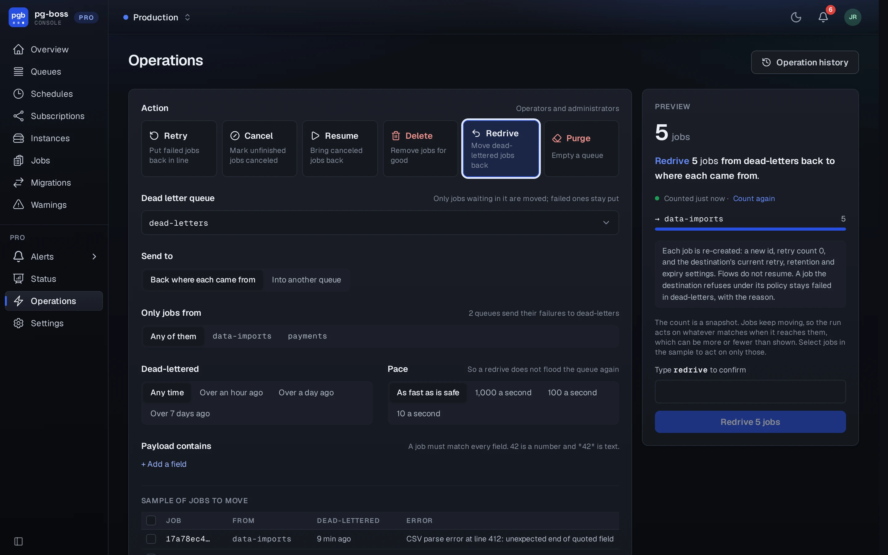

# Operations

**Operations** runs one verb (retry, cancel, resume or delete)
over every job matching a filter at once. It's the page for the morning after
a bad deploy. The same page also runs a [redrive](#redrive) out of a dead letter
queue and a [purge](#purge) that empties a queue.

Describe the set: queues, state, how long ago the jobs were created, how many
times they have been retried, and fields their `data` must contain. When a user
presses **Preview**, the page counts the set up to 1,000 (more shows as 1,000+). The page then describes
what will happen in one sentence and shows how the matches split across queues and a few of the
actual jobs. Any change to the filter after the preview sets the count aside until the next preview.
The queue picker searches queue names as you type. After a preview, the picker lists the queues with matching
jobs first and shows each queue's count, with the most matches at the top.

{.light-only}
{.dark-only}

Nothing runs until a user presses **Preview**, types the action's name (`retry`,
`delete` and so on) and presses the button that names it. A user confirms the
filter. The count shown is a snapshot, because jobs keep moving. The run acts on
whatever matches when it reaches each job, which can be more or fewer than shown.
Selecting jobs in the sample limits the run to the selected jobs the filter
still matches.

- Each verb only touches what it could touch on its own: retry acts on
  failures, resume on cancellations, cancel on anything unfinished, delete on
  everything. The count follows the same rule and doesn't promise more than
  the verb does.
- A payload value is read as JSON when it parses and as text otherwise.
  For example, `42` matches the number and `"42"` the string.
- Permissions are the same as for a single job. Deleting needs `job:delete`, which
  only the admin role has. The page doesn't offer deleting to an operator and
  refuses an operator's delete request.
- Each recount is read-only and gives up after 10 seconds. On a large job
  table, narrow the filter to a queue or an age.
- The operation runs in chunks beside the live queues and commits each chunk.
  A large operation doesn't hold locks for minutes. **Stop after this chunk**
  ends the operation there and keeps what's already done. The button shows to users whose role can
  run the operation's verb on that database.
- The run needs the page open, because the page runs the operation by posting one
  chunk at a time. Leaving the page or closing the tab stops the operation after
  the chunk in progress. The page asks before the user leaves. The history shows a run whose page went
  away as stopped a minute after its last chunk.
- One operation runs at a time in a database. The page refuses a second operation at
  confirm and names the operation already running.
- The audit log records each operation when it starts, with who started it,
  the filter and the expected count. The log records the operation again when
  it ends, with how it ended, how many jobs it changed and any error. A stop request is recorded
  too.
- Deleted jobs are gone. The page warns that there is no undo.

The page saves a filter by name. A user can apply a saved filter again from the top of the page.
**Operation history** in the page header lists
every operation on the database from the last 90 days, newest first, and shows how
each operation ended. Filter it by action or by how the operations ended. For
[global admins](./roles.md#global-admin), each row links to its entries in the audit log.

## Redrive

**Redrive** moves the jobs waiting in a dead letter queue back into work as new
jobs, through pg-boss's own `redrive()`. The page offers a redrive when at least one
queue names another as its `deadLetter`. A redrive needs the same permission as
retrying a job.

Choose the dead letter queue, then where the jobs go: **back where each came
from** (the default), or **into another queue**. Filters narrow the redrive to the jobs
from one source queue, by payload, and by how long ago they were dead-lettered.
A pace cap of 1,000, 100 or 10 jobs a second keeps a large redrive from flooding
the queue again. The summary shows how the jobs split across
destinations and the first few jobs the redrive would move, with the error each job failed
with.

{.light-only}
{.dark-only}

- Only waiting jobs are moved. A job that failed inside the dead letter queue
  stays there.
- A job with no source queue recorded (sent straight to the dead letter queue)
  stays put unless the redrive names a destination. The page shows how many such jobs there are.
- Each job is re-created with a new id, retry count 0, and the destination's
  current retry, retention and expiry settings. A job from a flow runs on
  its own without resuming the flow.
- A job the destination refuses under its policy (`short`, `singleton`,
  `stately`) is a collision. It stays failed in the dead letter queue with
  `output.reason` set to `redrive_conflict`. The history counts the
  collisions and links to the queue.
- The confirmed number is a ceiling. The run leaves out jobs dead-lettered
  after the confirmation.

To open the page ready to redrive a queue, link to
`/pro/ops?verb=redrive&queue=<dead letter queue>`.

## Purge

**Purge** empties one queue through one of pg-boss's own calls. The choice of
what to empty picks the call:

| Choice | Deletes | pg-boss call |
| - | - | - |
| Everything | Every job, active jobs too | `deleteAllJobs()` |
| Queued jobs | Created and retry jobs, none started | `deleteQueuedJobs()` |
| Finished jobs | Completed, canceled and failed jobs | `deleteStoredJobs()` |

A queue's page offers **Purge** to users who can delete jobs. Purging needs
`job:delete`, as deleting does. The count before confirming reads at most 1,000
jobs. Because the call takes no filter, the purge empties the queue as it is at run
time, including jobs that arrive after the count. Purging everything also
deletes jobs being worked, whose workers then find nothing to complete.

The purge runs in one chunk. The history shows how many jobs it deleted, from the
number pg-boss returns or, when pg-boss returns none, from the queue's cached
counts. A note in the history warns that those counts include the deleted jobs
until the next monitor pass.

A queue that still holds jobs can't be deleted from its page. The page asks a
user to purge the queue first.

To open the page ready to purge a queue, link to
`/pro/ops?verb=purge&queue=<queue>`.
