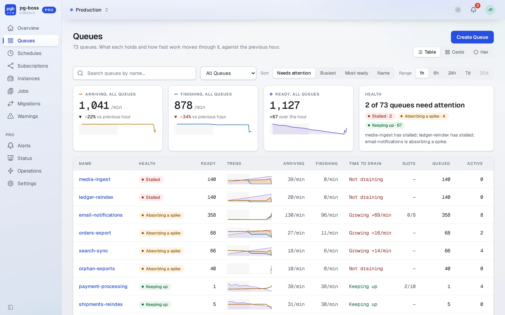
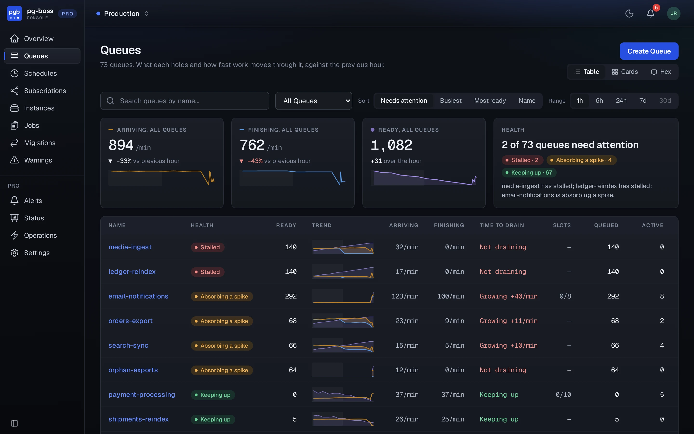
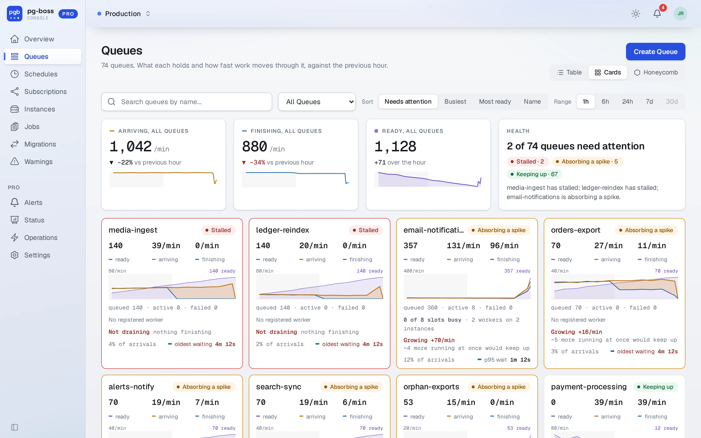
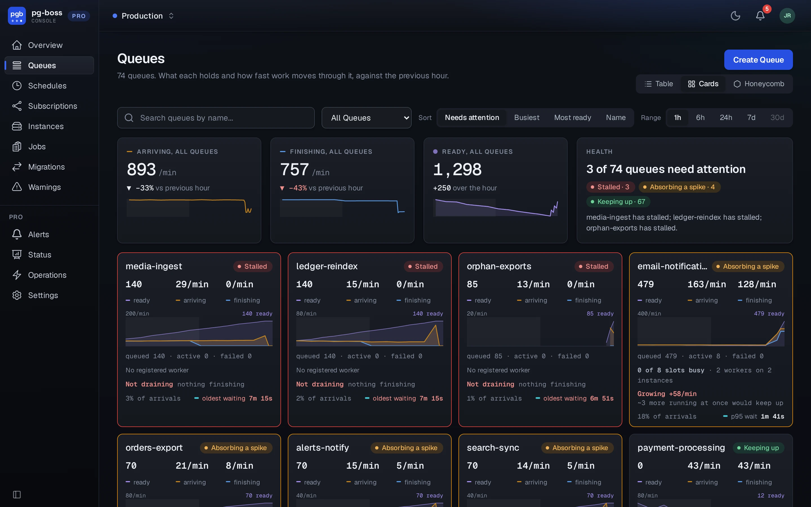
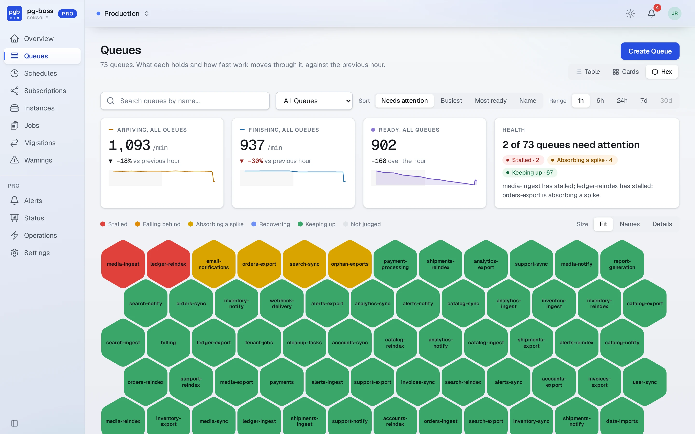
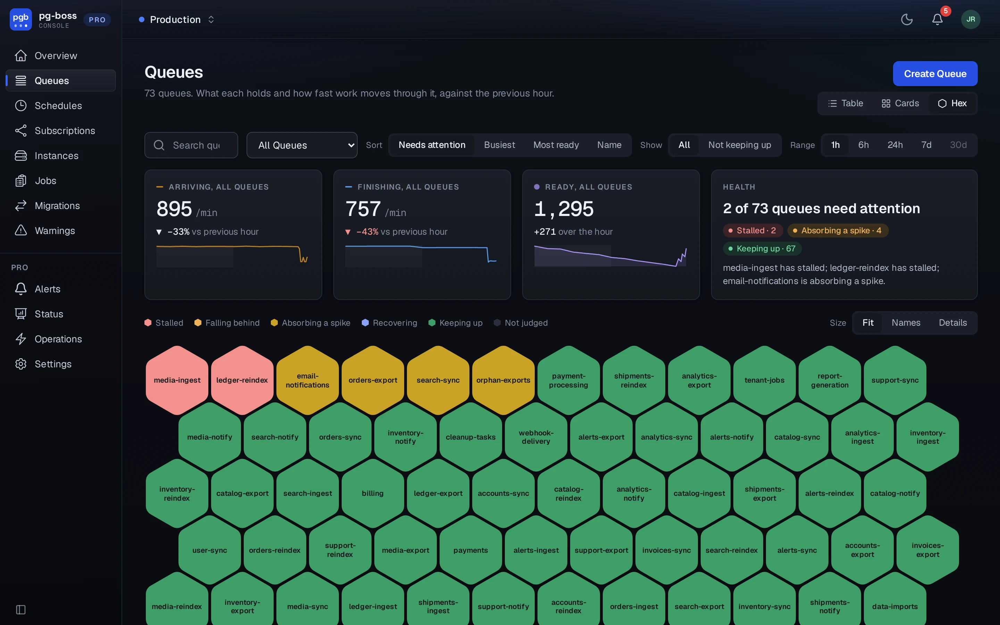
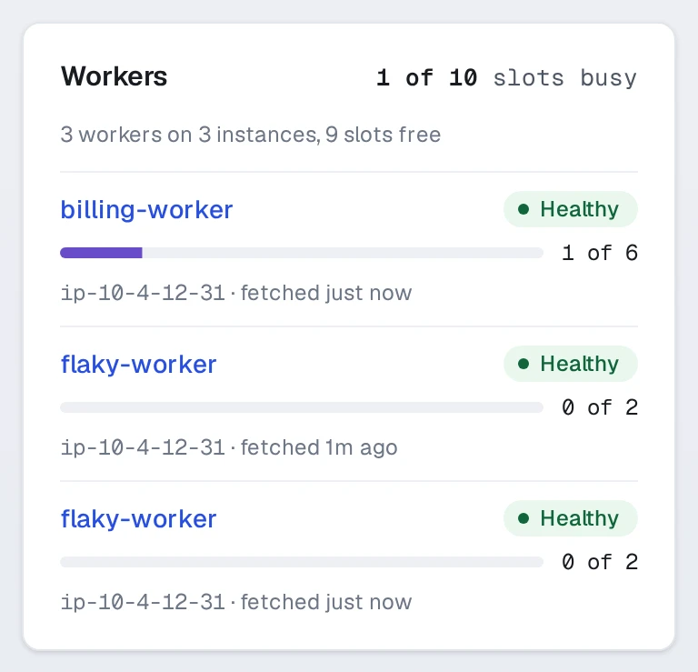
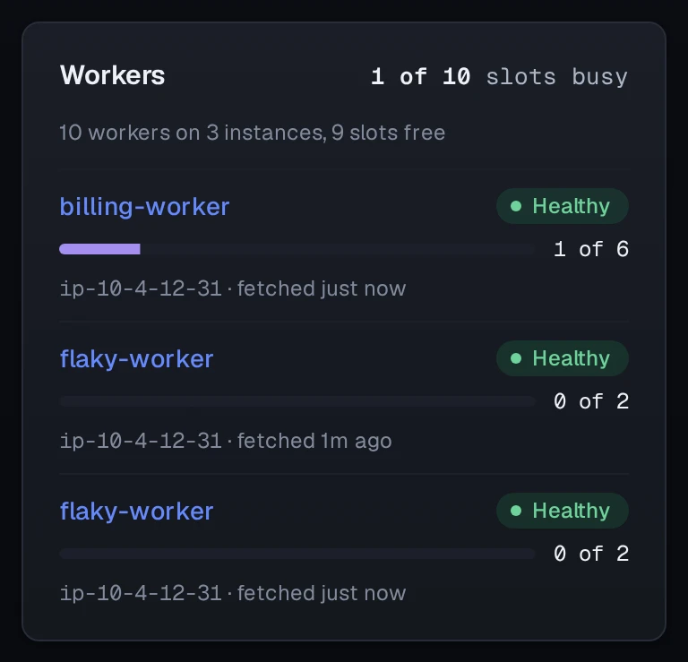
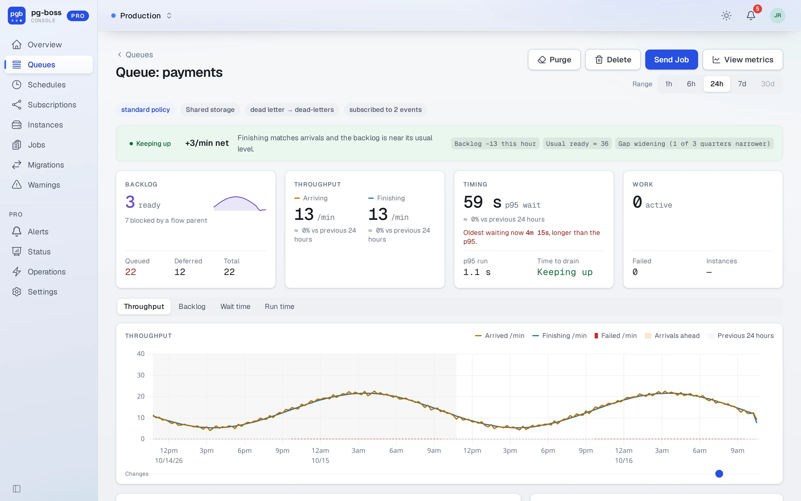
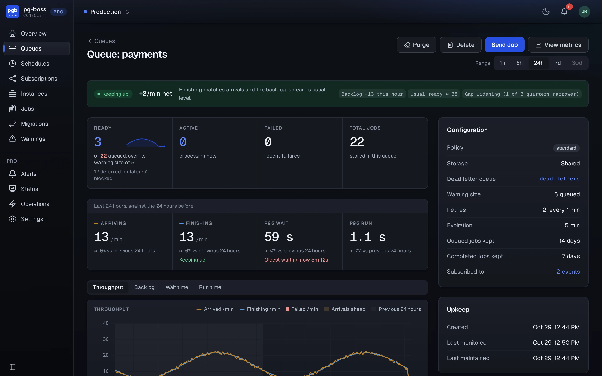

# Queues

Pro shows the free dashboard's queue pages with its own additions beside them.

## Health

Pro judges each queue over the last hour from the stats pg-boss records. It compares the queue's arrivals with what finished, and its backlog with what it usually holds. Finishing, here and on every queue page, counts jobs that completed or failed:

| Verdict | Means |
| - | - |
| Keeping up | Finishing what arrives. |
| Recovering | Working off a backlog that is shrinking. |
| Absorbing a spike | More arriving than finishing, for now. An alert rule can treat a spike that lasts as falling behind. |
| Falling behind | More arriving than finishing, and the backlog growing past what is usual. |
| Stalled | Jobs ready and nothing finishing. |

A queue with too little counted in the hour has no verdict. Health needs `persistQueueStats` on the pg-boss instances that run the monitor.

## Queues

The queue list shows each queue's rates, health, time to drain and workers, with the figures across every queue above them. The range runs from an hour to thirty days, as far back as pg-boss keeps stats. **Table**, **Cards** and **Hex** are three views of the same list. **Needs attention** sorts the queues that need attention first. The list refreshes every 15 seconds while the tab is visible.

### Table view

The table is the free dashboard's [queue list](../dashboard.md#queues), ten queues to a page. Pro adds each queue's health, arrival and finishing rates, time to drain and busy slots to it.

A slot holds one job. Each `work()` call has `localConcurrency × batchSize` of them, which is the most jobs it can have active at once, so a queue's slots are that product added up over the live instances working it. Busy slots are the jobs those instances had active at their last heartbeats. Every slot busy means more workers would add throughput.

Time to drain compares arrivals with finishing over the last 15 minutes, and the ready count with what the queue usually holds:

| Value | Means |
| - | - |
| Not draining | Jobs are arriving and almost nothing is finishing. |
| Growing | More is arriving than finishing, with more than 20 jobs ready above usual. It shows how fast the backlog grows and about how many more jobs running at once would keep up. |
| Clears in | More is finishing than arriving, with more than 20 jobs ready above usual. It shows about how long until the backlog is back to usual. |
| Keeping up | The backlog is within 20 jobs of usual, or arrivals and finishing are about even. |

This **Keeping up** reads the last 15 minutes, so it can differ from the health verdict of the same name, which reads the hour.

{.light-only}
{.dark-only}

### Cards view

Each queue gets a card, ten to a page.

{.light-only}
{.dark-only}

### Hex view

Each queue is a hexagon colored by its health, up to 500 to a page. The hexagons get smaller as a page holds more. The smallest show the first letter of each part of the name, so `payments-final` reads `pf`. Hover over one for the queue's name, health and counts.

Over a range longer than an hour, a hexagon shows the lower of the queue's health now and the lowest health it held for 5 minutes or more in the range. So a longer range never shows a queue as healthier than a shorter one, and the hover says how long the low point lasted.

**Size** above the hexagons keeps them larger: **Fit** shrinks them to fit about a screen, **Names** keeps every queue's name, and **Details** adds its ready count. The choice is remembered. **Show** in the toolbar keeps the Hex view to the queues **Not keeping up**, which hides every hexagon colored Keeping up or Not judged. The filter covers every queue, including those past the first 500.

A refresh or a change of range recolors each queue where it is. The order changes only when the sort, filter or page does, and a new queue goes at the end.

{.light-only}
{.dark-only}

## Queue detail

A queue's page adds its arrival and finishing rates, p95 wait and run times against the previous period, time to drain, and its health with the reasons for it. Its charts share one time axis: throughput, backlog, wait time and run time. The throughput chart shades **Arrivals ahead** where more arrived than finished.

The sidebar lists each `work()` call on the queue, with its instance and its busy slots, from the [instance registry](./instances.md). A pill beside the instance names the first of its own checks it fails (event loop, then CPU, then memory, as on the [instances page](./instances.md)), or reads **Healthy** when it passes them all. An instance started with `registerInstance: false`, or on a pg-boss version before 12.36, can work the queue without appearing there.

{.light-only width=384}
{.dark-only width=384}

The backlog chart is the Waiting chart from the free [metrics page](../dashboard.md#queue-metrics), with ready, blocked and deferred jobs stacked and active jobs drawn over them. **View metrics** and the page's counts open this chart, and `/queues/:name/metrics` redirects to it. Pro has one backlog chart, so two charts on different ranges can't disagree.

Under the charts, a row of changes marks what users did through the Pro Console (from the audit log) and what the instances working the queue did. An instance mark shows when one started, stopped, went quiet, or started on a new pg-boss version.

{.light-only}
{.dark-only}

If a queue's `deleteAfterSeconds` is shorter than the monitor pass, the queue deletes finished jobs before the monitor counts them. The page warns about this above the charts. Those jobs are never counted, so throughput and wait and run times read low.

Wait and run times need pg-boss 12.36 or later.
