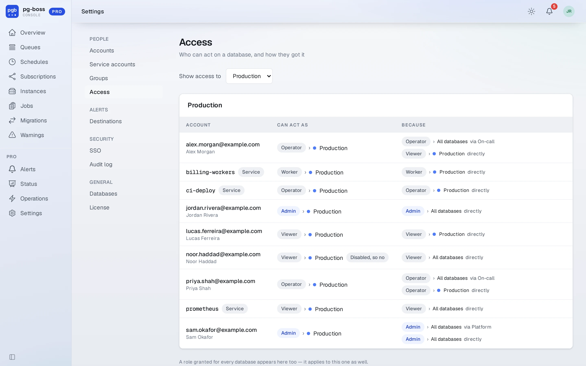
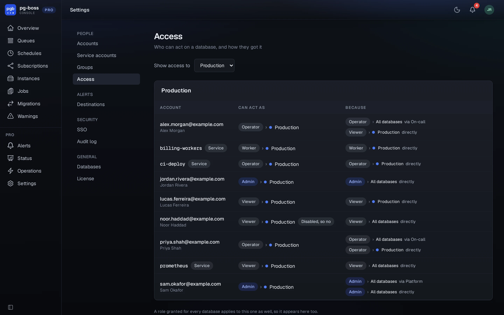

# Roles and access

Each grant gives a role on one database or on all of them, to a person, a [group](./accounts.md#groups) or a [service account](./api-tokens.md). The same person can be an operator on one database and a viewer on another. Where several grants apply to a database, someone may do everything any of them allows.

| Role | May |
| - | - |
| Viewer | Read. A viewer can't even send a job. |
| Operator | Read, and retry, cancel, resume and send jobs, and acknowledge alerts. |
| Admin | Everything an operator may, and delete jobs, create and delete queues and schedules, and manage alert rules. An admin over every database also manages accounts, groups, SSO, destinations and settings. |
| Worker | For a service account a worker uses, over the API only: fetch, complete and fail jobs, and send them. People can't hold it. |

Grants read as the role, then where it applies: `Operator › All databases`, or `Viewer › ● Production` with the database's color.

## Access page

`/pro/access` answers the question people ask in an incident, which is who can act on this database and why. Choose a database, and the page lists each person or service account with a role there. Beside each one it shows the role they end up with and every grant that produced it, direct or through a group. A role granted for every database appears for each one.

{.light-only}
{.dark-only}

Pro always refuses two changes, and says so. It won't remove the last administrator over every database, by demotion, disabling or deletion, because nobody would be left to undo it. It also won't let an account disable or delete itself.
