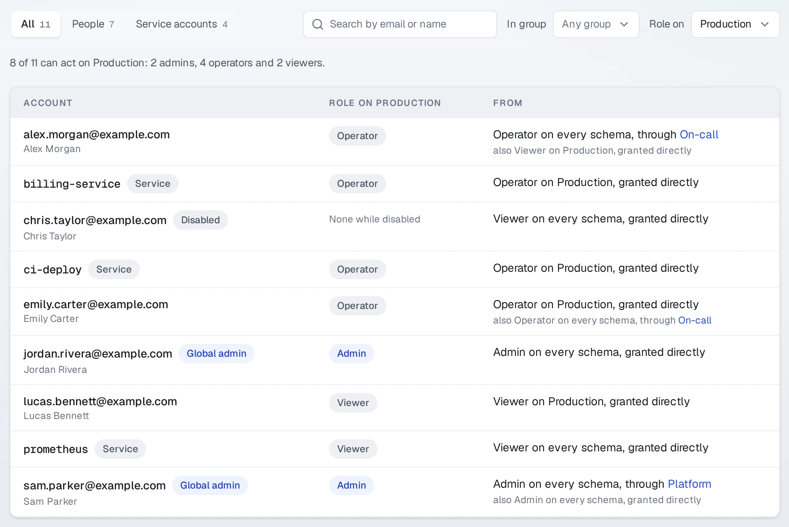
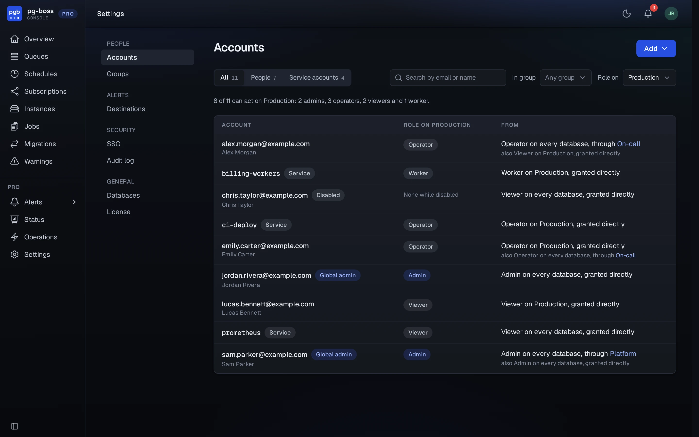

# Roles and access

Access comes from grants. A grant gives a person, a [group](./accounts.md#groups) or a [service account](./api-tokens.md) a role on one schema or on all schemas. The same person can be an operator on one schema and a viewer on another. Where several grants apply to a schema, the user may do everything any of those grants allows.

| Role | May |
| - | - |
| Viewer | Viewer users have read-only access. |
| Operator | Operator users can retry, cancel, resume and send jobs, and acknowledge alerts. |
| Admin | Admin users can delete jobs, and create and delete queues and schedules. An admin role covers one schema. Admin on all schemas is the [global admin](#global-admin) role. |

Grants read as the role followed by its scope, such as `Operator › All schemas` or `Viewer › Production`, where "Production" is a schema's name.

## Global admin

An account with the admin role on all schemas is a global admin, whether the grant is its own or comes through a group. To make one, choose **Global admin** as the role, under **Pro administration**, when adding a person or granting a role to a person or a group. **Admin** always names one schema. Leaving the schema unset doesn't make a global admin. A service account can't be a global admin. Only a global admin manages alert rules, accounts, groups, SSO, destinations and settings, and opens the [audit log](./audit-log.md). An admin on one schema can't, because an admin who manages accounts could widen their own grant. The accounts list and an account's page show a **Global admin** label beside the name. The first account, made at [setup](./install.md), is a global admin.

## Access by schema

The accounts list answers the question people ask during an outage, which is the accounts that can act on this schema and the grants their roles come from. Choose the schema in the accounts list's **Role on** filter. The list then shows each person or service account with a role there and counts how many hold each role. Beside each account, the list shows the role the account ends up with and the grant that role comes from, directly or through a group. Any weaker grants appear under that grant. A role granted for every schema appears for each schema. A disabled account shows that it has no role.

{.light-only}
{.dark-only}

Pro always refuses two changes, and says so. It won't remove the last global admin, by demotion, disabling or deletion, because nobody would be left to undo it. An account also can't disable or delete itself.
