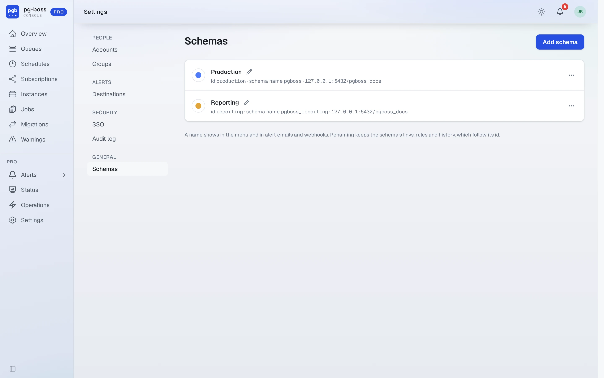
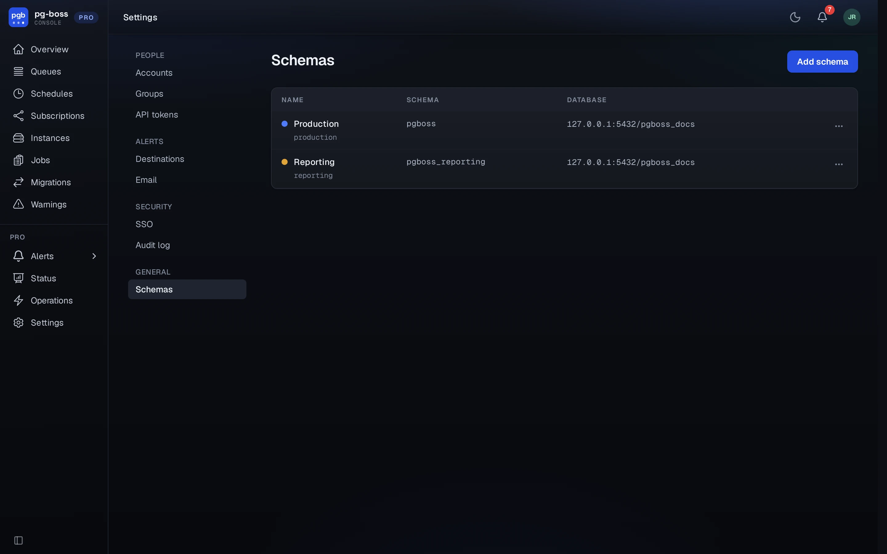

# Schemas

A schema is one pg-boss schema in one database, such as the pg-boss an application uses in
production. Pro monitors each schema added under **Settings › Schemas** and reads no list of schemas
from its environment.

The Pro Console shows one schema at a time. Every page about a schema shows its name and a colored
dot at the start of the top bar. With more than one schema, a menu there switches between them.

{.light-only}
{.dark-only}

## Adding

**Settings › Schemas** is visible only to [global admins](./roles.md#global-admin). A new install
has no schemas, and its first global admin is sent to this page. **Add schema** asks for:

- **Name**, such as Production or Billing. Pro makes the schema's id from the name it is first
  given, such as `production` for Production. The id never changes.
- **Connection**, as one connection string or as separate fields for host, port, database, user,
  password and SSL mode. Connect as the role that owns the pg-boss schema. See
  [schema permissions](./install.md#schema-permissions).
- **Schema name**, the pg-boss schema's name in Postgres. It's `pgboss` unless the application's
  pg-boss uses another.

**Test connection** connects and reads the schema's pg-boss version. A schema that doesn't exist yet
is fine, because the application's pg-boss creates it when it first starts. Pro refuses its own
database, and a pg-boss schema that is already added under another name.

Pro stores each connection encrypted with [`PGBOSS_PRO_SECRET_KEY`](./administration.md#secrets) and
never sends it back to the browser. The list shows each schema's host and database without the
password.

## Names and colors

A global admin renames a schema with the pencil beside its name. A name saves when you press Enter
or leave the field. A color saves when you pick it. Names show in the schema menu, in alert emails
and webhook payloads, and in the audit log. A webhook payload holds the name in `schema_label` and the
id in `schema`. Renaming keeps every link, alert rule and history row, because they all refer to the
schema's id.

## Connection changes

**Change connection** in a schema's menu replaces the stored connection and its password, such as
after a password rotation or a move to another host. The schema's id, rules and history stay.

A schema whose connection was saved under an earlier `PGBOSS_PRO_SECRET_KEY` shows **Connection
can't be decrypted** in the list, and a banner on every page names it to global admins. Pro leaves
the schema out of every page, alert rule and metric until a global admin enters its connection again
with **Change connection**, or Pro restarts with the earlier key.

## Removal

**Remove** in a schema's menu stops monitoring the schema and deletes everything Pro keeps about it:
its alert rules with their history, its alerts, role grants on it, its operations and its status
history. The confirmation counts the rules, open alerts and grants first. Open alerts are deleted
without a resolve. Close any incident they opened at its destination. The audit log keeps its
entries. Removing a schema from Pro leaves the schema and its database as they are.

## Per schema and whole install

Some of the Pro Console is about one schema and some about the whole install. A page about one
schema shows that schema at the start of the top bar. Settings and Profile name the area there
instead.

| Per schema | Whole install |
| - | - |
| Overview, queues, jobs, schedules, subscriptions | Accounts, groups and access |
| Instances, migrations and warnings | The audit log, which names each entry's schema and filters by it |
| Alerts and alert rules, and the bell | Alert destinations, which every schema's rules share |
| Status and Operations | Schemas and SSO |
| Sending, retrying, cancelling and deleting jobs, and queue and schedule changes | Profile |
| The Pro API at `/pro/api/v1/<schema>` | Service accounts and their tokens |

A role is granted for one schema or for all schemas. The same user can be an operator on one schema
and a viewer on another. The Pro Console remembers the last schema viewed for 30 days. A page that
names no schema, such as Settings, leads back to it.

## Pro queues

Pro runs its own background work on pg-boss queues in the `pgboss` schema of
[Pro's database](./install.md#database-setup). A global admin finds them as **Pro queues** under
**Internal** at the end of the schema menu. They aren't one of the schemas added under **Settings ›
Schemas**. A banner on each of their pages says which database holds them.

- `pgboss-pro-alerts` runs the alert evaluator once a minute.
- Each alert destination has a [send queue](./destinations.md#send-queues), named
  `pgboss-pro-send-` and the destination's id. Its page is titled with the destination's name.

Their pages show rates, wait times and health like any other queue's, because Pro's pg-boss keeps
`persistQueueStats` on. The Pro Console makes no changes to Pro's queues.
