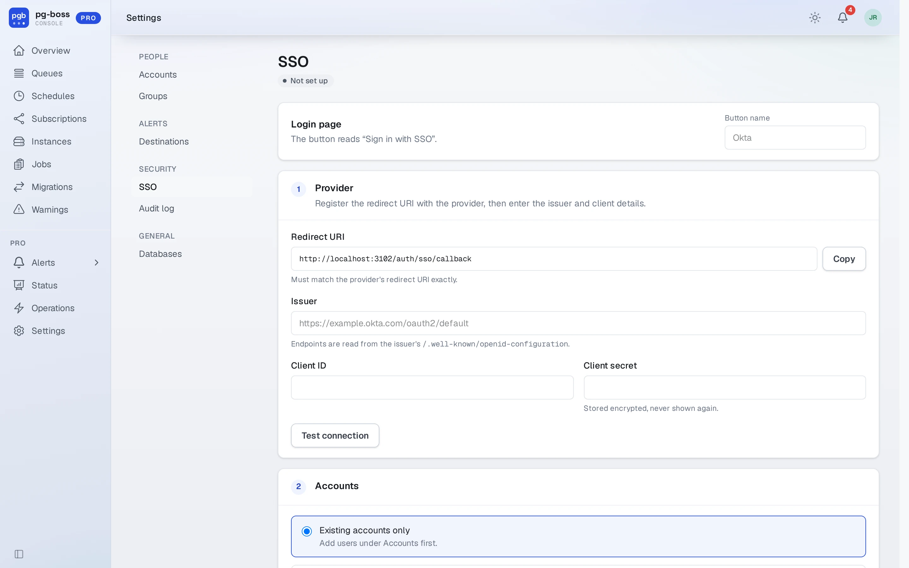
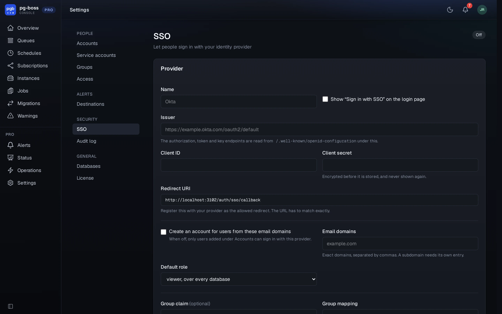

# Single sign-on

`/pro/sso` points Pro at any OpenID Connect provider, such as Okta,
Entra, Google, Auth0 or Keycloak. The page runs in the order you set it up:

- **Login page** names the **Sign in with…** button.
- **1 Provider**: copy the redirect URI into the provider, then paste
  the issuer, the client id and the client secret it gives you. **Test
  connection** checks that the issuer answers.
- **2 Accounts**: existing accounts only, or also new accounts for the
  email domains you name.
- **3 Groups** (optional): which provider groups fill which Pro groups.

**Save** at the foot saves the button name and all three steps. **Turn on** and
**Turn off** at the top of the page add the button to the login page or take it
away, at once and without a save. **Turn on** appears once a provider is saved,
and it needs a saved issuer and client id. The status under the title shows
whether the button is on the login page.

{.light-only}
{.dark-only}

Pro matches users on their **verified** email address. A user invited here
first who later signs in through the provider lands on the same account, with
the roles they already had. Pro refuses an address the provider hasn't
verified. **Accounts** can let an unknown address become a new account,
and it doesn't by default. That choice needs the email domains that get an account, matched
exactly, so `example.com` doesn't admit `mail.example.com`. Without that limit,
a provider with public sign-up, such as Google or Auth0, would give an account
to anyone with a mailbox there. A new account starts as viewer or operator on
all databases, or with no role until a global admin grants one. It never
starts as admin.

The first sign-in through the provider links the account to that person's id at
the provider (the token's `sub`). After that, someone else the provider gives the
same address can't sign in as the account, and the person keeps it if the
provider changes their address. When the provider replaces a person's own
account, a global admin presses **Forget SSO link** on the account's page, and
the next sign-in links again. Pointing Pro at a new issuer links each account
again by its address.

If the provider sends a group claim, **Groups** maps its group names onto Pro
groups, a row each, and each row's Pro group is one that already exists. Pro syncs only the mapped groups, so a group kept by hand is never
emptied because the provider doesn't list it. A token with no group claim is a
person in no group, which is what Okta sends when none passes its filter, so
Pro takes them out of every mapped group. A claim holding one name as a string
counts as that one group. Membership changes only at sign-in, so a person
removed at the provider leaves the mapped group at their next sign-in.

Two cases change no membership. One is a token where Entra ID says it left the
groups out past its group limit (`_claim_names` or `hasgroups`). The other is a
sign-in that would take the last global admin out of the group that makes them
one.

A sign-in through the provider starts a Pro session that lasts 12 hours. Pro
doesn't hear from the provider after that, so a person disabled or signed out
there keeps their open session until it ends. To end it at once, disable the
account in Pro, which ends its sessions immediately.

The issuer must be the one the provider's discovery document names, with or
without a trailing slash. For Entra ID, that is the issuer with your tenant's
id, not `common`. It must be `https`, except on `localhost`, `127.0.0.1` or
`[::1]`, where Pro accepts `http`. That allows a full round trip against a provider running
in a local container, before Pro points at the real one.
