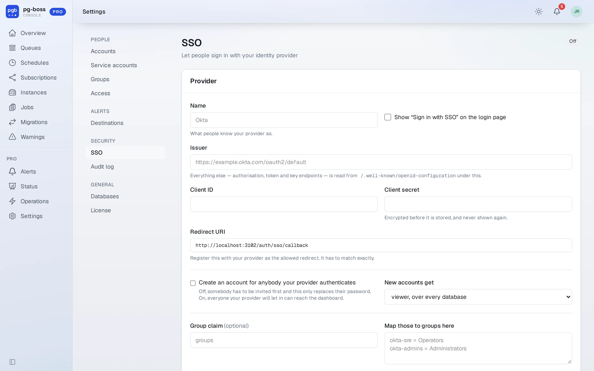
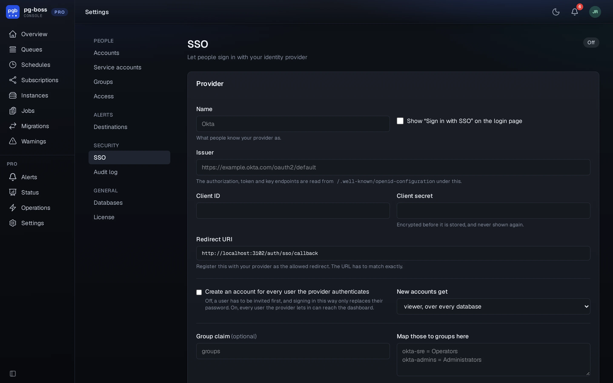

# Single sign-on

`/pro/sso` points the dashboard at any OpenID Connect provider: Okta, Entra,
Google, Auth0, Keycloak. Paste the issuer, the client id and the client secret,
copy the redirect URI it shows you into your provider, and the login page gains
a **Sign in with…** button.

{.light-only}
{.dark-only}

People are matched on their **verified** email address, so somebody invited here
first and signing in through your provider afterwards lands on the same account
with the roles they already had. An address your provider has not verified is
refused. Whether an unknown address becomes a new account is your choice, and
off by default.

If your provider sends a group claim, you can map its group names onto groups
here. Only the groups you name are synced: one you maintain by hand is never
emptied because the provider has not heard of it.

The issuer must be `https`, with one exception: `http` is accepted when the host
is `localhost`, `127.0.0.1` or `[::1]`, so you can try the whole round trip
against a provider running in a container on your own machine before you point
Pro at the real one.
