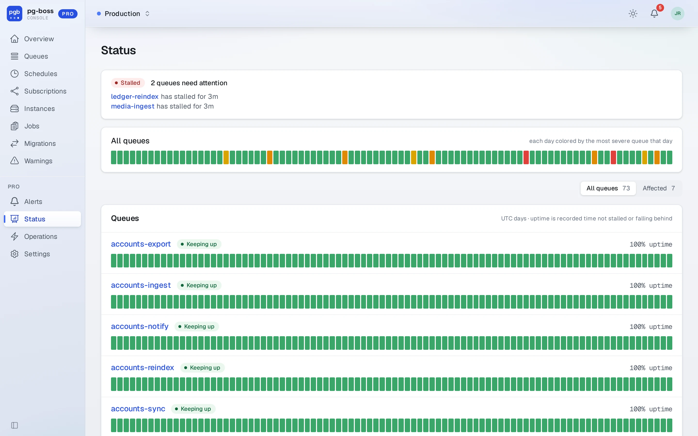
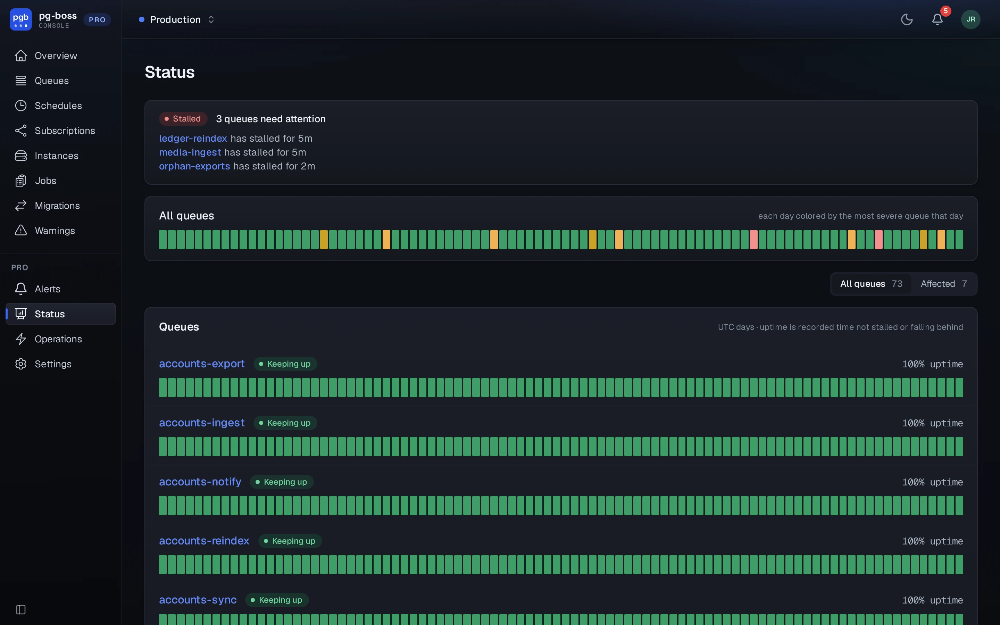

# Status

`/pro/status` shows how each queue kept up over the last ninety days, a day at a time, in the shape of a public status page. A day takes the color of the least healthy hour the queue had in it: keeping up, absorbing a spike, falling behind or stalled. Rows stay in name order whatever their state, since a status page is read by position.

{.light-only}
{.dark-only}

Open a day that wasn't green to see what happened in it. On the strip across every queue, opening a day narrows the list to the queues that weren't green that day.

The page reads the hourly verdicts that Pro's alert evaluator writes to its own tables on each pass, because pg-boss keeps a week of stats and this page shows ninety days. History starts when Pro first runs against a database.
