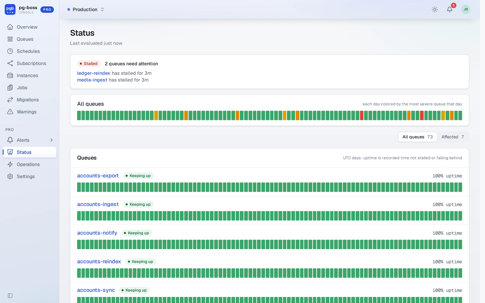
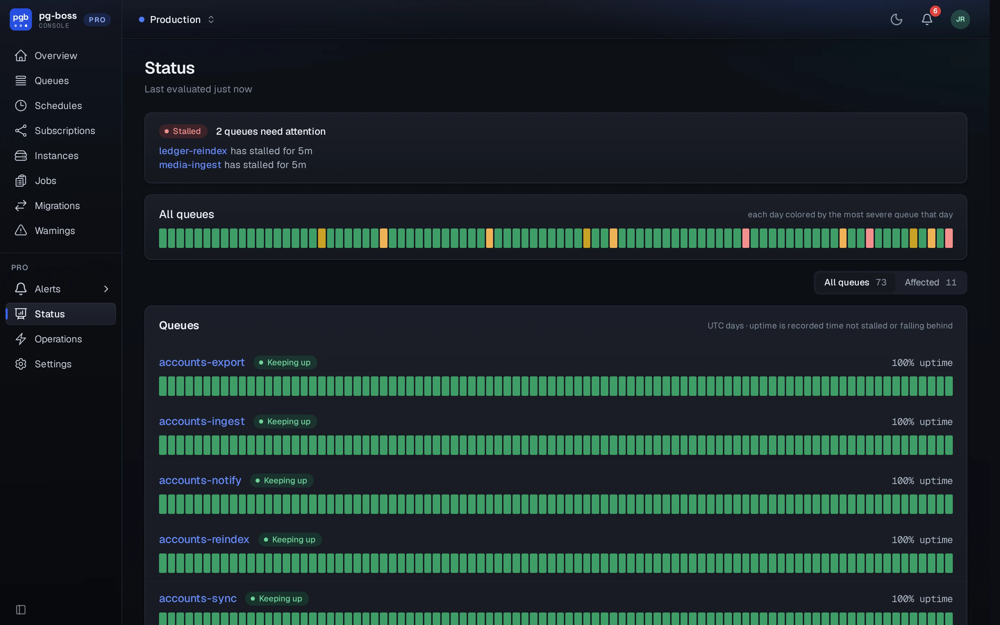
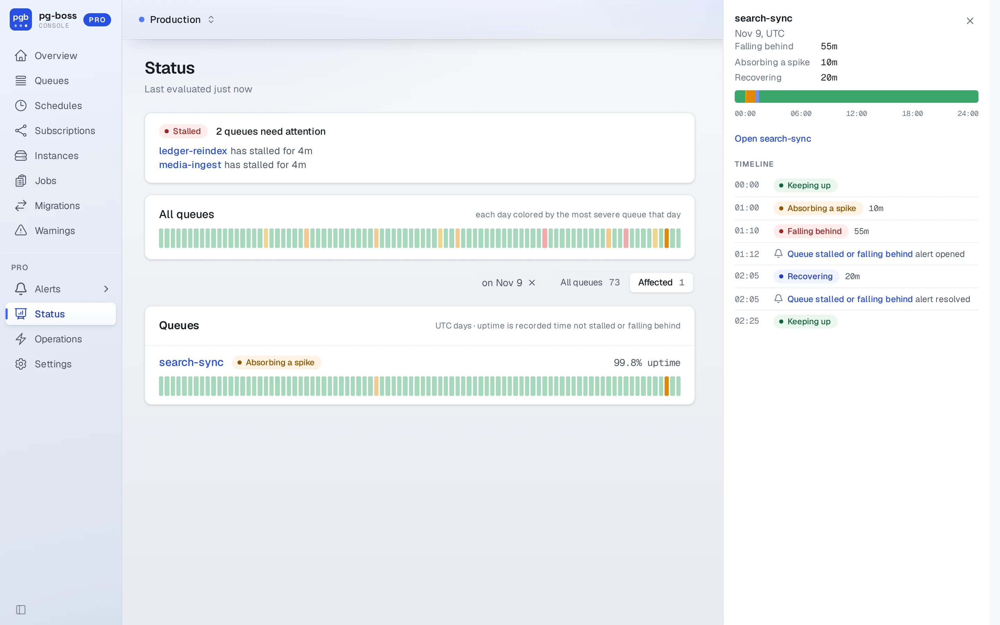
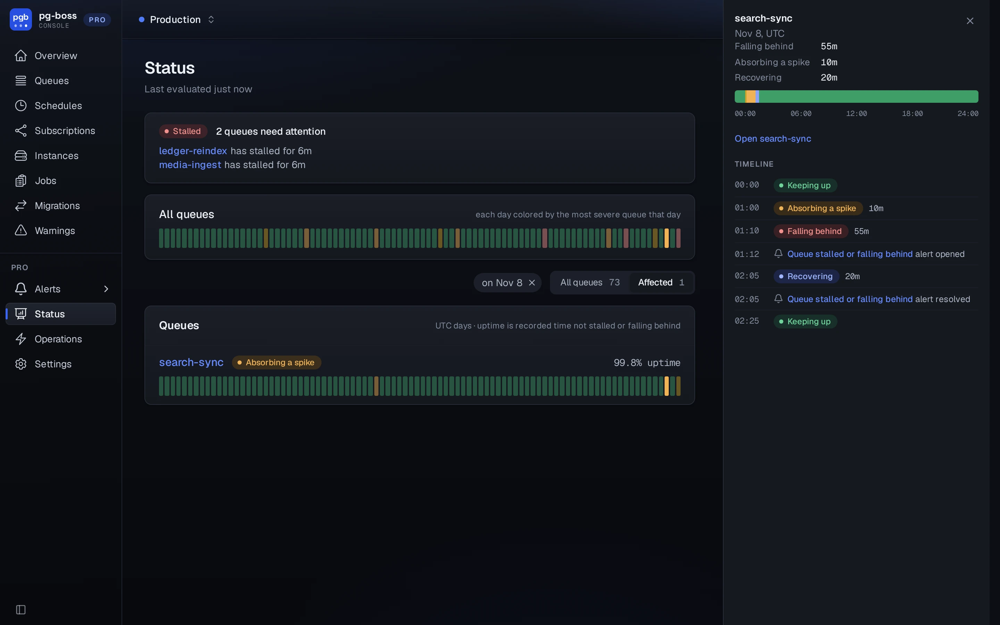

# Status

`/pro/status` is laid out like a public status page and shows how each queue kept up on each of the last ninety days. Each queue has a strip of days and its uptime. A summary strip at the top of the page summarizes status across all queues.

{.light-only}
{.dark-only}

## Recording

Pro's alert evaluator runs once a minute. On each pass it judges every queue's [health](./queues.md#health) over the last hour and records the verdict in Pro's own tables, because pg-boss keeps stats for [`queueStatRetentionDays`](../api/constructor.md#queuestatretentiondays) (7 by default) and this page shows ninety days. A pass credits up to 3 minutes since the previous pass to the state the queue was last seen in. A new state starts at the pass that first sees it, so every stretch starts and ends on a pass. A queue too quiet or too new to judge isn't recorded for that time.

When more than 3 minutes go by without a pass, as when Pro was stopped, the next pass replays the gap a minute at a time from the stats pg-boss kept. Each minute is judged as the evaluator would have judged it live. Time pg-boss has no stats for stays unrecorded. The first pass against a database replays as far back as those stats go, so history starts with the stats pg-boss already holds (a week by default). Pro deletes history older than ninety days. The page header says when the last pass finished.

## Days

Days are UTC days. Today's cell shows the day so far. A queue's day adds up the time recorded in each state and takes the color of the least healthy state that totals 5 minutes or more. The table lists the states from least healthy. Short stretches count toward the total, so three 2-minute stalls color a day stalled.

| Color | State |
| - | - |
| Red | Stalled |
| Orange | Falling behind |
| Yellow | Absorbing a spike |
| Green | Keeping up. No state above reached 5 minutes. Recovering doesn't color a day, so a day spent recovering is green too. |
| Gray | Nothing recorded for the queue that day |

Each day on the summary strip takes the color of the least healthy queue that recorded anything that day. Its tooltip counts the queues in each color. Opening a day there narrows the list to the queues that stalled, fell behind or absorbed a spike that day. **Affected** lists the queues that did so on any day shown. On a narrow screen the strips show the last thirty days.

## Day details

A day colored stalled, falling behind or absorbing a spike opens to its 24 hours as a band and the same day as a timeline. The band colors each stretch as the table above does, and shows recovering stretches in blue. Each row of the timeline is a stretch of one state with the UTC time it started. A row also shows how long the stretch lasted, unless the queue was keeping up. A stretch shorter than 5 minutes is folded into the row next to it, which counts the stretches it includes. The band still shows every stretch. Stretches in the state that colored the day aren't folded, so three 2-minute stalls on a day colored stalled are three rows. A gap of 5 minutes or more with nothing recorded is a row of its own. Short stretches just before such a gap show only on the band.

{.light-only}
{.dark-only}

Each change made that day to an [alert](./alerts.md) on the queue is a row at the time it happened, linked to the alert: when it opened, who acknowledged it, and when and why it closed. Alert rows aren't folded. An alert opened on an earlier day and still open at 00:00 has a row at 00:00 with the day it opened. Every alert on the queue appears except a failed operation's. Alerts don't change a day's color or a queue's uptime, which come only from the recorded states, so a green day opens nothing even when an alert changed that day.

## Uptime

A queue's uptime is the share of its recorded time over the days shown that it wasn't stalled or falling behind. Time absorbing a spike or recovering counts as up. Time with no verdict recorded counts neither way, so a queue with nothing recorded has no uptime.
